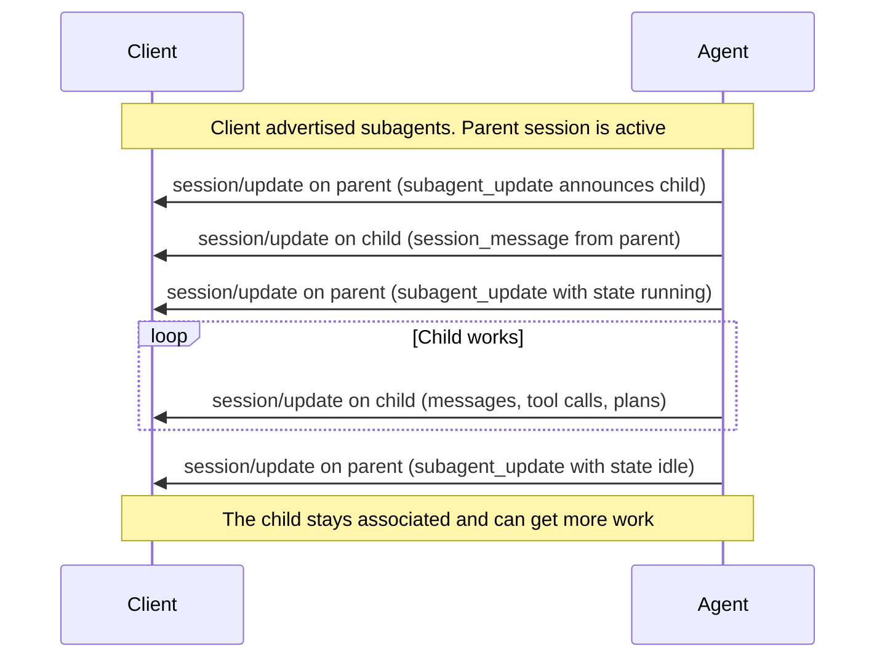

An [Agent](/protocol/v1/overview#agent) can delegate work to subagents. It can expose a subagent to the [Client](/protocol/v1/overview#client) as a **child session**: a session with its own `sessionId` that the Agent creates and owns. The child's messages, thoughts, plans, and tool calls arrive as ordinary `session/update` notifications with the child's `sessionId`, so the Client can show them apart from the parent session.

Exposing subagents is optional for Agents. An Agent can use subagents without exposing them and report their results through the parent session.

<br />



<br />

## Checking support

The Client advertises support with the `subagents` capability in its `initialize` request:

```json highlight={7}
{
  "jsonrpc": "2.0",
  "id": 0,
  "method": "initialize",
  "params": {
    "protocolVersion": 1,
    "clientCapabilities": {
      "subagents": {}
    }
  }
}
```

The field is optional and nullable. Omitted or `null` means the Client does not support subagents. Supplying `{}` means the Client:

- understands `subagent_update` and registers the child session it announces
- attributes requests and notifications that carry a child's `sessionId` to that child
- applies the [restrictions](#restricted-methods) on what it sends for a child
- understands [`session_message` and `session_message_chunk`](/protocol/v1/prompt-turn#session-directed-messages)

The Agent **MUST NOT** send `subagent_update`, `session_message`, or `session_message_chunk` unless the Client advertised `subagents`. It sends [`session` tool call content](/protocol/v1/tool-calls#sessions) only to a Client that advertised it.

There is no Agent capability. A Client learns that an Agent exposes subagents when it receives the first `subagent_update`.

## Announcing a child session

The Agent announces a child with a `subagent_update` on the parent session. The outer `sessionId` names the parent, and `update.sessionId` names the child:

```json
{
  "jsonrpc": "2.0",
  "method": "session/update",
  "params": {
    "sessionId": "sess_parent",
    "update": {
      "sessionUpdate": "subagent_update",
      "sessionId": "sess_child_1",
      "title": "Test investigator",
      "description": "Investigates platform-specific test failures.",
      "capabilities": {
        "cancel": {}
      }
    }
  }
}
```

The first `subagent_update` for a child `sessionId` announces that the parent created and owns the child. Later updates for the same child patch its fields. They do not create another child or move the child to another parent.

The Agent **MUST** send the announcing `subagent_update` before any request or notification that carries the child's `sessionId`. This covers:

- `session/update` notifications for the child
- a `session_message` that names the child as sender or recipient
- a [`session` content item](/protocol/v1/tool-calls#sessions) that references the child
- `session/request_permission`, `elicitation/create`, `fs/read_text_file`, `fs/write_text_file`, and `terminal/*` requests for the child

The rule also applies to short-lived work.

<ParamField path="sessionId" type="SessionId" required>
  The child session's ID. It is unique on the connection and identifies the same
  child across repeated delegations. The Agent **MUST NOT** reuse it for an
  unrelated session.
</ParamField>

<ParamField path="title" type="string">
  The parent's display label for the child. It need not be unique. If none is
  set, the Client chooses a fallback.
</ParamField>

<ParamField path="description" type="string">
  The parent's description of the child's role or purpose. It is current display
  text, not a record of the instructions sent to the child.
</ParamField>

<ParamField path="capabilities" type="SubagentSessionCapabilities">
  What the Client may send for this child. `cancel` is the only capability
  defined. See [Restricted methods](#restricted-methods).
</ParamField>

<ParamField path="state" type="StateUpdate">
  The child's foreground state. See [Work state](#work-state).
</ParamField>

<ParamField path="cwd" type="string">
  The child's working directory, as an absolute path. See [Working
  directories](#working-directories).
</ParamField>

<ParamField path="additionalDirectories" type="string[]">
  Additional directories the child works in, each as an absolute path.
</ParamField>

Every field except `sessionId` is a patch. An omitted field leaves the stored value unchanged, `null` clears it, and a value replaces the whole previous value.

- Clearing `title` or `description` removes the parent's label for the child.
- `capabilities` is replaced as a whole and is not merged. `capabilities: null` and `capabilities: {}` both permit nothing. Inside the object, an omitted or `null` `cancel` means unsupported, not unchanged. A child whose `capabilities` was never sent permits nothing.
- `state` is replaced as a whole. Clearing it leaves the child's activity unconfirmed. It does not report `idle`.
- Clearing `cwd` or `additionalDirectories` makes the child inherit that value from its parent again.

`title` and `description` are the parent's labels for the child, so a Client can list a session's subagents from the parent's updates alone. The child's own [`session_info_update`](/protocol/v1/session-list#updating-session-metadata) describes the child's conversation and does not change them. A change to either title does not rewrite earlier messages or tool calls.

### Parents and nesting

The outer `sessionId` is the child's immediate parent. When a child creates a subagent of its own, the Agent sends `subagent_update` with that child's ID as the outer `sessionId`, so sessions can nest to any depth. A child has one parent. A `subagent_update` cannot move an existing session to another parent, name its own outer session as the child, or create a cycle.

The association records which session owns the child. It does not limit which sessions exchange [messages](#messages-between-sessions) with it.

A child `sessionId` identifies a conversation, not one task, turn, or tool call. Finishing or cancelling work does not end the association, and the parent can give the same child more work. Reuse is not required. An Agent whose runtime creates a new worker for each delegation announces a new child each time and sends nothing more for it once its work ends. That child keeps its last reported state and history.

### What the Agent exposes

- If the Agent learns of a child's activity before it knows the child's parent, it announces the child once it knows both, or holds the activity until then. It **MUST NOT** guess the parent or announce a nested child under the root session in the meantime.
- If the Agent cannot identify a child and its parent without blocking an operation, it **MAY** leave that operation unexposed and report it through the parent. It **MUST NOT** later move a request or update it already sent to a different session.
- Once a child is exposed, new requests and updates that the Agent knows belong to that child's work **MUST** carry the child's `sessionId`. The Agent does not fall back to the root session for them.
- A parent's request for permission to create or delegate to a child belongs to the parent. It does not require the child to be announced first.

The Agent chooses the child's working directory, MCP servers, and tools, and they can differ from the parent's. Requests the Agent sends for a child, such as `session/request_permission`, `fs/write_text_file`, or `terminal/create`, pass through the same Client capabilities and permission checks as the parent's. The Agent **MUST NOT** use a child to get around a restriction the Client placed on the parent session.

## Child session updates

Announcing a child registers it on the connection. The Agent then sends the child's updates and requests with the child's `sessionId`, without another request from the Client. There is no method to attach or subscribe to a child, and Clients **MUST NOT** send `session/load` or `session/resume` for a child to start receiving its updates.

A child uses the same updates as any session, with its own `sessionId` as the outer `sessionId`. For example, a tool call that the child runs:

```json
{
  "jsonrpc": "2.0",
  "method": "session/update",
  "params": {
    "sessionId": "sess_child_1",
    "update": {
      "sessionUpdate": "tool_call",
      "toolCallId": "call_001",
      "title": "Run the integration tests",
      "kind": "execute",
      "status": "pending"
    }
  }
}
```

Requests work the same way. If that tool call needs permission, the [permission request](/protocol/v1/tool-calls#requesting-permission) carries the child's `sessionId`, and the Client presents it as the child's request:

```json
{
  "jsonrpc": "2.0",
  "id": 12,
  "method": "session/request_permission",
  "params": {
    "sessionId": "sess_child_1",
    "toolCall": {
      "toolCallId": "call_001"
    },
    "options": [
      {
        "optionId": "allow-once",
        "name": "Allow once",
        "kind": "allow_once"
      },
      {
        "optionId": "reject-once",
        "name": "Reject",
        "kind": "reject_once"
      }
    ]
  }
}
```

A `toolCallId` is unique within its session, and a `messageId` identifies an entry in one session's transcript. `call_001` in the child and `call_001` in the parent are different tool calls.

Updates for a parent and its children can interleave. Updates are ordered within each session, and a child's first update follows its announcement.

The Client did not set up the child, so the Agent reports the child's context:

| Context                                      | Reported through                                                                                                         |
| -------------------------------------------- | ------------------------------------------------------------------------------------------------------------------------ |
| Working directory and additional directories | `cwd` and `additionalDirectories` on the parent's `subagent_update`. See [Working directories](#working-directories)     |
| Display label and role                       | `title` and `description` on the parent's `subagent_update`                                                              |
| Messages from the parent                     | `session_message` in the child's transcript. See [Messages from a parent to a child](#messages-from-a-parent-to-a-child) |
| The child's own conversation title           | `session_info_update` on the child                                                                                       |
| Model, reasoning level, and other options    | `config_option_update` on the child. See [Configuration](#configuration)                                                 |
| Foreground state                             | `state` on the parent's `subagent_update`. See [Work state](#work-state)                                                 |
| Plan, context window usage, and cost         | [Plan updates](/protocol/v1/agent-plan) and `usage_update` on the child. See [Usage and cost](#usage-and-cost)           |

The Client cannot prompt a child, so a child's [slash commands](/protocol/v1/slash-commands) cannot be run. Agents need not send `available_commands_update` for a child, and Clients **MUST NOT** offer a child's commands as input to the child or its parent.

A child's MCP servers, tools, and system prompt are not reported.

### Working directories

`cwd` and `additionalDirectories` on `subagent_update` report where the Agent placed the child. They have the same meaning as the [session setup](/protocol/v1/session-setup#working-directory) fields of the same names, and every path **MUST** be absolute. `additionalDirectories: []` reports that the child has no additional directories. A list replaces the previous list and is not merged.

A field that was never reported, or was cleared, is inherited: the child's effective value is its immediate parent's current effective value. For a root session, that is the value from session setup. The two fields are inherited separately. A child that moves to its own worktree and should not keep the parent's additional directories reports `additionalDirectories: []` with its `cwd`:

```json
{
  "jsonrpc": "2.0",
  "method": "session/update",
  "params": {
    "sessionId": "sess_parent",
    "update": {
      "sessionUpdate": "subagent_update",
      "sessionId": "sess_child_1",
      "title": "Test investigator",
      "cwd": "/home/user/project/.worktrees/test-investigator",
      "additionalDirectories": []
    }
  }
}
```

- The Agent **MUST** report a value that differs from the parent's before it sends child updates or requests that depend on it.
- An Agent that cannot determine a child's directories **SHOULD NOT** expose that child as sharing the parent's workspace. It can leave the child's work unexposed instead.
- Agents **SHOULD** report the narrowest directories the child needs, such as the worktree and not the temporary directory that contains it.
- The Agent can change a child's directories, for example with a new worktree for each task. It reports the new values before child updates or requests that depend on them. A change does not rewrite earlier messages or tool calls, whose paths are already absolute.

The fields report where the child runs. They do not ask the Client to create, check out, or clean up a directory. Reporting them does not depend on the Agent's `sessionCapabilities.additionalDirectories` capability, which covers the directories a Client sends in session setup.

A child's effective `[cwd, ...additionalDirectories]` is its root set:

- The [root-set checks](/protocol/v1/session-setup#workspace-root-security) that apply to [file system](/protocol/v1/file-system) and [terminal](/protocol/v1/terminals) requests use the child's root set for a child's requests.
- The Client does not negotiate a child's root set. The Agent chooses where a child runs, and that can be outside the parent's root set. A Client with a stricter policy for such directories applies it to the requests it receives, as it would for any session.
- A directory named only in model output or replayed history is not part of a child's root set.
- When a child's `terminal/create` request omits `cwd`, the Client uses the child's effective `cwd`. Agents **SHOULD** still pass an explicit `cwd` on a child's terminal requests.

### Configuration

Agents **SHOULD** report a child's configuration, when it is available, with [`config_option_update`](/protocol/v1/session-config-options#from-the-agent) on the child session. They send it after the announcement and again when the configuration changes, including between tasks for the same child. Each update carries the complete list, as for any session.

- A child's configuration can differ from its parent's. If the Agent does not report it, the Client **MUST NOT** infer values from the parent or invent options.
- Reporting options does not permit `session/set_config_option` for the child, even to set an option to its current value. No capability defined today permits it.
- For a child whose configuration the Client cannot change, Agents **SHOULD** limit each `select` option's values to its current value. Clients **SHOULD** show such an option as a label or a disabled selector, and show `boolean` options as read-only.
- An Agent that still uses [session modes](/protocol/v1/session-modes) can report a child's current mode with `current_mode_update` on the child. Reporting a mode does not permit `session/set_mode` for the child.

## Messages between sessions

Sessions exchange [session-directed messages](/protocol/v1/prompt-turn#session-directed-messages), which the Agent reports with `session_message` and `session_message_chunk`. A message can go from a parent to a child, from a child back to its parent, or between other known sessions. It does not change which session owns a child. The Agent delivers these messages itself. The Client does not forward their content or send `session/prompt` because it received one.

### Messages from a parent to a child

A parent directs a child with session-directed messages. This includes the first message, which starts the child's work, and later messages to the same child.

- Agents **SHOULD** report each message as the incoming view in the child's transcript: a `session_message` with the outer `sessionId` set to the child and `senderSessionId` set to the parent. They send it before the child's response to it.
- If the parent's conversation also records the message, Agents **SHOULD** report the outgoing view in the parent's transcript and link the two views with `senderMessageId` and `recipientMessageId`.
- Agents **SHOULD NOT** report the message as a `user_message_chunk` in the child's transcript. A user message attributes it to the human user.
- When the Agent has no evidence of who sent a message the child received, it omits `senderSessionId` and **MUST NOT** assume the parent. It can add the sender in a later `session_message`. Clients show such an entry as a message from another session, not as a user message.

For example, the incoming view in the child's transcript:

```json
{
  "jsonrpc": "2.0",
  "method": "session/update",
  "params": {
    "sessionId": "sess_child_1",
    "update": {
      "sessionUpdate": "session_message",
      "messageId": "msg_from_parent_1",
      "senderSessionId": "sess_parent",
      "recipientSessionId": "sess_child_1",
      "senderMessageId": "msg_to_child_1",
      "content": [
        {
          "type": "text",
          "text": "Find out why the integration tests fail on Windows."
        }
      ]
    }
  }
}
```

The `description` on `subagent_update` describes the child's role and does not replace the message. A parent that sends the message through a tool can also report it in that tool call's input. The tool call reports the operation, and the child's `session_message` reports what the child received.

### Session references in tool calls

A tool call that spawns, waits on, or otherwise operates on a session can link to it with a [`session` content item](/protocol/v1/tool-calls#sessions). The reference is for display. It does not establish ownership, permit the Client to send anything for the referenced session, or report that session's state.

### Session IDs in an update

An update for a subagent can carry several session IDs. Each one has its own purpose:

| Location                                         | Purpose                                                     |
| ------------------------------------------------ | ----------------------------------------------------------- |
| Outer `params.sessionId`                         | The session whose transcript or entities the update changes |
| `update.sessionId` in `subagent_update`          | The child that the outer session owns                       |
| `update.senderSessionId` in `session_message`    | The session that sent the message                           |
| `update.recipientSessionId` in `session_message` | The session the message is addressed to                     |
| `sessionId` in `session` tool call content       | A session the tool call operates on                         |

## Work state

The Agent reports a child's foreground state in the `state` field of the parent's `subagent_update`. The Client sends no `session/prompt` for a child, so no response reports that the child's work stopped. The `state` field is the only report.

```json
{
  "jsonrpc": "2.0",
  "method": "session/update",
  "params": {
    "sessionId": "sess_parent",
    "update": {
      "sessionUpdate": "subagent_update",
      "sessionId": "sess_child_1",
      "state": {
        "state": "idle",
        "stopReason": "end_turn"
      }
    }
  }
}
```

There is no separate subagent lifecycle. Work can start and stop many times in one child, and `idle` does not end the association.

<ResponseField name="running">Foreground work is in progress.</ResponseField>

<ResponseField name="requires_action">
  Foreground work is blocked on user action.
</ResponseField>

<ResponseField name="idle">
  Foreground work is not in progress, and the parent can give the child more
  work. The optional `stopReason` is a [stop
  reason](/protocol/v1/prompt-turn#stop-reasons) or `error`. Omitted or `null`
  means no reason was reported.
</ResponseField>

<ResponseField name="unknown">
  The Agent cannot currently determine foreground activity. See [Unknown
  state](#unknown-state).
</ResponseField>

- When the Agent observes a child's foreground work start, resume, or stop, it **MUST** report `running` or `idle`.
- The Agent **SHOULD** report `requires_action` while the observed work is blocked on user action, and **SHOULD** include `stopReason` when it knows why the work stopped.
- The Agent need not reconstruct transitions it did not observe, and it does not guess activity.
- `state` is replaced as a whole. For example, `{ "state": "running" }` replaces an earlier idle snapshot together with its stop reason. A `subagent_update` that omits `state` leaves the snapshot as it was.
- If no state was reported, or the snapshot was cleared, the Client has no confirmed state for the child. Neither the announcement nor clearing the field means `running`, `idle`, or cancelled.
- `idle` is not a successful outcome and does not release the child. Cancelled work is `idle` with `stopReason: "cancelled"`.
- Clients keep a state or stop reason they do not recognize, together with its payload. A value that begins with `_` is implementation-specific, and other values are reserved for the protocol. An unrecognized value does not mean that the work ended or that the child closed.

A failure that ends the child's foreground work is `idle` with `stopReason: "error"` and, when available, the failure as a JSON-RPC error object in `error`. It does not close the child or fail its parent. This snapshot is the only place the Client learns that the child's work failed:

```json
{
  "jsonrpc": "2.0",
  "method": "session/update",
  "params": {
    "sessionId": "sess_parent",
    "update": {
      "sessionUpdate": "subagent_update",
      "sessionId": "sess_child_1",
      "state": {
        "state": "idle",
        "stopReason": "error",
        "error": {
          "code": -32000,
          "message": "Authentication required"
        }
      }
    }
  }
}
```

### After the parent's prompt response

The parent's `session/prompt` response does not mean that its children have stopped. The Agent keeps sending the updates and requests of a child that is still running.

When such a child reports back, the parent can work on the result while no `session/prompt` request is pending. The Agent then sends the parent's updates and requests with the parent's `sessionId`, such as `agent_message_chunk`, `tool_call`, and `session/request_permission`. A Client that advertises `subagents` handles them as it does during a prompt turn.

- No `session/prompt` response reports that this work stopped. The `state` field reports the state of child sessions only.
- `session/cancel` with the parent's `sessionId` cancels this work. No response confirms the cancellation.

### Unknown state

When the Agent can no longer observe a child's foreground work, it **MUST** report the `unknown` state: a `subagent_update` on the parent with `"state": { "state": "unknown" }`. Silence alone is not lost observability. Observability is also lost when the Agent itself stops tracking a child that may still be working, for example when its runtime starts a new conversation and drops the association.

- The Client **MUST NOT** keep presenting an earlier `running` or `requires_action` as confirmed activity. It can keep the last known state for context.
- A later `running`, `requires_action`, or `idle` replaces `unknown` for the same child.
- `unknown` does not close or cancel the child, does not resolve its pending requests, and does not withdraw its capabilities. If a capability is no longer available, the Agent sends new `capabilities`.
- The child's unfinished tool calls and terminals stay as last reported. The Agent **MUST NOT** invent a final status for them. The Client **MUST NOT** present them as confirmed activity or treat them as failed or cancelled. If the Agent later learns that the work ended, it reports the final statuses and the child's `idle` state as usual.

## Restricted methods

A Client observes a child session and answers the requests the Agent sends for it. It cannot give the child new work. A Client-initiated request or notification that changes a child session or its runtime is not permitted unless that child's `capabilities` enable it. This is an allowlist: Clients **MUST NOT** send such a method for a child only because the Agent supports it for ordinary sessions. That includes methods added in later protocol versions.

| The Client sends                                                                                                                                                | With a child's `sessionId`                                                                   |
| --------------------------------------------------------------------------------------------------------------------------------------------------------------- | -------------------------------------------------------------------------------------------- |
| `session/cancel`                                                                                                                                                | Only while the child's `capabilities.cancel` is an object. See [Cancellation](#cancellation) |
| Responses to the Agent's requests for the child, such as `session/request_permission`, `fs/read_text_file`, and `terminal/create`                               | Always. A response is not Client-initiated, and the Client **MUST** still send it            |
| `session/prompt`, `session/load`, `session/resume`, `session/close`, `session/delete`, `session/set_mode`, `session/set_config_option`, and every other request | Not permitted                                                                                |

- `cancel` is the only capability defined for a child session. It enables `session/cancel` and nothing else.
- The Agent ignores a `session/cancel` for a child that does not advertise `cancel`. It **SHOULD** reject any other request that is not permitted for a child with `-32602`. This includes `session/close` and `session/delete`, which do not report success for a child.
- Loading or resuming a session changes which runtime is attached to it, so `session/load` and `session/resume` are not read-only for a child.
- [`session/list`](/protocol/v1/session-list) does not return child sessions. A Client learns of them from `subagent_update`.
- The parent's own communication with its children is not Client-initiated, and these capabilities do not limit it.

## Cancellation

While a child's `capabilities.cancel` is an object, the Client can send [`session/cancel`](/protocol/v1/prompt-turn#cancellation) with the child's `sessionId`:

```json
{
  "jsonrpc": "2.0",
  "method": "session/cancel",
  "params": {
    "sessionId": "sess_child_1"
  }
}
```

It cancels the child's foreground work, not the work of its parent or siblings. The capability governs what the Client can cancel. The Agent can cancel work it delegated at any time.

- The Agent stops the work, sends its pending updates, and then confirms with `idle` and `stopReason: "cancelled"` in the parent's `subagent_update`. A child has no `session/prompt` response for the Client to wait for.
- A provider that accepts a stop command has not yet stopped the work. The Agent reports `cancelled` when it observes that the work stopped. If it can no longer observe the child, it reports [`unknown`](#unknown-state).
- A cancellation that arrives after the work ended does not change that work's outcome.
- Cancellation does not close the child. The parent can give it more work afterwards.

Cancelling a session's work, whether the session is a parent or a child, also cancels the descendant work that the cancelled work is waiting on, such as a child whose result a pending tool call needs. Whether other descendants keep running is up to the Agent. A child that the cancelled work did not wait on can continue. A child that does not advertise `cancel` is still stopped when an ancestor's cancellation covers it. The Client learns which descendants stopped from their reported state, not from the cancellation.

To stop a child that keeps running, the Client cancels that child's session if it advertises `cancel`, or [closes](#closing-the-parent) the parent session.

The Client **SHOULD** mark the cancelled session's unfinished tool calls as cancelled, as [Cancellation](/protocol/v1/prompt-turn#cancellation) describes. It **SHOULD** do the same for a descendant once that descendant reports `idle` with `stopReason: "cancelled"`. It **SHOULD** still accept later updates for those tool calls. This is local display, not a tool call status on the wire.

### Pending requests

A request the Agent sends for a child, such as `session/request_permission` or `elicitation/create`, carries the child's `sessionId`. It stays attributed to that child and **MUST NOT** move to the parent or to later work of the same child.

Marking a tool call as cancelled does not resolve the requests that are pending for it:

- When the Client cancels a session's work, it **MUST** respond to that session's pending `session/request_permission` requests with the `cancelled` outcome, as [Cancellation](/protocol/v1/prompt-turn#cancellation) requires. It **SHOULD** dismiss that session's [elicitations](/protocol/v1/elicitation#responses) and respond with the `cancel` action.
- The cancellation does not resolve a descendant's pending requests. Once that descendant reports `idle` with `stopReason: "cancelled"`, the Client handles its requests as if it had cancelled the descendant directly. Until then, the user can still answer them. A descendant that keeps running keeps its requests.
- If the Client learns that the work behind a request has ended and the request no longer applies, it **SHOULD** dismiss the control and send the matching cancellation response. `idle` alone does not cancel the requests of unrelated work that continues.
- Agents can cancel a child's abandoned request with [`$/cancel_request`](/protocol/v1/cancellation), including when the Agent stops the work on its own. `$/cancel_request` stays optional. Advertising `subagents` does not require it.
- A response that arrives after the work was cancelled still resolves its request. The Agent **SHOULD NOT** use it to restart cancelled or abandoned work, and **MUST NOT** use it to permit a new task for the same child. A request **MUST NOT** get more than one response.
- The Agent does not wait for a child's pending requests to resolve before it reports the child's state.

## Closing the parent

The Agent owns child resources. [`session/close`](/protocol/v1/session-setup#closing-active-sessions) on a parent session cancels the work of all its descendants, including children that keep running after the parent's own work ended, and frees their active resources. Clients **MUST NOT** send `session/close` for a child.

- The Client handles the pending requests of the closed session's descendants together with the parent's own, as [Pending requests](#pending-requests) describes.
- Closing does not erase child history, and the Agent need not send a final update for each child.
- Whether a later `session/load` or `session/resume` of the parent restores the children is up to the Agent.
- [`session/delete`](/protocol/v1/session-delete) on a parent keeps its usual meaning. It is not a substitute for closing an active session.

## Connection loss

After the connection ends, the Client **MUST NOT** keep presenting a child's last `running` or `requires_action` state as confirmed activity, and **MUST NOT** infer that unfinished work succeeded, failed, or was cancelled. It can show the child as disconnected, or its activity as unknown, and keep the outcomes it recorded.

This is local display. It is not the [`unknown`](#unknown-state) state, which an Agent reports on a live connection. State that the Agent reports after the Client loads or resumes the parent replaces it and can be `running` again for the same child.

## Loading and resuming

The Client reconnects through the parent session. [`session/load`](/protocol/v1/session-setup#loading-sessions) replays the parent's history, and [`session/resume`](/protocol/v1/session-setup#resuming-sessions) does not. The Client **MUST NOT** send either for a child. The Agent decides whether loading or resuming a parent reattaches its children's runtimes, restores them, or only makes their recorded history available.

### What the Client keeps

When the Client sends `session/load` or `session/resume` for a session, it **MUST** discard the state and capabilities it holds for that session's children:

- Each child's effective `capabilities` start empty, and its state starts unconfirmed. History the Client already shows can stay visible.
- The Client **MUST NOT** send `session/cancel` for a child until the request succeeds and a current `subagent_update` advertises `cancel`.
- If the request fails, the Client discards the child state and capabilities it received during that request.

Which `subagent_update` notifications are current depends on the request:

- **`session/resume`.** Nothing is replayed, so every `subagent_update` and every child update is current. They can arrive before or after the response.
- **`session/load`.** The successful response is the boundary. The `capabilities` and `state` in a `subagent_update` that arrives before the response are historical. They **MUST NOT** permit the Client to send anything for the child or confirm that the child is working, and they never become the child's effective capabilities. The Agent sends the current `capabilities` and `state` after the response.

### What the Agent sends

- **Ancestors first.** The announcement rule applies again on every load or resume, because the Client need not keep the session tree from an earlier connection. Before the Agent sends live updates or requests for a child, it has announced every ancestor of that child during this load or resume, parent before child. A replayed `subagent_update` counts, and the Agent need not repeat it after the response. An ancestor whose runtime was not restored is still announced. Its `subagent_update` can omit `capabilities` and `state`.
- **Current state.** The Agent **SHOULD** report each child's current state when it can determine it. A replayed `running` state does not show that the child is working now.
- **Capabilities.** The Agent can omit `capabilities` for a child that permits nothing, because the effective set starts empty.
- **No invented outcomes.** The Agent **MUST NOT** report a failure, a cancellation, or a permanently lost child only because the stored history has no final update or the child's runtime could not be restored. A child with history only stays visible, with unconfirmed state and no capabilities.
- **Directories.** Replayed `cwd` and `additionalDirectories` values describe the recorded context. Agents **SHOULD** send current values after the load or resume when they differ, and **MUST** report a new value or `null` when a child's directory no longer exists.
- **Configuration.** A child's `config_option_update` that arrives before the `session/load` response is historical. The Client **MUST NOT** present it, or configuration it held before the load or resume, as the child's confirmed current configuration. Agents **SHOULD** send a current `config_option_update` for a restored child when it is available. After `session/load`, they send it after the response.

For example, `root` owns `coordinator`, which owns `worker`, and only `worker` is still running after a resume. The Agent announces `coordinator` under `root`, then `worker` under `coordinator`, before it sends new updates for `worker`. The `subagent_update` for `coordinator` can omit `capabilities` and `state`. The Agent does not announce `worker` directly under `root`.

### Replayed child history

`session/load` replays the parent's history as [Loading a session](/protocol/v1/session-setup#loading-a-session) describes. The Agent **SHOULD** also replay the associations and child history it still has. Child history can be incomplete or missing. Complete child history is not required to expose subagents.

- A Client that did not advertise `subagents` gets the parent's history without `subagent_update`, `session_message`, or `session_message_chunk`. The Agent can still replay the results and summaries recorded in the parent.
- Replayed child updates **MUST** keep their original `sessionId`, their known parent, and their order within each session. A child's `subagent_update` precedes its other replayed updates.
- If the Agent can recover a child's identity and parent but not its conversation, it can replay only the `subagent_update`. That is history. It does not show that the child is running or that its transcript is complete.
- If the Agent cannot reconstruct an association truthfully, it **MUST NOT** guess the parent or send updates for a child it has not announced. It can omit that child's history.
- A recorded `session_message` can still be replayed with the participant IDs and content the Agent has, even when the other participant's association or history is unavailable. Clients **MUST NOT** infer ownership, activity, or capabilities from such a message, and can show the other participant as unavailable. Agents **MUST NOT** invent a participant ID or report the content as a message to or from the user.
- The Agent **MUST** send all history it selected for the replay before the response. It does not send recorded child state after the response as if it were current.
- The Agent **SHOULD** report known gaps, for example with a [notice](/protocol/v1/prompt-turn#session-notices) when the Client supports notices. Missing history does not show that a child never existed, stopped, failed, or was cancelled.
- Replay **MUST NOT** send a recorded `session/request_permission`, `elicitation/create`, or other Agent request again. A new request for a child is live. The Agent can send it once the child and its ancestors are announced.
- Other live updates for a child can arrive during the replay, if the Agent keeps each session's order and the replay cannot overwrite or duplicate newer content.

## Usage and cost

A child reports its context window usage and cost with [`usage_update`](/protocol/v1/prompt-turn#session-usage-updates) on its own `sessionId`. Cost reporting stays optional for parents and children.

When a session has child sessions, its cost includes the costs of its descendants: its children, their children, and so on. A root session's cost is the Agent's total for the whole tree. A descendant's cost can reach its ancestors later, for example once the descendant's work stops.

- A child without a reported cost has an unknown cost, not zero.
- Clients **MUST NOT** add a child's cost to an ancestor's, because the ancestor's cost already includes it. To show what a session and its descendants cost, a Client shows that session's cost.
- Context window usage belongs to each session and is not summed across sessions.

For example, a parent reports USD 1.20, its child USD 0.30, and that child's own child USD 0.10. Each amount includes the ones below it, so the whole tree cost USD 1.20, not USD 1.60.
