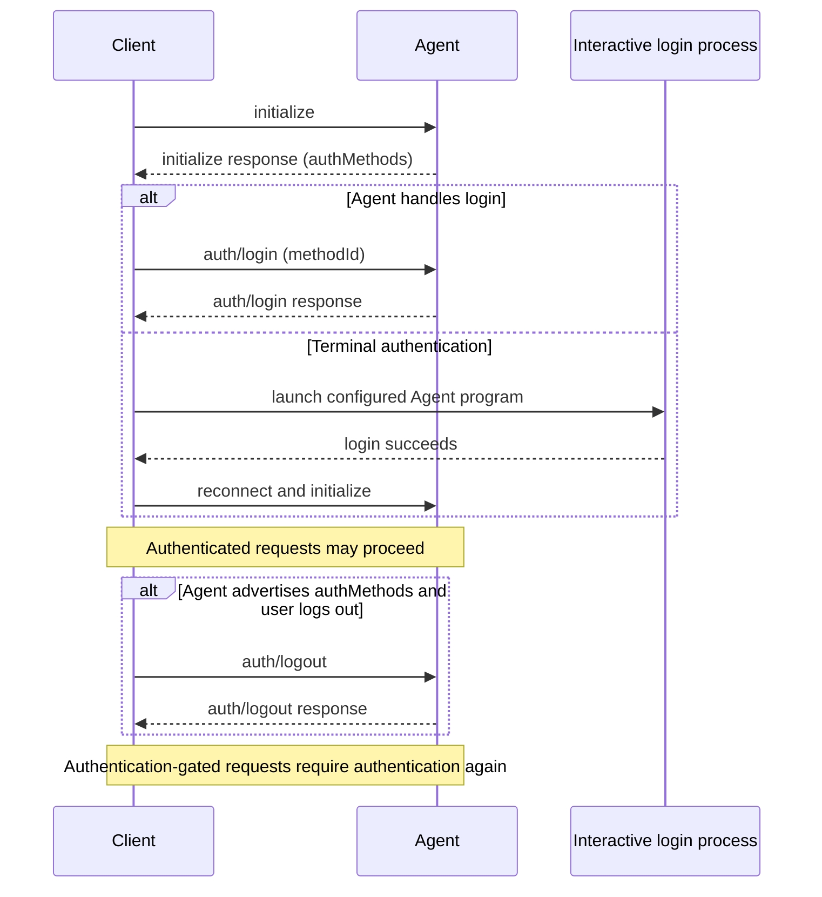

ACP authentication is negotiated during
[initialization](/protocol/v2/initialization). Agents advertise available
authentication methods in `authMethods`. A non-empty list makes `auth/login`
and `auth/logout` available, while each authentication method type defines
whether the Client invokes `auth/login`.

<br />



<br />

## Advertising authentication

Agents advertise authentication options in the `authMethods` field of the
`initialize` response. Every method has a `methodId`, but the Client sends that
ID to `auth/login` only for a method whose type defines that protocol-driven
flow.

Returning a non-empty `authMethods` list advertises `auth/login` and `auth/logout`. Each `methodId` **MUST** be unique within the list. An Agent that does so **MUST** implement both
`auth/login` and `auth/logout`. If `authMethods` is omitted or empty, the Agent
does not advertise these methods and Clients **MUST NOT** call either one.

`capabilities.auth` is orthogonal to this requirement. It advertises
authentication-related extensions, not the availability of the baseline
`auth/login` and `auth/logout` methods.

```json highlight={8-15}
{
  "jsonrpc": "2.0",
  "id": 0,
  "result": {
    "protocolVersion": 2,
    "capabilities": {},
    "authMethods": [
      {
        "methodId": "agent-login",
        "name": "Agent login",
        "type": "agent",
        "description": "Sign in using the agent's login flow"
      }
    ],
    "info": {
      "name": "my-agent",
      "title": "My Agent",
      "version": "1.0.0"
    }
  }
}
```

Because this response has a non-empty `authMethods` list, the Agent **MUST** support both `auth/login` and `auth/logout`.

### Authentication method types

The standard authentication method type is `agent`, where the Agent handles
authentication through `auth/login`. Every authentication method **MUST** include a
`type` discriminator:

```json
{
  "methodId": "agent-login",
  "name": "Agent login",
  "type": "agent",
  "description": "Sign in using the agent's login flow"
}
```

The `terminal` type tells the Client to run the configured Agent program
interactively:

```json
{
  "methodId": "terminal-login",
  "name": "Log in from the terminal",
  "type": "terminal",
  "args": ["--login"],
  "env": [
    {
      "name": "ACP_INTERACTIVE_LOGIN",
      "value": "1"
    }
  ]
}
```

Authentication method `type` values can be custom or future variants. Custom
method types **MUST** begin with `_`. Unknown non-underscore method types are
reserved for future ACP variants. Clients that do not understand a method type
**SHOULD** preserve the raw method payload when storing, replaying, proxying, or
forwarding initialization data, and otherwise ignore the method or display it
generically.

Terminal authentication methods require Client support. Clients advertise this
during initialization with `capabilities.auth.terminal`:

```json highlight={7-9}
{
  "jsonrpc": "2.0",
  "id": 0,
  "method": "initialize",
  "params": {
    "protocolVersion": 2,
    "capabilities": {
      "auth": {
        "terminal": {}
      }
    },
    "info": {
      "name": "my-client",
      "title": "My Client",
      "version": "1.0.0"
    }
  }
}
```

If `capabilities.auth.terminal` is omitted or `null`, the Client does not
advertise support. Supplying `{}` means the Client can reproduce the configured
Agent invocation in an interactive terminal. Agents **MUST NOT** advertise a `terminal` method unless this capability is present. Clients ignore `terminal` methods they did not enable.

See the [schema](/protocol/v2/schema#authmethod) for the full
`AuthMethod` definitions and the [Terminal Authentication
RFD](/rfds/auth-methods) for the design.

## Agent-handled authentication

When an Agent requires authentication and the selected method's type defines a
protocol-driven login flow, the Client calls `auth/login` with that advertised
method's ID:

```json
{
  "jsonrpc": "2.0",
  "id": 1,
  "method": "auth/login",
  "params": {
    "methodId": "agent-login"
  }
}
```

<ParamField path="methodId" type="string" required>
  The ID of an advertised authentication method whose type defines the
  `auth/login` flow. Clients **MUST NOT** pass a `terminal` method.
</ParamField>

`auth/login` may stay pending while the user completes an interactive flow. The Agent can run that flow itself, for example by opening a local browser, or through a URL-mode [elicitation](/protocol/v2/elicitation) scoped to the `auth/login` request with `requestId`. Whether authentication outlasts the connection is up to the Agent. Credentials are often stored where other connections can use them.

On success, the Agent returns an empty result:

```json
{
  "jsonrpc": "2.0",
  "id": 1,
  "result": {}
}
```

If `methodId` is not an advertised method whose type uses `auth/login`, the Agent responds with `-32602` (Invalid params). If login fails or the user abandons it, the Agent responds with `-32000` (Authentication required). A login cancelled with [`$/cancel_request`](/protocol/v2/cancellation) gets `-32800`.

When the Agent requires authentication, any request except `initialize`, `auth/login`, and `auth/logout` may fail with `auth_required` (`-32000`). After successful
authentication, the Client can create new sessions without receiving an
`auth_required` error for authentication-gated requests.

## Terminal authentication

For a `terminal` method, the Client:

1. Launches a separate interactive process using the same configured Agent
   program and base launch configuration as the ACP connection.
2. Appends the method's `args` and applies its `env`, overriding any same-named
   variables in the base launch configuration. Every `env` entry **MUST** have a
   unique `name`.
3. Presents the terminal to the user and waits for the process to exit. Exit
   status zero signals success. A non-zero status, termination without an exit
   status, or cancellation signals failure.
4. On success, retries an operation rejected for requiring authentication. The Client **SHOULD** first close the existing ACP connection, start and initialize a new one, and resume with `session/resume` any sessions it wants to keep, since the running Agent may not pick up the new credentials. It **MAY** instead retry on the existing connection first, and reconnect only if the retry still fails with `auth_required`. For an already-inserted prompt, see
   [Authentication failures during session work](#authentication-failures-during-session-work).

The descriptor cannot provide a command. The Client derives the command from its
own Agent configuration. Agents **SHOULD** provide arguments that enter a
login-only flow and exit when it completes. ACP does not define an output
pattern or other in-band success signal. Clients may recognize
implementation-specific signals only as an extension. The terminal process is
not the ACP connection, so the Client **MUST NOT** send an `auth/login` request
for a terminal method.

### Launch safety

- Clients **SHOULD** pass `args` as separate arguments rather than building a shell command line from them, and **SHOULD NOT** offer terminal authentication when the launch target re-parses arguments, such as a remote shell or a Windows batch file.
- Clients **SHOULD NOT** apply `env` entries that change program lookup, dynamic loading, interpreter or shell startup, or proxy and TLS trust without user approval. Examples include `PATH`, `LD_*`, `DYLD_*`, `NODE_OPTIONS`, `PYTHONPATH`, `BASH_ENV`, `HTTPS_PROXY`, and `SSL_CERT_FILE`.
- Clients **SHOULD** show the appended `args` and `env` before launch. `env` values **SHOULD NOT** contain secrets.

## Authentication failures during session work

`auth_required` (`-32000`) applies in v2 both to rejected requests and to
authentication failures that end foreground work. For `session/prompt`, the
reporting channel depends on whether the user message was inserted:

- Before insertion, the Agent returns an `auth_required` JSON-RPC error response.
- After insertion, the Agent **MUST** respond successfully with the inserted
  `messageId`, even if authentication fails before the response is sent. If the
  failure terminates foreground work, the Agent **MUST** report `idle` and
  **SHOULD** include `stopReason: "error"` with `error.code: -32000`.

Clients may prompt the user to complete an advertised authentication flow.
Successful authentication does not itself restart work that already ended.
Resending the prompt inserts a new message and does not undo the original
insertion or any tool side effects. Clients **SHOULD NOT** automatically resubmit
an inserted prompt as though it had been rejected. See
[Failures](/protocol/v2/prompt-lifecycle#failures).

## Logging out

The `auth/logout` method allows Clients to end the current authenticated state.
Clients may call it only when the Agent advertised one or more authentication methods during initialization. There is no separate logout
capability marker.

```json
{
  "jsonrpc": "2.0",
  "id": 2,
  "method": "auth/logout",
  "params": {}
}
```

On success, the Agent returns an empty result:

```json
{
  "jsonrpc": "2.0",
  "id": 2,
  "result": {}
}
```

After a successful `auth/logout`, authentication-gated requests will require the
user to complete one of the advertised authentication flows again.

## Active sessions

The protocol does not guarantee what happens to already-running sessions after
`auth/logout`. Agents may terminate them, keep them running, or return
`auth_required` errors for future session activity.

Clients **SHOULD** be prepared for active session operations to fail with
authentication-related errors after logout and **SHOULD** prompt the user to
authenticate again when appropriate.
