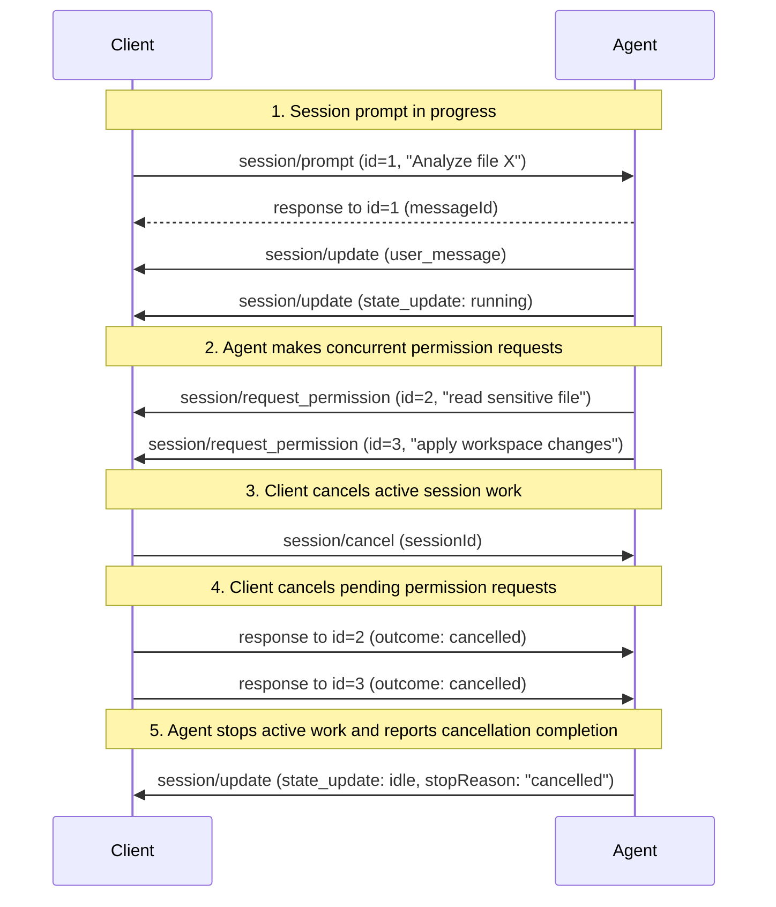

ACP uses JSON-RPC 2.0 for making requests and getting responses.

The JSON-RPC specification doesn't define any standard mechanism for request cancellation and keeps it up to the implementation.

## `$/cancel_request` notification

To make cancellation consistent, ACP defines a `$/cancel_request` notification that can be sent to cancel requests. Its `requestId` identifies a request that the sender of `$/cancel_request` issued. Receivers match it only against requests they received from that sender, since each side chooses its own request IDs.

Cancellation remains optional as it might not be implementable in all clients or servers. For example if the implementation uses a single threaded synchronous programming language then there is little it can do to react to a `$/cancel_request` notification.

When a `$/cancel_request` notification is received by a supporting implementation, the implementation:

- **MAY** cancel the corresponding request activity and all nested activities related to that request
- **MAY** finish sending any pending notifications before responding
- **MUST** still send a response for the original request

If the request already finished, or the receiver doesn't cancel it, the receiver sends its normal response.

Receivers **MUST** ignore a `$/cancel_request` for a request ID that is unknown or already answered, and **MUST NOT** send a second response for it.

If the receiver does cancel the request, it sends one of these responses:

- A successful response, where the method defines one for cancellation: `session/prompt` after its user message is inserted (with its `messageId`), `session/request_permission` with the `cancelled` outcome, or `elicitation/create` with the `cancel` action
- An error response with code [`-32800` (Request Cancelled)](/protocol/v2/schema#errorcode)

A sender that stops waiting for a response, for example after a timeout or because the work that needed it ended, **SHOULD** send `$/cancel_request` for that request so the receiver can stop work or dismiss UI. The calling side **MAY** implement graceful cancellation processing by waiting for the response from the remote side.

Cancellation **MAY** also be done explicitly on a per-feature basis within the protocol to cover specific scenarios, such as cancellation of [active session work](/protocol/v2/prompt-lifecycle#cancellation).

`session/cancel` and `$/cancel_request` have different scopes. Cancelling one
permission or elicitation request does not automatically cancel the whole
foreground workflow or determine its state. The Agent applies the aggregate
[state-transition rules](/protocol/v2/prompt-lifecycle#state-transitions).

On `session/cancel`, Clients **MUST** answer pending permissions for the cancelled
foreground work with the `cancelled` outcome. Requests whose `subject` references
work in the latest [`background`](/protocol/v2/prompt-lifecycle#background-work) list stay open. After cancellation completes, Agents **SHOULD** ignore late
answers rather than use them to resume the cancelled work. After aborting active
foreground work and sending its final updates, the Agent **MUST** report `idle`
with `stopReason: "cancelled"`. No additional completion update is required if
no foreground work was active. See [Elicitation Cancellation](/protocol/v2/elicitation#session-cancellation)
for selective cancellation of related requests and external URL interactions.

## Internal cancellation

Requests can also be cancelled internally by the executing party without receiving `$/cancel_request`:

- On the Client, the user closes the IDE or switches projects, or a file becomes unavailable.
- On the Agent, the LLM context limit is reached, an internal timeout fires, or resources run out.

When internal cancellation occurs, the executing party **SHOULD**:

- Send the same response it would send for `$/cancel_request`: the method's defined cancellation result where one exists (an inserted prompt's `messageId`, a `cancelled` permission outcome, or an elicitation `cancel` action), otherwise `-32800` (Request Cancelled)
- Ensure consistent behavior regardless of cancellation source

Both kinds of cancellation answer `session/prompt` with `-32800` only before the user message is inserted. Once it is inserted, the Agent responds successfully with its `messageId`, and the work it started is stopped with [`session/cancel`](/protocol/v2/prompt-lifecycle#cancellation) or ends with the matching [stop reason](/protocol/v2/prompt-lifecycle#stop-reasons). See [Prompt Accepted](/protocol/v2/prompt-lifecycle#2-prompt-accepted).

## Example: cascading cancellation flow

Sending `session/cancel` does not automatically send `$/cancel_request` for outstanding Agent-to-Client requests. An Agent can explicitly propagate cancellation to those requests, but the Client **MUST** answer pending permission requests with the `cancelled` outcome when it sends `session/cancel`, as specified in [active session work cancellation](/protocol/v2/prompt-lifecycle#cancellation). It does not wait for `$/cancel_request`.

