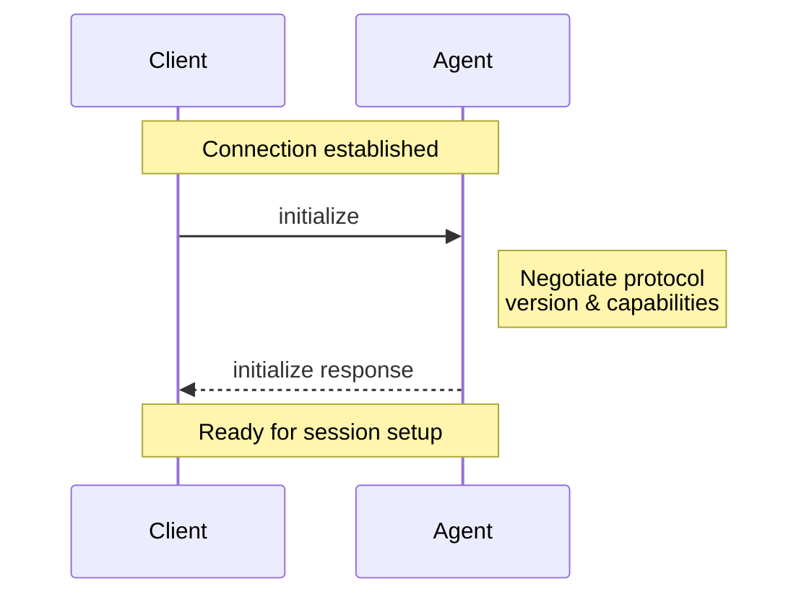

The Initialization phase allows [Clients](/protocol/v2/draft/overview#client) and [Agents](/protocol/v2/draft/overview#agent) to negotiate protocol versions, capabilities, and authentication methods.

<br />



<br />

Before a Session can be created, Clients **MUST** initialize the connection by calling the `initialize` method with:

- The latest [protocol version](#protocol-version) supported
- The [capabilities](#client-capabilities) supported
- The [implementation information](#implementation-information) for the Client

```json
{
  "jsonrpc": "2.0",
  "id": 0,
  "method": "initialize",
  "params": {
    "protocolVersion": 2,
    "capabilities": {
      "auth": {
        "terminal": {}
      }
    },
    "info": {
      "name": "my-client",
      "title": "My Client",
      "version": "1.0.0"
    }
  }
}
```

The Agent **MUST** respond with the chosen [protocol version](#protocol-version), the [capabilities](#agent-capabilities) it supports, and its [implementation information](#implementation-information):

```json
{
  "jsonrpc": "2.0",
  "id": 0,
  "result": {
    "protocolVersion": 2,
    "capabilities": {
      "session": {
        "prompt": {
          "image": {},
          "audio": {},
          "embeddedContext": {}
        },
        "mcp": {
          "stdio": {},
          "http": {}
        }
      }
    },
    "info": {
      "name": "my-agent",
      "title": "My Agent",
      "version": "1.0.0"
    },
    "authMethods": []
  }
}
```

`authMethods` is optional. Returning one or more valid entries advertises the Agent's authentication surface and means the Agent **MUST** implement both `auth/login` and `auth/logout`. If `authMethods` is omitted or empty, Clients **MUST NOT** call either method.

`capabilities.auth` is separate from this method surface. It advertises authentication-related extensions and does not change the availability rules for `auth/login` or `auth/logout`.

## Protocol version

The protocol versions that appear in the `initialize` requests and responses are a single integer that identifies a **MAJOR** protocol version. This version is only incremented when breaking changes are introduced.

Clients and Agents **MUST** agree on a protocol version and act according to its specification.

See [Capabilities](#capabilities) to learn how non-breaking features are introduced.

### Version Negotiation

The `initialize` request **MUST** include the latest protocol version the Client supports.

The Agent **MUST** select the highest protocol version it supports that is less than or equal to the requested version. If it supports the requested version, this selects that version. A successful `initialize` response **MUST NOT** select a version higher than the requested version and **MUST** use the selected version's initialization response shape.

If no supported version is less than or equal to the requested version, the Agent **MUST** reject `initialize` with error code `-32022` (`Unsupported protocol version`). The error's `data` **MUST** be an object containing the required, non-null fields `requested` (the requested protocol version) and `supported` (an array of the protocol versions the Agent supports). An empty `supported` array means the endpoint has no protocol implementations configured.

```json
{
  "jsonrpc": "2.0",
  "id": 0,
  "error": {
    "code": -32022,
    "message": "Unsupported protocol version",
    "data": {
      "requested": 1,
      "supported": [2]
    }
  }
}
```

A version-mismatch error does not initialize the connection. The Agent **MUST NOT** begin version-specific operations on that connection, and the Client **SHOULD** close it and inform the user. Missing, non-integer, or out-of-range `protocolVersion` values are malformed parameters and **MUST** receive `-32602` (`Invalid params`) instead.

The Client **MUST** check that it supports the version in a successful response. Advertising a latest version does not imply support for every earlier version. If the Client does not support the selected version, it **SHOULD** close the connection and inform the user.

## Capabilities

Capabilities describe features supported by the Client and the Agent.

All capabilities included in the `initialize` request are **OPTIONAL**. Clients and Agents **SHOULD** support all possible combinations of their peer's capabilities.

The introduction of new capabilities is not considered a breaking change. Therefore, Clients and Agents **MUST** treat all capabilities omitted in the `initialize` request as **UNSUPPORTED**.

Capabilities may advertise top-level method surfaces or nested features that
only apply within a supported surface.

Capabilities may specify the availability of protocol methods, notifications, or a subset of their parameters. They may also signal behaviors of the Agent or Client implementation.

Receivers **MUST** ignore unknown capability fields at every nesting level, as described in [Unknown Object Fields](/protocol/v2/draft/extensibility#unknown-object-fields). Unknown fields do not advertise support for any capability the receiver understands.

Implementations can also [advertise custom capabilities](/protocol/v2/draft/extensibility#advertising-custom-capabilities) using the `_meta` field to indicate support for protocol extensions.

Experimental features follow their own documented negotiation requirements, not
a connection-wide unstable-schema flag. See [Experimental Features and
Negotiation](/protocol/v2/draft/extensibility#experimental-features-and-negotiation)
for the distinction between capability-gated operations and capability-free
informational additions.

### Client Capabilities

Clients **MAY** include defined capability fields in `capabilities`.
Omitted fields mean unsupported.

#### Terminal Authentication

<ParamField path="auth.terminal" type="TerminalAuthCapabilities Object">
  The Client can reproduce the configured Agent invocation in an interactive
  terminal. Omitted or `null` means unsupported. Supplying `{}` means the Agent
  may advertise `type: "terminal"` authentication methods.
</ParamField>

<Card icon="terminal" horizontal href="/protocol/v2/draft/authentication">
  Learn more about Terminal Authentication
</Card>

#### Elicitation

<ParamField path="elicitation" type="ElicitationCapabilities Object">
  The Client advertises its supported `elicitation/create` modes. Omitted or
  `null` means no modes are advertised. A present object advertises each mode
  only through its corresponding non-null `form` or `url` field. Empty and
  all-null objects are valid but advertise no supported modes. Unlike MCP, ACP
  does not treat `{}` as form support.
</ParamField>

<Card icon="message-question" horizontal href="/protocol/v2/draft/elicitation">
  Learn more about Elicitation
</Card>

### Agent Capabilities

The Agent **SHOULD** specify whether it supports the following capabilities:

<ResponseField name="session" type="SessionCapabilities Object">
  The Agent supports the `session/*` method surface. Omitted or `null` means the
  Agent does not support session methods. Supplying `{}` means the Agent
  supports the baseline session methods: `session/new`, `session/list`,
  `session/resume`, `session/close`, `session/prompt`, `session/cancel`, and
  `session/update`.
</ResponseField>

<ResponseField name="auth" type="AgentAuthCapabilities Object">
  Authentication-related extensions supported by the Agent. This field is
  orthogonal to `authMethods` and does not advertise the availability of
  `auth/login` or `auth/logout`.
</ResponseField>

<ResponseField name="providers" type="ProvidersCapabilities Object">
  **Unstable.** The Agent supports `providers/list`, `providers/set`, and
  `providers/disable`. Omitted or `null` means unsupported; supplying `{}` means
  supported. Clients **MUST NOT** call these methods unless this capability is
  present, even if their SDK exposes the experimental request types.
</ResponseField>

#### Session Capabilities

Supplying `session: {}` means the Agent supports `session/new`,
`session/list`, `session/resume`, `session/close`, `session/prompt`,
`session/cancel`, and `session/update`.

Optionally, Agents **MAY** support prompt extensions, MCP server transports, and
additional session methods such as `session/delete` by specifying nested
capabilities.

<ResponseField name="prompt" type="PromptCapabilities Object">
  Object indicating the different types of [content](/protocol/v2/draft/content)
  that may be included in `session/prompt` requests. Omitted or `null` means the
  Agent does not advertise any prompt extensions beyond the baseline text and
  resource-link content required by `session/prompt`.
</ResponseField>

<ResponseField name="mcp" type="McpCapabilities Object">
  Object indicating the MCP server transports that may be included in session
  lifecycle requests. Omitted or `null` both mean the Agent does not advertise
  MCP server transport support for sessions.
</ResponseField>

<ResponseField name="delete" type="SessionDeleteCapabilities Object">
  The [`session/delete`](/protocol/v2/draft/session-delete) method is available.
  Omitted or `null` both mean the Agent does not advertise support. Supplying an
  empty object means the Agent supports deleting sessions from `session/list`.
</ResponseField>

<ResponseField
  name="additionalDirectories"
  type="SessionAdditionalDirectoriesCapabilities Object"
>
  The Agent supports `additionalDirectories` on supported session lifecycle
  requests. Omitted or `null` both mean the Agent does not advertise support.
  Supplying `{}` means the Agent supports additional workspace roots.
</ResponseField>

<ResponseField name="systemPrompt" type="SessionSystemPromptCapabilities Object">
  **Unstable.** The Agent supports
  [`systemPrompt`](/protocol/v2/draft/session-setup#system-prompt-unstable) on
  session lifecycle requests. Omitted or `null` both mean the Agent does not
  advertise support. Supplying `{}` means the Agent supports `append` mode.
  Supplying `{ "mode": { "override": {} } }` also advertises `override` mode.
</ResponseField>

#### Session Prompt Capabilities

As a baseline, Agents that advertise `session` **MUST** support `ContentBlock::Text` and `ContentBlock::ResourceLink` in `session/prompt` requests.

Optionally, they **MAY** support richer types of [content](/protocol/v2/draft/content) by specifying the following capabilities:

<ResponseField name="image" type="PromptImageCapabilities Object">
  The prompt may include `ContentBlock::Image`. Omitted or `null` means the
  Agent does not advertise support. Supplying `{}` means the Agent supports
  image content in prompts.
</ResponseField>

<ResponseField name="audio" type="PromptAudioCapabilities Object">
  The prompt may include `ContentBlock::Audio`. Omitted or `null` means the
  Agent does not advertise support. Supplying `{}` means the Agent supports
  audio content in prompts.
</ResponseField>

<ResponseField
  name="embeddedContext"
  type="PromptEmbeddedContextCapabilities Object"
>
  The prompt may include `ContentBlock::Resource`. Omitted or `null` means the
  Agent does not advertise support. Supplying `{}` means the Agent supports
  embedded context in prompts.
</ResponseField>

#### Session MCP Capabilities

<ResponseField name="stdio" type="McpStdioCapabilities Object">
  The Agent supports connecting to MCP servers over stdio. Omitted or `null`
  means the Agent does not advertise support. Supplying `{}` means the Agent
  supports stdio MCP server transports.
</ResponseField>

<ResponseField name="http" type="McpHttpCapabilities Object">
  The Agent supports connecting to MCP servers over HTTP. Omitted or `null`
  means the Agent does not advertise support. Supplying `{}` means the Agent
  supports HTTP MCP server transports.
</ResponseField>

<Card icon="shield-check" horizontal href="/protocol/v2/draft/authentication">
  Learn more about Authentication
</Card>

## Implementation Information

Both Clients and Agents **MUST** provide information about their implementation in the `info` field. It takes the following three fields:

<ParamField path="name" type="string">
  Intended for programmatic or logical use, but can be used as a display name
  fallback if title isn’t present.
</ParamField>

<ParamField path="title" type="string">
  Intended for UI and end-user contexts — optimized to be human-readable and
  easily understood. If not provided, the name should be used for display.
</ParamField>

<ParamField path="version" type="string">
  Version of the implementation. Can be displayed to the user or used for
  debugging or metrics purposes.
</ParamField>

---

Once the connection is initialized, you're ready to [create a session](/protocol/v2/draft/session-setup) and begin the conversation with the Agent.
