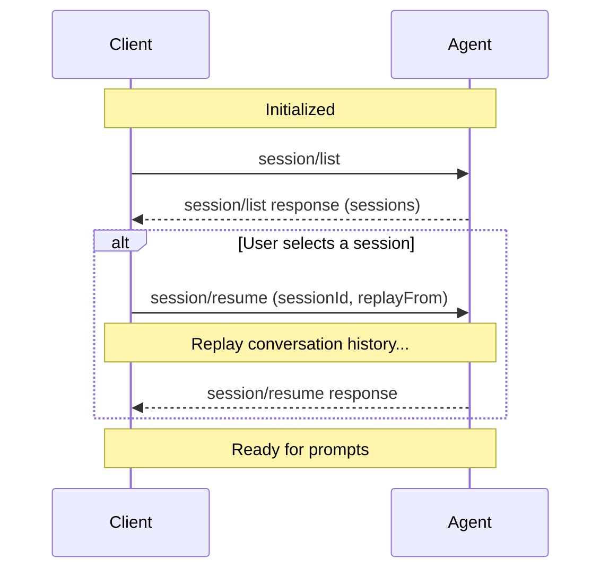

The `session/list` method returns the sessions an Agent knows about. Clients use it to show session history and let users switch between sessions.

Agents can also send a `session_info_update` notification when a session's title or metadata changes, so Clients don't have to poll.

Before listing sessions, Clients **MUST** first complete the [initialization](/protocol/v2/draft/initialization) phase. Agents that advertise `capabilities.session` **MUST** support `session/list`.

<br />



<br />

Agents that also advertise `session.additionalDirectories` may
include `additionalDirectories` in returned `SessionInfo` objects to report
additional workspace roots for listed sessions.

<Note>
  If the Agent advertises the `session.delete` capability, Clients can remove
  sessions from future `session/list` results with
  [`session/delete`](/protocol/v2/draft/session-delete).
</Note>

## Listing sessions

Clients discover existing sessions by calling the `session/list` method with optional filtering and pagination parameters:

```json
{
  "jsonrpc": "2.0",
  "id": 2,
  "method": "session/list",
  "params": {
    "cwd": "/home/user/project",
    "cursor": "eyJwYWdlIjogMn0="
  }
}
```

All parameters are optional. A request with an empty `params` object returns the first page of sessions.

<ParamField path="cwd" type="string">
  Filter sessions by working directory. Must be an absolute path. Agents reject
  a relative path with `-32602`. Only sessions whose `cwd` is this same
  directory are returned. Sessions in subdirectories or with it in
  `additionalDirectories` don't match. Agents **MAY** normalize paths when
  comparing, for example ignoring a trailing separator.
</ParamField>

<ParamField path="cursor" type="string">
  Opaque cursor token from a previous response's `nextCursor` field for
  cursor-based pagination. See [Pagination](#pagination).
</ParamField>

The Agent **MUST** respond with a list of sessions and optional pagination metadata:

```json
{
  "jsonrpc": "2.0",
  "id": 2,
  "result": {
    "sessions": [
      {
        "sessionId": "sess_abc123def456",
        "cwd": "/home/user/project",
        "title": "Implement session list API",
        "updatedAt": "2025-10-29T14:22:15Z",
        "_meta": {
          "com.example/messageCount": 12,
          "com.example/hasErrors": false
        }
      },
      {
        "sessionId": "sess_xyz789ghi012",
        "cwd": "/home/user/another-project",
        "title": "Debug authentication flow",
        "updatedAt": "2025-10-28T16:45:30Z"
      },
      {
        "sessionId": "sess_uvw345rst678",
        "cwd": "/home/user/project",
        "updatedAt": "2025-10-27T15:30:00Z"
      }
    ],
    "nextCursor": "eyJwYWdlIjogM30="
  }
}
```

<ResponseField name="sessions" type="SessionInfo[]" required>
  Array of session information objects.

  <Expandable title="SessionInfo">
    <ResponseField name="sessionId" type="string" required>
      Unique identifier for the session.
    </ResponseField>
    <ResponseField name="cwd" type="string" required>
      Working directory for the session. Always an absolute path.
    </ResponseField>
    <ResponseField name="additionalDirectories" type="string[]">
      If the Agent advertises `session.additionalDirectories`, it
      **MAY** include this field to report the complete ordered additional-root list
      associated with the listed session. Omitted and empty values are equivalent: this `SessionInfo` response reports no additional roots.
      Clients **MUST NOT** merge this field with prior values or infer additional
      roots from agent-specific state.
    </ResponseField>

    <ResponseField name="title" type="string">
      Human-readable title for the session. May be auto-generated from the first prompt.
    </ResponseField>
    <ResponseField name="updatedAt" type="string">
      RFC 3339 timestamp of the last activity in the session.
    </ResponseField>
    <ResponseField name="_meta" type="object">
      Agent-specific metadata. See [Extensibility](/protocol/v2/draft/extensibility).
    </ResponseField>

  </Expandable>
</ResponseField>

<ResponseField name="nextCursor" type="string">
  Opaque cursor token. If present, pass this in the next request's `cursor`
  parameter to fetch the next page. Omitted and `null` are equivalent and mean
  there are no more results.
</ResponseField>

When no sessions match the criteria, the Agent **MUST** return an empty `sessions` array.

## Pagination

`session/list` uses cursor-based pagination. The request includes an optional `cursor`, and the response includes `nextCursor` when more results are available.

- Clients **MUST** treat a missing `nextCursor` as the end of results. Only an omitted or `null` `nextCursor` ends the results. An empty string is a valid cursor
- Clients **MUST NOT** assume a fixed page size
- Clients **MUST** treat cursors as opaque tokens, which means not parsing, modifying, or persisting them
- Agents **MUST** return `-32602` if the cursor is invalid
- Agents **SHOULD** enforce reasonable page sizes internally

## Updating session metadata

Agents **SHOULD** send a `session_info_update` notification via `session/update` on each connection where the session is [active](/protocol/v2/draft/session-setup#session-lifecycle) whenever session metadata changes, including changes
requested by a Client. The same response and notification ordering guidance as
[`config_option_update`](/protocol/v2/draft/session-config-options#from-the-agent)
applies here.

```json
{
  "jsonrpc": "2.0",
  "method": "session/update",
  "params": {
    "sessionId": "sess_abc123def456",
    "update": {
      "sessionUpdate": "session_info_update",
      "title": "Implement user authentication",
      "_meta": {
        "com.example/tags": ["feature", "auth"],
        "com.example/priority": "high"
      }
    }
  }
}
```

All fields are optional. Only include fields that have changed. Omitted fields are left unchanged. Set a nullable field to `null` to clear it.

<ResponseField name="title" type="string | null">
  Human-readable title for the session. Set to `null` to clear.
</ResponseField>

<ResponseField name="updatedAt" type="string | null">
  RFC 3339 timestamp of last activity. Set to `null` to clear.
</ResponseField>

<ResponseField name="_meta" type="object | null">
  Agent-specific metadata patch. Omit to leave unchanged. Set to `null` to
  clear. An object patches the stored metadata by top-level key. See [Metadata
  Patches](/protocol/v2/draft/extensibility#metadata-patches).
</ResponseField>

The `sessionId`, `cwd`, and `additionalDirectories` fields are **not** included
in the update. `sessionId` is already in the notification's `params`, `cwd` is
immutable after session setup, and ACP does not currently define mid-session
mutation for `additionalDirectories`. Agents typically send this notification
after the first meaningful exchange to auto-generate a title.

The Agent sends these updates on each connection where the session is [active](/protocol/v2/draft/session-setup#session-lifecycle). Clients can refresh metadata for
other sessions through `session/list`.

## Interaction with other session methods

`session/list` only discovers sessions. It does **not** restore or modify them:

1. Client calls `session/list` to discover available sessions
2. User selects a session from the list
3. Client calls [`session/resume`](/protocol/v2/draft/session-setup#resuming-sessions) with the chosen `sessionId` to resume the conversation, optionally setting `replayFrom` to request history replay

## Archived sessions (unstable)

Agents that advertise `session.archive` support `session/archive`, `session/unarchive`, the `archived` filter on `session/list`, and `archived` on each listed session. Clients **MUST NOT** use any of them unless the Agent advertises the capability. See the [RFD](/rfds/session-archive).

Archiving hides a session from default `session/list` results. Unarchiving returns it. Both keep the session ID and saved history, and both take only a `sessionId` and return an empty result:

```json
{
  "jsonrpc": "2.0",
  "id": 5,
  "method": "session/archive",
  "params": {
    "sessionId": "sess_abc123"
  }
}
```

The `archived` filter on `session/list` selects sessions by archive state:

| Value                         | Sessions returned           |
| ----------------------------- | --------------------------- |
| Omitted, `null`, or `exclude` | Only sessions not archived. |
| `include`                     | Archived and not archived.  |
| `only`                        | Only archived sessions.     |

Agents **MUST** reject a value they don't support with `-32602` rather than falling back to `exclude`. The filter combines with `cwd` and applies before pagination. Clients keep the same `cwd` and `archived` values when following `nextCursor`.

Agents that advertise the capability **MUST** include a boolean `archived` on every listed session.

- If the session is active, `session/archive` cancels any ongoing work and frees the session's resources as if [`session/close`](/protocol/v2/draft/session-setup#closing-active-sessions) had been called, then archives it. This does not require the `close` capability.
- `session/unarchive` never loads or resumes a session. Clients that want to continue an archived session **SHOULD** unarchive it before calling `session/resume`. Agents **MAY** reject `session/resume` for an archived session.
- Archive state persists across connections and restarts. Closing, loading, or resuming a session does not change it.
- Because archiving closes the session, [`session/status`](/rfds/session-status) reports an archived session as `saved`.
- Archiving an archived session, or unarchiving one that isn't archived, succeeds. A session that does not exist gets `-32002`.
- Deleted sessions are excluded from every filter value, and unarchiving does not restore them.
