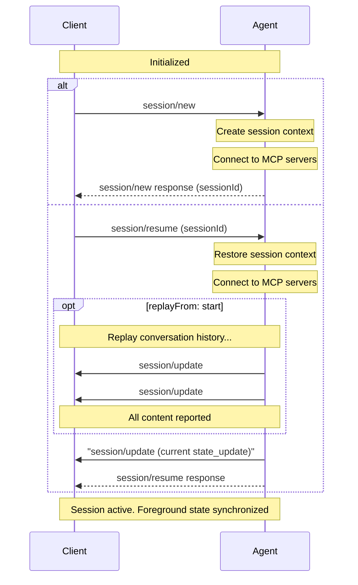

Sessions represent a specific conversation or thread between the [Client](/protocol/v2/draft/overview#client) and [Agent](/protocol/v2/draft/overview#agent). Each session has its own context, conversation history, and state, so one Agent can run several independent sessions.

Before creating a session, Clients **MUST** first complete the [initialization](/protocol/v2/draft/initialization) phase to establish protocol compatibility and capabilities.

If the Agent requires authentication, session methods may fail with `auth_required` (`-32000`) until the Client completes the [authentication flow](/protocol/v2/draft/authentication).

<br />



<br />

## Session lifecycle

A session exists from `session/new` until the Agent discards it. Agents choose how long to keep sessions: for example, they may not store a session that was never prompted, may expire old sessions, or may remove one through [`session/delete`](/protocol/v2/draft/session-delete). `session/list` and `session/resume` only see sessions the Agent still has, and resuming one it no longer has fails with `-32002`.

On a connection, a session is **active** from a successful `session/new`, `session/resume`, or, when supported, `session/fork` (for the new session) until `session/close` or the end of the connection. A forked session starts with no background work: unfinished tool calls and running terminals copied into its history are not live, and its state snapshots report `background: []` until it starts its own. Agents **SHOULD NOT** discard a session while it is active, except through `session/delete`, which closes it first.

- Session-scoped requests such as `session/prompt` and `session/set_config_option` require an active session. Otherwise the Agent responds with `-32002`. See [Unknown Sessions](/protocol/v2/draft/error#unknown-sessions). Agents ignore `session/cancel` for a session that isn't active.
- Closing a session ends it on the connection but doesn't discard it. Whether a closed session stays listed and resumable depends on how long the Agent keeps it.
- Resuming a session that is already active on the connection synchronizes it again, like any resume. Ongoing work continues, and the request's MCP servers and workspace roots replace the previous ones.
- Whether a session can be active on more than one connection at once is up to the Agent. An Agent that doesn't allow it **MAY** reject a `session/resume` for a session active on another connection, or end the session's activity on that other connection as if it were closed, for example when a Client reconnects before the Agent notices the old connection is gone.
- When the connection ends, its sessions stop being active. The Agent **MAY** continue or cancel their foreground work. A later `session/resume` reports the outcome in its [current-state snapshot](#current-state-synchronization).

## Creating a session

Clients create a new session by calling the `session/new` method with:

- The [working directory](#working-directory) for the session
- A list of [MCP servers](#mcp-servers) the Agent should connect to

```json
{
  "jsonrpc": "2.0",
  "id": 1,
  "method": "session/new",
  "params": {
    "cwd": "/home/user/project",
    "mcpServers": [
      {
        "type": "stdio",
        "name": "workspace-tools",
        "command": "/path/to/mcp-server",
        "args": ["--stdio"],
        "env": []
      }
    ]
  }
}
```

The Agent **MUST** respond with a unique [Session ID](#session-id) that identifies this conversation:

```json
{
  "jsonrpc": "2.0",
  "id": 1,
  "result": {
    "sessionId": "sess_abc123def456"
  }
}
```

## Initial session state

New sessions default to `idle` until a `state_update` reports otherwise. Updates
may arrive before or after the `session/new` response. Clients **MUST NOT**
overwrite an already-reported state when the response arrives. An optional
initial idle notification is a snapshot, not a completed turn.

Agents **SHOULD** put initial state in the `session/new` response, such as `configOptions` and `availableCommands`, rather than sending notifications before it. Agents **SHOULD NOT** send session-scoped requests, such as permission requests or elicitations, before the response, because the Client cannot yet show them for that session. While a `session/new` is pending, Clients **MAY** buffer notifications for a `sessionId` they don't recognize and apply them in order once the response arrives, or drop them. Agents cannot rely on such notifications being seen.

`session/resume` does not imply idle: an existing session may still be running
or waiting for user action. See [Current-State Synchronization](#current-state-synchronization).

The `session/new`, `session/resume`, and, when supported, `session/fork` responses carry the session's [configuration options](/protocol/v2/draft/session-config-options) in `configOptions` and [available slash commands](/protocol/v2/draft/slash-commands) in `availableCommands`. Because a setup response replaces the lists the Client holds, an Agent whose session has configuration options or commands **MUST** include them in that response. For example, a new session can return both:

```json
{
  "jsonrpc": "2.0",
  "id": 1,
  "result": {
    "sessionId": "sess_abc123def456",
    "configOptions": [
      {
        "configId": "brave_mode",
        "name": "Brave Mode",
        "description": "Skip confirmation prompts and act autonomously",
        "type": "boolean",
        "currentValue": false
      }
    ],
    "availableCommands": [
      {
        "type": "command",
        "name": "test",
        "description": "Run tests for the current project"
      }
    ]
  }
}
```

`configOptions` and `availableCommands` are optional. Each is the complete current list for the session: omission or `[]` means none, and empty lists are omitted when serializing. Agents **MUST NOT** send `null` for these fields.

When a `session/new`, `session/resume`, or, when supported, `session/fork` response arrives, Clients replace the lists they hold for the session with the response's lists, including lists from updates received before the response. Later `config_option_update` and `available_commands_update` notifications each replace the complete list, including `[]` to clear it.

For a fork, `availableCommands` advertises commands available in the newly created session, not the source session.

## Resuming sessions

Agents that advertise `capabilities.session` **MUST** support
`session/resume`, which Clients use to reconnect to existing sessions. By
default, resume restores the session context without replaying prior
conversation history. Clients that need history replay can request it with
`replayFrom`.

To resume an existing session, Clients **MUST** call the `session/resume` method
with:

- The [Session ID](#session-id) to resume
- [MCP servers](#mcp-servers) to connect to
- The [working directory](#working-directory)
- Optionally, a `replayFrom` cursor

```json
{
  "jsonrpc": "2.0",
  "id": 2,
  "method": "session/resume",
  "params": {
    "sessionId": "sess_789xyz",
    "cwd": "/home/user/project",
    "mcpServers": [
      {
        "type": "stdio",
        "name": "workspace-tools",
        "command": "/path/to/mcp-server",
        "args": ["--mode", "workspace"],
        "env": []
      }
    ]
  }
}
```

When `replayFrom` is omitted or `null`, the Agent **MUST NOT** replay the
conversation history via `session/update` notifications before responding. It
restores the session context, reconnects to the requested MCP servers, and
returns once the session is active and its current foreground state has been
synchronized. The required current-state snapshot is live synchronization, not
history replay. Updates that report in-progress work, such as the content of a message that is still streaming, are live updates, not history replay.

To request full history replay, Clients set `replayFrom` to
`{ "type": "start" }`:

Replay cursors are inclusive: replay includes the position identified by the
cursor. For `{ "type": "start" }`, that means replaying all retained conversation history.

```json
{
  "jsonrpc": "2.0",
  "id": 3,
  "method": "session/resume",
  "params": {
    "sessionId": "sess_789xyz",
    "cwd": "/home/user/project",
    "replayFrom": {
      "type": "start"
    }
  }
}
```

When `replayFrom.type` is `"start"`, the Agent **MUST** replay all retained
conversation history to the Client in the form of `session/update` notifications before
responding.

The schema accepts custom and future `replayFrom.type` values so intermediaries
can preserve them. An Agent that does not support the supplied cursor type
**MUST** reject `session/resume` with `-32602` (Invalid params). It **MUST NOT**
silently substitute another cursor or resume without replay. Malformed
`replayFrom` values also result in `-32602`.

### Replay contents

Replay reports retained history with the same updates and semantics as live delivery: messages, tool calls, [display terminals](/protocol/v2/draft/tool-calls#display-only-terminals), plans, and [compactions](/protocol/v2/draft/prompt-lifecycle#session-compaction).

The Agent can replay each entity's updates or only its current state, for example a whole message instead of its chunks, or a terminal `output` snapshot instead of every output chunk.

A replayed tool call whose work is no longer running or waiting **SHOULD** have a final status (`completed`, `failed`, or `cancelled`). Work that is still running after resuming keeps its live status and continues with live updates.

Replay does not include:

- Historical `state_update` notifications. See [Current-State Synchronization](#current-state-synchronization).
- [Notices](/protocol/v2/draft/prompt-lifecycle#session-notices), which are live-only and **SHOULD NOT** be replayed. If the condition is still relevant after resuming, the Agent may send a new notice.
- Pending permission requests and elicitations. See [Current-State Synchronization](#current-state-synchronization).

Agents need not replay historical `usage_update`, `session_info_update`, `config_option_update`, or `available_commands_update` notifications, since they describe past values rather than current ones. See [Current-State Synchronization](#current-state-synchronization).

Agents are not required to persist every inserted user message or retain it for
any minimum period. Live-only messages, including locally handled commands, may
be absent from replay. A successful prompt response confirms insertion, not
future availability in history. Absence from replay does not contradict it.

For example, a user message from the conversation history:

```json
{
  "jsonrpc": "2.0",
  "method": "session/update",
  "params": {
    "sessionId": "sess_789xyz",
    "update": {
      "sessionUpdate": "user_message",
      "messageId": "msg_user_8f7a1",
      "content": [
        {
          "type": "text",
          "text": "What's the capital of France?"
        }
      ]
    }
  }
}
```

Followed by the agent's response:

```json
{
  "jsonrpc": "2.0",
  "method": "session/update",
  "params": {
    "sessionId": "sess_789xyz",
    "update": {
      "sessionUpdate": "agent_message",
      "messageId": "msg_agent_c42b9",
      "content": [
        {
          "type": "text",
          "text": "The capital of France is Paris."
        }
      ]
    }
  }
}
```

During replay, the Agent **MUST** include an opaque `messageId` for each
replayed message, unique among messages of the same
[type](/protocol/v2/draft/prompt-lifecycle#entity-ids). A retained user
message inserted by `session/prompt` **MUST** use the ID returned in that
prompt response, including after reconnecting or restarting the Agent. Replaying a command reports its message. It does not
execute the command again.

Agents **SHOULD** preserve the IDs of all other replayed [entities](/protocol/v2/draft/prompt-lifecycle#entity-ids), such as agent and thought message IDs, `toolCallId`, `terminalId`, `planId`, and `compactionId`, across replay when possible, but these IDs are not
guaranteed to remain stable across reconnects or Agent restarts. Clients **MUST
NOT** rely on them to deduplicate replay against previously received history. A
full replay is authoritative: Clients **SHOULD** rebuild all of the session's entities, such as messages, tool calls, terminals, plans, and compactions, from it rather than merging it into
existing state by ID.

`user_message`, `agent_message`, and `agent_thought` updates
are upserts keyed by `messageId`. Their `content` arrays replace the whole
message content, while chunk updates with the same `messageId` append content.

When replay reconstructs a message from its beginning using chunks, the Agent
**MUST** first send the corresponding message update (`user_message`,
`agent_message`, or `agent_thought`) with the same ID and `content: []`.
This initializes or clears content under the ID used for that replay before
replayed chunks append. It does not reconcile a message previously delivered
under a different ID. A full-content message update can instead replace content
under the replayed ID directly.

Clients apply replayed message updates and chunks in the order they are
received. If a message update with `content` arrives after chunks for the same
`messageId`, it replaces the content accumulated from those chunks. If chunks
arrive after a message update, they append to that update's current content.
Message updates that omit `content` can update other optional fields without
changing the current content.

Replay also applies top-level `_meta` as a
[metadata patch](/protocol/v2/draft/extensibility#metadata-patches) and does not reset it.
A message update that replaces `content` leaves `_meta` keys it does not
mention. When the Client may already hold metadata for an entity, the Agent
removes stale keys by setting them to `null`, or sends `_meta: null` before the
current object.

When all requested replay entries have been reported to the Client, the Agent
**MUST** synchronize current state as described below, then respond to the
original `session/resume` request.

```json
{
  "jsonrpc": "2.0",
  "id": 3,
  "result": {}
}
```

The response also includes the current `configOptions` and `availableCommands` as
described in [Initial Session State](#initial-session-state), whether or not
history replay was requested.

### Current-state synchronization

For every successful resume, the Agent **MUST** send a current
[`state_update`](/protocol/v2/draft/prompt-lifecycle#session-states) after any requested
history replay and before the resume response. This is required even when
`replayFrom` is omitted or `null`. The snapshot reports the current foreground
state after resuming: `idle`, `running`, or `requires_action`, or the draft
`unknown` state when activity is unobservable.

The snapshot carries the [`background`](/protocol/v2/draft/prompt-lifecycle#background-work) list like any other. Before it, the Agent **MUST** send a current update for each listed item that the requested replay did not already deliver at its current state: a `terminal_update` for each terminal, a `tool_call_update` for each tool call, and a `subagent_update` for each child. When no replay was requested, this means all of them.

Agents **MUST NOT** replay historical `state_update` notifications as current
activity. The snapshot and subsequent live state changes **MUST** be delivered
in order, without replacing a newer state with a stale snapshot. An idle
snapshot may include the last stop reason for context, but does not report a
new completion or cancellation. Clients **MUST NOT** reset the state to idle
on the resume response.

If connection loss made a pending permission request or elicitation unusable,
the Agent **SHOULD** reestablish it or safely resolve the wait.

Agents **SHOULD** also send current session info through `session_info_update` after any requested
history replay and before responding, even when `replayFrom` is omitted or
`null`. This synchronizes current state rather than replaying historical
configuration or metadata changes.

Agents that report usage **MAY** likewise send a current `usage_update` after any requested history replay and before responding.

## Closing active sessions

Agents that advertise `capabilities.session` **MUST** support
`session/close`, which tells the Agent to cancel any ongoing work
for a session and free any resources associated with that active session.

To close an active session, Clients **MUST** call the `session/close` method
with the session ID:

```json
{
  "jsonrpc": "2.0",
  "id": 2,
  "method": "session/close",
  "params": {
    "sessionId": "sess_789xyz"
  }
}
```

<ParamField path="sessionId" type="SessionId" required>
  The ID of the active session to close.
</ParamField>

The Agent **MUST** cancel any ongoing work for that session as if
[`session/cancel`](/protocol/v2/draft/prompt-lifecycle#cancellation) had been called, then free the
resources associated with the session. The Client answers pending permission requests with the `cancelled` outcome, as it would after `session/cancel`. Before responding to `session/close`, the Agent **MUST** cancel every pending [elicitation](/protocol/v2/draft/elicitation#session-cancellation) scoped to that session with `$/cancel_request`. Unlike cancellation, closing also stops the session's background work, including everything in the latest [`background`](/protocol/v2/draft/prompt-lifecycle#background-work) list. After a successful close, the Client **SHOULD** treat every listed tool call, and every tool call that references a listed terminal, that has not reported a final status as `cancelled`, and every listed terminal without `exitStatus` as exited with no known exit status. It **MUST** answer any pending permission request for listed work with `cancelled`. The Agent **MAY** send final updates for listed work before responding, but does not have to.

When closing cancels active foreground work, the Agent **MUST** send the final updates for that work and the idle `state_update` with `stopReason: "cancelled"` before responding successfully to `session/close`. Closing an idle session does not itself require another idle update.

Closing also cancels pending `session/prompt` requests whose messages have not been inserted, including [held prompts](/protocol/v2/draft/prompt-lifecycle#prompts-during-active-work). If closing prevents a prompt's user message from being inserted, the Agent **MUST** answer that request with `-32800` (Request Cancelled). If the message has already been inserted, the Agent **MUST** respond successfully with its `messageId`, as described in [Prompt Accepted](/protocol/v2/draft/prompt-lifecycle#2-prompt-accepted). Prompt responses need not precede the close response. After the close response, the Agent sends no other messages for the session on that connection.

On success, the Agent responds with an empty result object:

```json
{
  "jsonrpc": "2.0",
  "id": 2,
  "result": {}
}
```

Closing is idempotent. If the session does not exist or is not active, for
example because it was already closed, the Agent **SHOULD** respond with the
same empty result. Clients **SHOULD** treat a `-32002` response to
`session/close` as a successful close. See [Unknown Sessions](/protocol/v2/draft/error#unknown-sessions).

## Additional workspace roots

Agents that advertise `session.additionalDirectories` allow Clients
to include `additionalDirectories` on supported session lifecycle requests to
expand the session's effective workspace root set. The supported stable requests are `session/new` and `session/resume`. When supported, `session/fork` also accepts `additionalDirectories` with the same rules. Its list is the complete root set for the new session and is not inherited from the source session.

```json
{
  "jsonrpc": "2.0",
  "id": 2,
  "method": "session/resume",
  "params": {
    "sessionId": "sess_789xyz",
    "cwd": "/home/user/project",
    "additionalDirectories": [
      "/home/user/shared-lib",
      "/home/user/product-docs"
    ]
  }
}
```

When present, `additionalDirectories` has the following behavior:

- `cwd` remains the primary working directory and the base for relative paths
- each `additionalDirectories` entry **MUST** be an absolute path
- omitting the field or providing an empty array activates no additional roots for the resulting session
- on `session/resume`, Clients **MUST** send the full intended additional-root list again. That list may differ from any previous or reported list as long as the request `cwd` matches the session's `cwd`, and omitting the field or providing an empty array does not restore stored roots implicitly

Clients **MUST** only send `additionalDirectories` when the Agent advertises `session.additionalDirectories`.

Agents that advertise the capability **MUST** reject a request with `-32602` if any entry is not an absolute path, and **MAY** reject entries that don't exist or aren't directories. Agents **MAY** ignore duplicate entries and entries equal to `cwd`, so the list reported in [`SessionInfo`](/protocol/v2/draft/session-list) can differ from the request. Agents that don't advertise the capability ignore the field.

## System prompt (unstable)

Agents that advertise `session.systemPrompt` allow Clients to include
system-level instructions on `session/new`, `session/resume`, and, when the
Agent supports it, `session/fork`.

```json
{
  "jsonrpc": "2.0",
  "id": 1,
  "method": "session/new",
  "params": {
    "cwd": "/home/user/project",
    "systemPrompt": {
      "mode": "append",
      "content": [
        {
          "type": "text",
          "text": "You are a code review specialist. Focus on security issues."
        }
      ]
    }
  }
}
```

`systemPrompt` has the following behavior:

- `mode` is required and selects how the Agent combines `content` with its own instructions
- `mode` values beginning with `_` are reserved for implementation-specific modes, and other unknown values for future ACP modes. Clients **MUST** only use a mode the Agent advertised. An Agent that receives a mode it does not support **MUST** return an error rather than treating it as `append` or `override`
- `append` adds `content` to the Agent's own instructions rather than replacing them. The Agent **SHOULD** give it system-level precedence, for example in the model's system prompt or developer instructions rather than in user-turn content. Where it is placed and how it is formatted is up to the Agent
- `override` replaces the Agent's built-in default instructions. It does not change tool availability, MCP servers, permissions, or session configuration. Context the Agent supplies from the workspace or environment, such as `AGENTS.md` files or skill listings, **MAY** still be included, and Agents **SHOULD** document what they keep. Clients that use `override` take responsibility for any tool guidance or safety instructions the Agent's default instructions provided
- only `text` content blocks are supported for now: Agents **MUST** accept them, and Clients **MUST NOT** send other content block types until a future capability allows them. Agents **MUST** return an error for content blocks they do not support, including unknown types
- omitting the field or setting it to `null` on `session/new` means the Agent uses its default instructions
- on `session/resume` and `session/fork`, Clients **SHOULD** send the same `systemPrompt` they used when the session was created. When it is omitted, the Agent may keep a prompt it stored with the session or use its default. When it differs, the Agent **SHOULD** apply it, and **MAY** defer the change until it next rebuilds its prompt (for example, after compaction) when applying it immediately would discard prompt caches or preserved reasoning
- if the Agent cannot apply a supplied `systemPrompt`, for example because of an unadvertised mode, an unsupported content block type, or content that exceeds its limits, it **MUST** return an error and **MUST NOT** create, resume, or fork the session. JSON-RPC `-32602` (Invalid params) is the **RECOMMENDED** error for malformed or unsupported values

Clients **MUST** only send `systemPrompt` when the Agent advertises `session.systemPrompt`, and **MUST** only use `override` mode when the Agent also advertises `session.systemPrompt.mode.override`:

```json highlight={8-10}
{
  "jsonrpc": "2.0",
  "id": 0,
  "result": {
    "protocolVersion": 2,
    "capabilities": {
      "session": {
        "systemPrompt": {
          "mode": { "override": {} }
        }
      }
    },
    "info": {
      "name": "my-agent",
      "title": "My Agent",
      "version": "1.0.0"
    }
  }
}
```

Content delivered at system level carries more weight with the model than user turns or tool output. Clients **SHOULD** only send content they trust at that level.

## Session ID

The session ID returned by `session/new` is a unique identifier for the conversation context.

Clients use this ID to:

- Send prompt requests via `session/prompt`
- Cancel ongoing operations via `session/cancel`
- Resume previous sessions via `session/resume`
- Close active sessions via `session/close`

## Working directory

The `cwd` (current working directory) parameter establishes the primary file system context for the session. This directory:

- **MUST** be an absolute path. Agents reject a request with a relative `cwd` with `-32602`.
- **MUST** be used for the session regardless of where the Agent subprocess was spawned
- **MUST** remain the base for relative-path resolution
- **MUST** be part of the session's effective root set

On `session/resume`, Clients **MUST** send the session's working directory. Agents **MAY** reject a different directory with `-32602`. Agents **MAY** normalize paths when comparing, for example ignoring a trailing separator.

When `session.additionalDirectories` is in use, the session's effective root set is `[cwd, ...additionalDirectories]`. This root set **SHOULD** serve as a boundary for tool operations on the file system.

### Workspace root security

The root set declares the session's scope. It confines shell commands only when a sandbox enforces it.

- Clients **SHOULD** only include directories the user expects the Agent to access, such as the workspace or directories the Client provides, like skills.
- Agents **SHOULD NOT** treat model output, Agent content, or replayed history as granting access outside the root set. Access outside it goes through a permission request.
- Implementations that enforce the root set **SHOULD** check the resolved path at the time of use, compare paths by component, and fail closed.

## MCP servers

The [Model Context Protocol (MCP)](https://modelcontextprotocol.io) allows Agents to access external tools and data sources. When creating a session, Clients **MAY** include connection details for MCP servers that the Agent should connect to.

MCP servers can be connected to using different transports. Agents advertise supported transports during initialization using `session.mcp.stdio`, `session.mcp.http`, the unstable `session.mcp.acp` (MCP over the ACP connection. See the [MCP over ACP RFD](/rfds/mcp-over-acp)), and any extension-specific transport capabilities. Agents **MUST** reject a request with a transport they don't support with `-32602`, including a transport they did not advertise and v1's `sse`.

Each server `name` **MUST** be unique within `mcpServers`. Agents reject duplicates with `-32602`.

On `session/resume`, `mcpServers` is the complete set of Client-provided servers for the session. Omitted and `[]` mean none. Agents **SHOULD NOT** restore servers from earlier `session/new` or `session/resume` requests. MCP servers the Agent is configured with independently of ACP are unaffected. The same applies to `session/fork`: its `mcpServers` is the complete set for the new session, not inherited from the source session.

### Transport types

Every MCP server object has a `type` discriminator that identifies its transport. Custom implementation-specific transport types **MUST** begin with `_`. Unknown non-underscore transport types are reserved for future ACP variants.

#### Stdio transport

When the Agent supports `session.mcp.stdio`, Clients can specify MCP servers configurations using the stdio transport.

<ParamField path="type" type="string" required>
  Must be `"stdio"` to indicate stdio transport
</ParamField>

<ParamField path="name" type="string" required>
  A human-readable identifier for the server
</ParamField>

<ParamField path="command" type="string" required>
  The absolute path to the MCP server executable
</ParamField>

<ParamField path="args" type="array">
  Command-line arguments to pass to the server. Omitted and empty values are
  equivalent.
</ParamField>

<ParamField path="env" type="EnvVariable[]">
  Environment variables to set when launching the server. Omitted and empty
  values are equivalent.

  <Expandable title="EnvVariable">
      <ParamField path="name" type="string" required>
        The name of the environment variable.
      </ParamField>
      <ParamField path="value" type="string" required>
        The value of the environment variable.
      </ParamField>
  </Expandable>
</ParamField>

Example stdio transport configuration:

```json
{
  "type": "stdio",
  "name": "workspace-tools",
  "command": "/path/to/mcp-server",
  "args": ["--stdio"],
  "env": [
    {
      "name": "API_KEY",
      "value": "secret123"
    }
  ]
}
```

Agents **SHOULD** launch stdio servers with the session's `cwd` as the working directory. `env` entries are added to the environment the Agent would otherwise give the process, replacing variables with the same name. Each `env` entry **SHOULD** have a unique `name`. Agents **MAY** reject duplicates with `-32602`. Otherwise the last entry with a given name wins.

#### HTTP transport

When the Agent supports `session.mcp.http`, Clients can specify MCP servers configurations using the HTTP transport.

<ParamField path="type" type="string" required>
  Must be `"http"` to indicate HTTP transport
</ParamField>

<ParamField path="name" type="string" required>
  A human-readable identifier for the server
</ParamField>

<ParamField path="url" type="string" required>
  The URL of the MCP server
</ParamField>

<ParamField path="headers" type="HttpHeader[]">
  HTTP headers to include in requests to the server. Omitted and empty values are equivalent. Headers that the MCP transport itself defines, such as `Accept` and `MCP-Protocol-Version`, are owned by the transport: Agents use the transport's values for them.

  <Expandable title="HttpHeader">
      <ParamField path="name" type="string" required>
        The name of the HTTP header.
      </ParamField>
      <ParamField path="value" type="string" required>
        The value to set for the HTTP header.
      </ParamField>
  </Expandable>
</ParamField>

Example HTTP transport configuration:

```json
{
  "type": "http",
  "name": "api-server",
  "url": "https://api.example.com/mcp",
  "headers": [
    {
      "name": "Authorization",
      "value": "Bearer token123"
    }
  ]
}
```

### Checking transport support

Before using stdio or HTTP transports, Clients **MUST** verify the Agent's capabilities during initialization:

```json highlight={7-10}
{
  "jsonrpc": "2.0",
  "id": 0,
  "result": {
    "protocolVersion": 2,
    "capabilities": {
      "session": {
        "mcp": {
          "stdio": {},
          "http": {}
        }
      }
    },
    "info": {
      "name": "my-agent",
      "title": "My Agent",
      "version": "1.0.0"
    }
  }
}
```

If `session.mcp.stdio` is omitted or `null`, the Agent does not support stdio transport.
If `session.mcp.http` is omitted or `null`, the Agent does not support HTTP transport.
Supplying `{}` means the Agent supports the corresponding transport.

Agents **SHOULD** connect to all MCP servers specified by the Client. If a server fails to launch or connect, the Agent either fails the request or continues without that server. If it continues, it **SHOULD** tell the user, for example with a [notice](/protocol/v2/draft/prompt-lifecycle#session-notices).

Clients **MAY** use this ability to provide tools directly to the underlying language model by including their own MCP server.

### Security

MCP server configurations can launch processes, and their `env` and `headers` values are credentials.

- Agents **SHOULD** launch `command` with `args` as separate arguments, without a shell.
- Clients **SHOULD NOT** send a stdio server from workspace files or Agent output until the user has approved its exact command, arguments, and environment variable names.
- Agents **SHOULD NOT** include `env` or `headers` values in session updates, errors, `_meta`, `session/list` results, replayed history, model context, or command lines, and **SHOULD NOT** log or persist them.
- Agents **SHOULD** send `headers` only to the configured origin.
- Clients that persist `mcpServers` **SHOULD** keep credentials in operating-system secret storage and **SHOULD NOT** log them.
