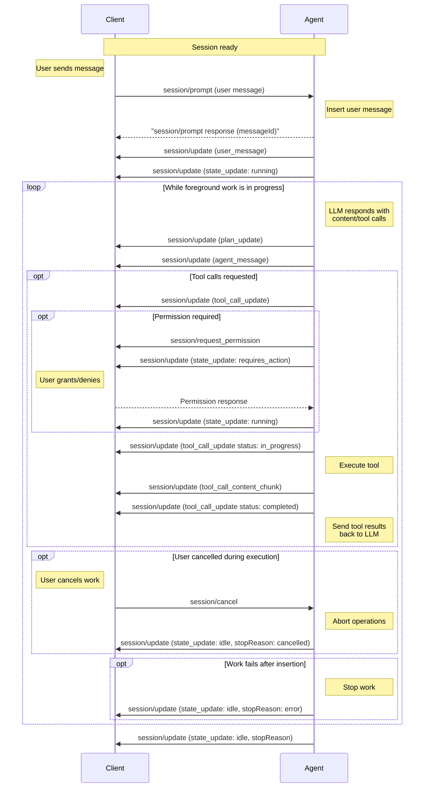

A prompt starts or contributes to [foreground work](#foreground-and-background-work) in a session. Foreground work can also start without a prompt, such as when the Agent follows up on a background task that finished; it reports the same states either way. The [Agent](/protocol/v2/overview#agent) may continue that work until it reports `idle`, including across multiple model exchanges and tool invocations.

`session/prompt` lasts until the Agent inserts the user message into the ACP conversation. This is what acceptance means for a prompt. The response returns that message's `messageId`; the Agent reports its content and placement, foreground state, output, and completion through `session/update` notifications.

Before sending prompts, Clients **MUST** first complete the [initialization](/protocol/v2/initialization) phase and [session setup](/protocol/v2/session-setup).

## Session Updates

Agents send `session/update` notifications to report streamed content, tool activity, and changes to session state. The `sessionUpdate` field inside `params.update` identifies the variant:

| `sessionUpdate` value       | Description                                                                                                                  |
| --------------------------- | ---------------------------------------------------------------------------------------------------------------------------- |
| `user_message_chunk`        | A streamed chunk of a user message.                                                                                          |
| `user_message`              | Creates or updates a user message identified by `messageId`.                                                                 |
| `agent_message_chunk`       | A streamed chunk of the Agent's response.                                                                                    |
| `agent_message`             | Creates or updates an Agent message identified by `messageId`.                                                               |
| `agent_thought_chunk`       | A streamed chunk of the Agent's reasoning.                                                                                   |
| `agent_thought`             | Creates or updates an Agent reasoning message identified by `messageId`.                                                     |
| `state_update`              | A snapshot of the Agent's [foreground activity](#session-states).                                                            |
| `tool_call_content_chunk`   | Appends a [content chunk to a tool call](/protocol/v2/tool-calls#streaming-content).                                         |
| `tool_call_update`          | Creates or updates a [tool call](/protocol/v2/tool-calls#reporting).                                                         |
| `terminal_update`           | Creates or updates an [Agent-owned terminal](/protocol/v2/tool-calls#display-only-terminals).                                |
| `terminal_output_chunk`     | Appends output bytes to an [Agent-owned terminal](/protocol/v2/tool-calls#display-only-terminals).                           |
| `plan_update`               | Creates or updates the [content of a plan](/protocol/v2/agent-plan) identified by ID.                                        |
| `available_commands_update` | The set of [available slash commands](/protocol/v2/slash-commands) is ready or has changed.                                  |
| `config_option_update`      | The session's [configuration options](/protocol/v2/session-config-options#from-the-agent) have changed.                      |
| `session_info_update`       | [Session metadata](/protocol/v2/session-list#updating-session-metadata), such as the title or last update time, has changed. |
| `usage_update`              | The session's [context window usage and cumulative cost](#session-usage-updates).                                            |
| `notice`                    | A live [user-facing notice](#session-notices) that is not part of session history.                                           |
| `compaction_update`         | Creates or updates a [context compaction](#session-compaction).                                                              |
| `compaction_summary_chunk`  | Appends content to a [compaction's retained summary](#session-compaction).                                                   |

This is the complete set of standard variants defined in the current [`SessionUpdate` schema](/protocol/v2/schema#sessionupdate), which describes each payload in detail. The walkthrough below illustrates common uses of these updates.

The protocol also supports [custom and future variants](/protocol/v2/extensibility#enum-and-tagged-union-variants). Clients that do not understand an update should preserve its raw payload when storing, replaying, proxying, or forwarding session history, and otherwise ignore it or display it generically.

Live-only [notices](#session-notices) **SHOULD NOT** be replayed, even when
preserved as unknown updates.

Session updates are not limited to prompt-driven foreground work. For example, Agents may advertise commands after creating a session, and background activity may emit updates while the Agent is [idle](#session-states).

### Entity IDs

Messages, tool calls, terminals, and plans are entities that the Agent creates and then updates by ID across multiple session updates. An entity is identified by its type together with its ID, not by its ID alone:

| Entity type   | Session updates                               | ID field     |
| ------------- | --------------------------------------------- | ------------ |
| User message  | `user_message`, `user_message_chunk`          | `messageId`  |
| Agent message | `agent_message`, `agent_message_chunk`        | `messageId`  |
| Agent thought | `agent_thought`, `agent_thought_chunk`        | `messageId`  |
| Tool call     | `tool_call_update`, `tool_call_content_chunk` | `toolCallId` |
| Terminal      | `terminal_update`, `terminal_output_chunk`    | `terminalId` |
| Plan          | `plan_update`                                 | `planId`     |

An ID is unique among entities of the same type within a session, not across all entity types, so the same string can identify one entity of each type. User messages, Agent messages, and Agent thoughts are separate types even though they share the `messageId` field. For example, an Agent may report a thought and a response derived from the same model output with the same `messageId`; they remain two distinct entities.

The Agent **MUST NOT** reuse an ID for a different entity of the same type within a session. Clients **MUST** key entities by both type and ID. An update applies only to the entity of its own type: an `agent_thought` whose `messageId` matches an existing Agent message creates or updates a thought and leaves the message unchanged. Likewise, a field that references an entity identifies an entity of one specific type; for example, the `messageId` returned by `session/prompt` identifies a user message.

## Foreground and Background Work

**Foreground work** is the Agent's active response or workflow in the session, including model processing, tool execution, and waiting for user action needed to continue that work. The Agent **MUST** treat that work as foreground whether it was started by a user prompt or by the Agent, for example to pursue an ongoing goal, continue earlier work, or act on a completed background task.

**Background activity** runs independently of the active response or workflow. A detached task continuing to run, its progress or completion updates, and session metadata updates do not by themselves start foreground work. If the Agent begins a response or workflow to act on a background result, that work is foreground work.

The same lifecycle requirements apply regardless of what started foreground work:

- When foreground work starts, the Agent **MUST** report `running`, or `requires_action` if the work starts blocked on user action.
- While foreground work is blocked on user action, the Agent **SHOULD** report `requires_action`. Once reported, it **MUST** report `running` when foreground progress resumes.
- When foreground work ends, the Agent **MUST** report `idle`, even if background activity continues, and **SHOULD** include the corresponding [stop reason](#stop-reasons).

Agent-initiated work does not require a `session/prompt` request or a synthetic user message. State updates describe the session's foreground work, not individual model exchanges, tool calls, or prompt requests.

For example, when a background task completes and the Agent starts a follow-up response:

```text
Agent → Client: state_update (running)
Agent → Client: agent_message / tool_call_update / …
Agent → Client: state_update (idle, stopReason: end_turn)
```

In contrast, if the Agent only reports a detached task's progress or completion while idle:

```text
Agent → Client: tool_call_update (in_progress)
Agent → Client: tool_call_update (completed)
Session remains idle; no foreground work started or ended.
```

A permission request or [elicitation](/protocol/v2/elicitation) does not by itself change the foreground state. If it blocks foreground work, the Agent **SHOULD** report `requires_action`. If it belongs only to independent background activity, the session may remain `idle`. Resolving a request does not itself imply `running`: the state changes only if foreground activity changes. See [Waiting for User Action](#waiting-for-user-action) and [Requesting Permission](/protocol/v2/tool-calls#requesting-permission).

## Prompt Lifecycle

A typical prompt-driven flow enables rich interactions between the user, Agent, and any connected tools.

The diagram shows one possible ordering; see [Insertion and ordering](#insertion-and-ordering).

<br />



### 1. User Message

The Client sends a user message with `session/prompt`:

```json
{
  "jsonrpc": "2.0",
  "id": 2,
  "method": "session/prompt",
  "params": {
    "sessionId": "sess_abc123def456",
    "prompt": [
      {
        "type": "text",
        "text": "Can you analyze this code for potential issues?"
      },
      {
        "type": "resource",
        "resource": {
          "uri": "file:///home/user/project/main.py",
          "mimeType": "text/x-python",
          "text": "def process_data(items):\n    for item in items:\n        print(item)"
        }
      }
    ]
  }
}
```

<ParamField path="sessionId" type="SessionId">
    The [ID](/protocol/v2/session-setup#session-id) of the session to send this message to.
</ParamField>
<ParamField path="prompt" type="ContentBlock[]">
    The contents of the user message, e.g. text, images, files, etc.

    Clients **MUST** restrict types of content according to the [Prompt Capabilities](/protocol/v2/initialization#prompt-capabilities) established during [initialization](/protocol/v2/initialization).

    <Card icon="comments" horizontal href="/protocol/v2/content">
      Learn more about Content
    </Card>

</ParamField>

### 2. Prompt Accepted

**Acceptance means insertion**: the Agent has logically added a user message to the ACP conversation, with a `messageId` and a position relative to other messages. Receipt, queueing, and assigning an ID are not insertion.

The Agent **MUST** respond successfully once the message is inserted, without waiting for foreground work to finish, and **MUST NOT** do so before insertion. Once inserted, it **MUST NOT** return an error response, even if failure or [request cancellation](/protocol/v2/cancellation) occurs before the response is sent. It returns the `messageId`; subsequent work outcomes are reported as described in [Failures](#failures) and [Cancellation](#cancellation).

An adapter can use a runtime's user-message echo or insertion event as evidence of insertion. For a [locally handled command](/protocol/v2/slash-commands#running-commands) that the runtime does not record, it can instead insert a live-only ACP user message.

The response contains the inserted user message's agent-generated `messageId`:

```json
{
  "jsonrpc": "2.0",
  "id": 2,
  "result": {
    "messageId": "msg_user_8f7a1"
  }
}
```

<ResponseField name="messageId" type="MessageId" required>
  The opaque ID of the inserted user message. This field is a required, non-null
  string; omission and explicit `null` are invalid.
</ResponseField>

The Agent **MUST** also report the inserted user message through a `user_message` update with the full `content` array or streamed `user_message_chunk` updates. All updates for that message **MUST** use the returned `messageId` and **MUST NOT** precede insertion. Clients **MUST** tolerate the updates arriving before or after the response.

```json
{
  "jsonrpc": "2.0",
  "method": "session/update",
  "params": {
    "sessionId": "sess_abc123def456",
    "update": {
      "sessionUpdate": "user_message",
      "messageId": "msg_user_8f7a1",
      "content": [
        {
          "type": "text",
          "text": "Can you analyze this code for potential issues?"
        }
      ]
    }
  }
}
```

The Client uses the JSON-RPC response ID to identify its submission, then associates it with `(sessionId, messageId)`. If the message update arrived first, the Client reconciles with that existing message rather than creating a duplicate. Agents **MUST** assign distinct message IDs to distinct inserted submissions, even if their content is identical; Clients must not infer the association from content or arrival order.

Insertion is not a promise of durable storage or model consumption. Every inserted input, including a locally handled command, is reported live, but Agents are not required to persist it or retain it for any minimum period. If the message is retained and replayed, the Agent **MUST** use the same ID. See [Resuming Sessions](/protocol/v2/session-setup#resuming-sessions).

A successful prompt response is not an `idle` signal. Session work and notifications continue independently of the completed prompt request. If the response is lost, the submission's outcome remains uncertain: replay may omit live-only or discarded messages, and a retry can create another submission.

The same insertion boundary applies when [closing the session](/protocol/v2/session-setup#closing-active-sessions) cancels a pending prompt: if closing prevents insertion, the request receives `-32800` (Request Cancelled); if the message has already been inserted, it receives a successful `messageId` response. Prompt responses need not precede the close response.

#### Insertion and ordering

`running` reports foreground work, not insertion. It may precede insertion, the prompt response, and user-message updates, for example while a foreground hook runs. It does not acknowledge a pending prompt's insertion.

#### Prompts that are never inserted

If a request is rejected before insertion, including by a hook or early failure, the Agent **MUST** return a JSON-RPC error response and **MUST NOT** emit user-message updates for that submission. [Request cancellation](/protocol/v2/cancellation) before insertion uses `-32800`.

The [foreground lifecycle](#foreground-and-background-work) applies independently of the request outcome: report `idle` when no foreground work remains, not merely because a prompt was rejected. A failed foreground hook can therefore require both a prompt error response and an idle update. If no foreground work started, rejection requires no state transition.

### 3. Agent Reports Output

When foreground work starts, the Agent **MUST** report its active state. Usually
this is a `state_update` notification with `state: "running"`. Work that starts
blocked on user action may report `requires_action` directly. When progress
resumes after a reported `requires_action`, the Agent **MUST** report `running`:

```json
{
  "jsonrpc": "2.0",
  "method": "session/update",
  "params": {
    "sessionId": "sess_abc123def456",
    "update": {
      "sessionUpdate": "state_update",
      "state": "running"
    }
  }
}
```

The language model **MAY** respond with text content, tool calls, or both.

The Agent reports the model's output to the Client via `session/update` notifications. This may include the Agent's plan for accomplishing the task:

```json expandable
{
  "jsonrpc": "2.0",
  "method": "session/update",
  "params": {
    "sessionId": "sess_abc123def456",
    "update": {
      "sessionUpdate": "plan_update",
      "plan": {
        "type": "items",
        "planId": "plan-1",
        "entries": [
          {
            "content": "Check for syntax errors",
            "priority": "high",
            "status": "pending"
          },
          {
            "content": "Identify potential type issues",
            "priority": "medium",
            "status": "pending"
          },
          {
            "content": "Review error handling patterns",
            "priority": "medium",
            "status": "pending"
          },
          {
            "content": "Suggest improvements",
            "priority": "low",
            "status": "pending"
          }
        ]
      }
    }
  }
}
```

<Card icon="lightbulb" horizontal href="/protocol/v2/agent-plan">
  Learn more about Agent Plans
</Card>

The Agent can report the model's text response as an `agent_message` update with the full `content` array:

```json
{
  "jsonrpc": "2.0",
  "method": "session/update",
  "params": {
    "sessionId": "sess_abc123def456",
    "update": {
      "sessionUpdate": "agent_message",
      "messageId": "msg_agent_c42b9",
      "content": [
        {
          "type": "text",
          "text": "I'll analyze your code for potential issues. Let me examine it..."
        }
      ]
    }
  }
}
```

#### Message IDs

The Agent **MUST** include an opaque `messageId` on message updates and message chunks.

User, agent, and thought messages can each be reported either as a message update with a full `content` array or as streamed chunks. `user_message`, `agent_message`, and `agent_thought` updates are upserts keyed by `messageId`: omitted `content` leaves the existing message content unchanged, `content: null` clears it, and concrete `content` arrays replace the previous content. Chunk updates with the same `messageId` append content; a changed `messageId` indicates a new message.

Clients apply message updates and chunks in the order they are received for each `messageId`:

- A message update without `content` leaves the current content unchanged, so Agents can update other optional fields without resending content.
- A message update with `content` replaces all content currently stored for that message, including content accumulated from earlier chunks.
- A message update with `content: []` or `content: null` clears the message content.
- A chunk appends its `content` to whatever content is current for that message, whether that content came from an earlier message update or earlier chunks.
- A message update's top-level `_meta` patches the message's stored metadata by
  top-level key, even when the same update replaces `content`, as described in [Metadata Patches](/protocol/v2/extensibility#metadata-patches). A chunk's `_meta`, when present, is
  chunk-scoped.

For example, if an Agent sends `agent_message` with `content: [A]`, then sends `agent_message_chunk` with `B`, the rendered message content is `[A, B]`. If it later sends another `agent_message` with `content: [C]`, the rendered content becomes `[C]`; the earlier full content and chunks are replaced. Subsequent chunks append to `[C]`.

For streaming agent text, the Agent can use `agent_message_chunk` updates:

```json
{
  "jsonrpc": "2.0",
  "method": "session/update",
  "params": {
    "sessionId": "sess_abc123def456",
    "update": {
      "sessionUpdate": "agent_message_chunk",
      "messageId": "msg_agent_c42b9",
      "content": {
        "type": "text",
        "text": " Let me examine it..."
      }
    }
  }
}
```

The Agent can report internal reasoning with the same message-update or chunk patterns. `agent_thought` updates patch fields for the same thought `messageId`; `agent_thought_chunk` updates append new content.

```json
{
  "jsonrpc": "2.0",
  "method": "session/update",
  "params": {
    "sessionId": "sess_abc123def456",
    "update": {
      "sessionUpdate": "agent_thought",
      "messageId": "msg_thought_a12",
      "content": [
        {
          "type": "text",
          "text": "Need to inspect the loop body before suggesting a fix."
        }
      ]
    }
  }
}
```

If the model requested tool calls, these are also reported immediately:

```json
{
  "jsonrpc": "2.0",
  "method": "session/update",
  "params": {
    "sessionId": "sess_abc123def456",
    "update": {
      "sessionUpdate": "tool_call_update",
      "toolCallId": "call_001",
      "title": "Analyzing Python code",
      "kind": "other",
      "status": "pending"
    }
  }
}
```

#### Session Notices

No Client capability is required in v2. Clients that do not implement `notice`
may preserve it through the [unknown-update
fallback](/protocol/v2/extensibility#enum-and-tagged-union-variants) and
ignore it or present it generically; this does not give it replay semantics.

At any point while a session exists, including outside prompt processing, the
Agent **MAY** send a live user-facing notice:

```json
{
  "jsonrpc": "2.0",
  "method": "session/update",
  "params": {
    "sessionId": "sess_abc123def456",
    "update": {
      "sessionUpdate": "notice",
      "severity": "warning",
      "title": "MCP server unavailable",
      "description": "Continuing without it."
    }
  }
}
```

`severity` is required and non-null and initially supports `info`, `warning`,
and `error`.
It is an open string enum: values beginning with `_` are reserved for
implementation-specific extensions, while other unknown values are reserved
for future ACP severities. Clients preserve unknown values and use a generic
notice presentation without inferring additional behavior from them.

`title` is required, non-null, non-empty plain text suitable for a compact
presentation. `description` is optional, nullable plain text with supporting
detail; omission and `null` both mean no description. `_meta` is an optional,
nullable object scoped to this event; omission and `null` both mean no event
metadata. Unlike compaction patch fields, these fields do not update or clear
an earlier notice.

Clients may ignore them, and Agents must behave as though a
notice may not have been received, displayed, or seen. A notice must not carry
information required for protocol correctness, authorization, user action,
task completion, or fatal-error reporting.

Clients own presentation and dismissal. They may use a toast, banner, inline
status region, notification center, or another accessible surface, and may
coalesce repeated notices. Severity is only a presentation hint; even `error`
does not fail a request, stop foreground work, change session state, or imply a
prompt stop reason. Dismissal is local and produces no acknowledgement or
removal event.

Notices have no ID or Agent-managed lifecycle. Each occurrence is an
independent live event, not conversation history, and **SHOULD NOT** be included
in session replay. If a condition remains relevant after reconnecting, the
Agent may emit a new notice.

#### Session Compaction

No Client capability is required in v2.

The Agent **MAY** report context compaction as one persistent, ID-addressed
timeline entity. A single `compaction_update` with `status: "completed"` is
sufficient; reporting progress is optional. Summary content is also optional.
It may be sent all at once in the `summary` field or streamed using
`compaction_summary_chunk` for the same `compactionId`.

For example, an Agent can report that compaction has started:

```json
{
  "jsonrpc": "2.0",
  "method": "session/update",
  "params": {
    "sessionId": "sess_abc123def456",
    "update": {
      "sessionUpdate": "compaction_update",
      "compactionId": "cmp_001",
      "status": "in_progress"
    }
  }
}
```

`compactionId` and `status` are required and non-null on every
`compaction_update`. The ID is an opaque, Agent-owned string, unique within the
session, and **MUST NOT** be reused for another compaction.

Clients initialize a first-seen compaction ID with status `in_progress` and unset
optional fields, then apply the notification.

The first notification fixes the entity's timeline position in receive
order: it follows previously received timeline content and precedes content
first received later. Later updates and chunks for an ID-addressed entity patch
it in place; they do not move or split it around the compaction.

| `status`      | Meaning                                      |
| ------------- | -------------------------------------------- |
| `in_progress` | Compaction has started and has not finished. |
| `completed`   | Compaction finished successfully.            |
| `failed`      | Compaction finished unsuccessfully.          |
| `cancelled`   | Compaction was cancelled before it finished. |

The Agent **MUST** report a terminal status when a reported compaction ends.

`status` is an open string enum. Values beginning with `_` are reserved for
implementation-specific extensions; other unknown values are reserved for
future ACP statuses. Clients preserve unknown strings and present a generic
state without inferring lifecycle or control behavior.

If the retained summary is available incrementally, the Agent may append one
[content block](/protocol/v2/content) at a time:

```json
{
  "jsonrpc": "2.0",
  "method": "session/update",
  "params": {
    "sessionId": "sess_abc123def456",
    "update": {
      "sessionUpdate": "compaction_summary_chunk",
      "compactionId": "cmp_001",
      "content": {
        "type": "text",
        "text": "## Retained context\n\n"
      }
    }
  }
}
```

`compactionId` and `content` are required and non-null on each chunk.
Chunk `_meta` is optional and nullable, is scoped to that chunk, and has no
patch semantics: omission and `null` both mean no chunk metadata.

An update may omit `summary` to retain the streamed content. A
non-streaming Agent can instead supply the complete summary, and a streaming
Agent can use the same field as an authoritative replacement of content received
so far:

```json
{
  "jsonrpc": "2.0",
  "method": "session/update",
  "params": {
    "sessionId": "sess_abc123def456",
    "update": {
      "sessionUpdate": "compaction_update",
      "compactionId": "cmp_001",
      "status": "completed",
      "summary": [
        {
          "type": "text",
          "text": "## Retained context\n\nThe user is updating the ACP schema."
        }
      ]
    }
  }
}
```

The following `compaction_update` fields are optional, nullable patches:

| Field     | Type             | Meaning                                                                               |
| --------- | ---------------- | ------------------------------------------------------------------------------------- |
| `summary` | `ContentBlock[]` | The unencrypted, user-displayable summary content produced or retained by compaction. |
| `error`   | `string`         | A human-readable error description.                                                   |
| `_meta`   | `object`         | Extensible metadata for the compaction entity.                                        |

For each patch field, omission leaves the stored value unchanged, `null` clears
it, and a concrete value replaces it. On a first-seen ID, omission and `null`
both start with no value. `summary: []` also clears the summary. A `_meta`
object patches the stored metadata by top-level key instead of replacing it;
see [Metadata Patches](/protocol/v2/extensibility#metadata-patches).

Clients apply updates and chunks in receive order for each ID. Chunks append
to the current summary; a concrete `summary` replaces all previously
accumulated content, and any subsequent chunks append to that replacement.
`summary: null` or `summary: []` clears accumulated content, including partial
output before failure or cancellation.

The summary is not the Agent's complete replacement history or generic status
text such as "Compaction completed". It should faithfully represent the
retained, user-displayable summary without internal prompt framing or hidden
instructions. Text blocks may contain Markdown. Agents should omit it when no
unencrypted summary is available or when disclosure would reveal context that
was not otherwise user-visible.

During [history replay](/protocol/v2/session-setup#resuming-sessions),
compaction updates and summary chunks follow the same semantics as live delivery.

Replay does not implicitly reset omitted patch fields. Agents use replacement
or clearing summary patches as needed to avoid duplicating content the Client
already holds.

Compaction does not instruct the Client to discard earlier conversation
history; collapsing it is a local presentation choice. It also does not replace
[`usage_update`](#session-usage-updates), which reports current context-window
utilization and cost rather than a compaction boundary.

#### Session Usage Updates

The Agent **MAY** also report current session context and cumulative cost state with a `usage_update`:

```json
{
  "jsonrpc": "2.0",
  "method": "session/update",
  "params": {
    "sessionId": "sess_abc123def456",
    "update": {
      "sessionUpdate": "usage_update",
      "used": 53000,
      "size": 200000,
      "cost": {
        "amount": 0.045,
        "currency": "USD"
      }
    }
  }
}
```

`used` and `size` are required and non-null token counts for the current session context. `cost` is optional and, if present, `amount` and `currency` are required. `currency` is an ISO 4217 currency code like `"USD"`.

### 4. Report Completion

When foreground work ends, the Agent **MUST** report `idle` with a `state_update` notification and **SHOULD** include the corresponding [`StopReason`](#stop-reasons):

```json
{
  "jsonrpc": "2.0",
  "method": "session/update",
  "params": {
    "sessionId": "sess_abc123def456",
    "update": {
      "sessionUpdate": "state_update",
      "state": "idle",
      "stopReason": "end_turn"
    }
  }
}
```

The Agent **MUST** send any pending updates for the foreground work that ended before sending its idle update. Background activity may continue to emit updates afterward.

Agents **MAY** stop foreground work at any point by sending an idle `state_update` session update. They **SHOULD** include the corresponding [`StopReason`](#stop-reasons).

### 5. Tool Invocation and Status Reporting

Before proceeding with execution, the Agent **MAY** request permission from the Client via the `session/request_permission` method.

While foreground work is blocked on a permission response or other user action, the Agent **SHOULD** report `requires_action`. After reporting it, the Agent **MUST** report `running` when foreground progress resumes, or `idle` if the work ends without resuming. These are aggregate state changes, not updates for each request. See [Waiting for User Action](#waiting-for-user-action). A permission request for independent background activity does not by itself change the foreground state. See [Foreground and Background Work](#foreground-and-background-work).

Once permission is granted (if required), the Agent **SHOULD** invoke the tool and report a status update marking the tool as `in_progress`:

```json
{
  "jsonrpc": "2.0",
  "method": "session/update",
  "params": {
    "sessionId": "sess_abc123def456",
    "update": {
      "sessionUpdate": "tool_call_update",
      "toolCallId": "call_001",
      "status": "in_progress"
    }
  }
}
```

As the tool runs, the Agent **MAY** send additional updates, providing
real-time feedback about tool execution progress. The Agent streams
incremental content items with `tool_call_content_chunk`:

```json
{
  "jsonrpc": "2.0",
  "method": "session/update",
  "params": {
    "sessionId": "sess_abc123def456",
    "update": {
      "sessionUpdate": "tool_call_content_chunk",
      "toolCallId": "call_001",
      "content": {
        "type": "content",
        "content": {
          "type": "text",
          "text": "Checked syntax..."
        }
      }
    }
  }
}
```

Clients append each `tool_call_content_chunk` to the current content for that `toolCallId`. A later `tool_call_update` with `content` replaces the accumulated content.

Display-only terminal bytes use `terminal_output_chunk`, not
`tool_call_content_chunk`. See [Display-only
Terminals](/protocol/v2/tool-calls#display-only-terminals) for their
per-terminal byte ordering and snapshot semantics.

Tools execute on the Agent. Clients may expose tools through MCP servers supplied during session setup. v2 does not define Client file-system or terminal-execution capabilities. Client interactions such as elicitation remain subject to their own negotiated capabilities.

When the tool completes, the Agent sends another update with the final status and any content:

```json
{
  "jsonrpc": "2.0",
  "method": "session/update",
  "params": {
    "sessionId": "sess_abc123def456",
    "update": {
      "sessionUpdate": "tool_call_update",
      "toolCallId": "call_001",
      "status": "completed",
      "content": [
        {
          "type": "content",
          "content": {
            "type": "text",
            "text": "Analysis complete:\n- No syntax errors found\n- Consider adding type hints for better clarity\n- The function could benefit from error handling for empty lists"
          }
        }
      ]
    }
  }
}
```

<Card icon="hammer" horizontal href="/protocol/v2/tool-calls">
  Learn more about Tool Calls
</Card>

### 6. Continue Conversation

The Agent sends the tool results back to the language model as another request.

The cycle returns to [step 3](#3-agent-reports-output), continuing until the language model completes its response without requesting additional tool calls or foreground work is stopped by the Agent or cancelled by the Client.

## Stop Reasons

When an Agent stops foreground work, it **SHOULD** specify the corresponding `StopReason` on an idle `state_update` session update. If the Agent knows it is idle but cannot determine why the work stopped, it may omit the stop reason. Clients **MUST** recognize `idle` as the end of foreground work even when the stop reason is omitted, `null`, malformed, or unknown; without a recognized stop reason, Clients cannot infer how the work ended.

<ResponseField name="end_turn">
  The Agent has finished foreground work, including a locally handled command
  that required no model call.
</ResponseField>

<ResponseField name="max_tokens">
  The maximum token limit is reached
</ResponseField>

<ResponseField name="max_turn_requests">
  The maximum number of model requests for the foreground work is exceeded
</ResponseField>

<ResponseField name="refusal">The Agent refuses to continue</ResponseField>

<ResponseField name="cancelled">The Client cancels active work</ResponseField>

<ResponseField name="error">
  Foreground work ended because something failed. See [Failures](#failures).
</ResponseField>

Custom or future stop reasons can be used when Clients can display a generic stopped state. Custom stop reasons **MUST** begin with `_`; unknown non-underscore stop reasons are reserved for future ACP variants.

## Failures

When foreground work ends because something failed, the Agent **MUST** report `idle` and **SHOULD** include the `error` stop reason. This includes pre-insertion work and failures before any model output. The prompt's response still follows the [insertion boundary](#2-prompt-accepted). This stop reason carries the failure in an `error` field beside `stopReason`, which the Agent **SHOULD** include:

```json
{
  "jsonrpc": "2.0",
  "method": "session/update",
  "params": {
    "sessionId": "sess_abc123def456",
    "update": {
      "sessionUpdate": "state_update",
      "state": "idle",
      "stopReason": "error",
      "error": {
        "code": -32000,
        "message": "Authentication required"
      }
    }
  }
}
```

<ResponseField name="error" type="Error">
  The failure that ended foreground work, as a JSON-RPC error object with
  required `code` and `message` and optional `data`. Optional and nullable:
  omission and `null` both mean the Agent supplied no failure details.
</ResponseField>

`error` belongs to the `error` stop reason; beside any other stop reason it is an unknown field. Clients may show `message` to the user and can handle `code` as they would for an error response: for example, `-32000` (authentication required) can prompt the user to authenticate before sending another prompt.

Before reporting the failure, the Agent **SHOULD** give each tool call that the failed work left unfinished a terminal status, using `failed` for calls that did not complete. A failure does not undo the insertion or any side effects the work already had, such as tools that ran. Sending the prompt again submits a new message.

The `error` stop reason is only for failures that end foreground work:

- A failure before the user message is inserted requires a JSON-RPC error response to `session/prompt`, whether or not it also ends foreground work.
- A failure the Agent recovers from while work continues, such as a retried model request or a failed tool call, is reported with a [notice](#session-notices) or a tool call whose status is `failed`, and does not change the state.
- Errors raised while aborting cancelled work are reported with the `cancelled` stop reason, as described in [Cancellation](#cancellation).
- A failure in background activity while the Agent is `idle` is not a stop reason, since no foreground work ended.

Clients detect a lost connection or an exited Agent process themselves; no update can report them.

## Session States

`state_update` is a snapshot of the session's aggregate foreground activity,
whether or not a prompt started it. It is not an event for an individual prompt,
model call, permission request, or elicitation.

<ResponseField name="running">Foreground work is in progress.</ResponseField>

<ResponseField name="idle">
  No foreground work is active. Background activity may continue.
</ResponseField>

<ResponseField name="requires_action">
  Foreground work is blocked on user action.
</ResponseField>

Background activity **MAY** continue and emit other `session/update` notifications while the Agent reports `idle`. These notifications do not change the state.

### Initial State and Synchronization

New sessions default to `idle` until a state update reports otherwise. State
updates may arrive before or after the `session/new` response. Clients
**MUST NOT** overwrite an already-reported state when the response arrives.
A separate initial idle notification is optional and does not represent completion.

`session/resume` does not imply `idle`. The Agent **MUST** send a snapshot of
foreground state after resuming, following any requested history replay and
before the successful resume response, even when no replay was requested.
Clients **MUST**
use that snapshot rather than infer activity from the response or replayed
content. See [Current-State Synchronization](/protocol/v2/session-setup#current-state-synchronization)
for ordering and pending interactions.

### State Transitions

The table describes live state reporting between the three standard states.
Initial or resume snapshots report the current state without implying a
transition.

| Current state                  | Condition                                                            | Next report                                                                |
| ------------------------------ | -------------------------------------------------------------------- | -------------------------------------------------------------------------- |
| `idle`                         | Foreground work starts                                               | **MUST** report `running`, or `requires_action` if the work starts blocked |
| `running`                      | Foreground work cannot progress without user action                  | **SHOULD** report `requires_action`                                        |
| `requires_action`              | Foreground progress resumes                                          | **MUST** report `running`                                                  |
| `running` or `requires_action` | All foreground activity ends                                         | **MUST** report `idle`                                                     |
| Any                            | Only independent background activity or an unrelated request changes | Unchanged                                                                  |
| Any                            | The current state is reported again                                  | Unchanged (idempotent snapshot)                                            |

`requires_action` is only for blocked foreground work. An outstanding request
alone does not justify it, but foreground work that starts blocked may report
it directly without an artificial `running` first.

Agents **MAY** repeat current-state snapshots. Clients **MUST** apply them
idempotently: repeats do not start new work, end additional work, or add usage
again. Repeated or resume idle snapshots may carry the last stop reason for
context, without creating a new completion or cancellation.

A repeated state may carry updated information. Applying that information does
not constitute another state transition.

When an idle transition ends work, the Agent **SHOULD** include its stop reason,
and **MUST** use `cancelled` when confirming foreground cancellation.

### Waiting for User Action

`requires_action` means the foreground workflow as a whole is blocked on user
action. The session remains `running` if other foreground work can
still progress, even if some permission requests or elicitations are pending.
Clients present those requests independently of the aggregate state.

With several outstanding requests, opening or resolving a request does not
itself cause a transition. Once `requires_action` is reported, the Agent
**MUST** report `running` when progress resumes, even if other requests remain
outstanding, or `idle` if the work ends without resuming. While still blocked,
answering one request does not imply `running`. Declining or cancelling a
request may lead to resumed work, a fallback, or completion.

Agents **SHOULD** ignore responses for work that has already ended rather than
use them to resume that work.

### Work Boundaries and Local Commands

When no foreground activity remains, the Agent **MUST** report `idle`. If
another foreground interval then begins, it reports an active state again,
even when the next interval starts immediately. Consecutive completed turns
therefore have an idle boundary, not a continuous `running` state. Completing
an individual prompt, command, or tool call while other foreground activity
continues does not require an idle boundary. This does not require Agents to
support prompts while work is active.

Handling an accepted prompt, including a local slash command that performs no
model work, **MUST** use the foreground lifecycle. A local command handled from
idle with no user-action wait uses `running` → `idle` and **SHOULD** use
`end_turn` for successful completion. Neither the prompt response nor output
notifications substitute for state updates. Foreground work may precede
insertion. See [Insertion and ordering](#insertion-and-ordering).

### Lifecycle Examples

These examples illustrate the lifecycle. Blocked-state examples assume the Agent
follows the recommendation to report `requires_action`. Start, resume-from-blocked,
and completion updates are required. Normal completion stop reasons are
recommended, and the cancellation stop reason is required.

The same rules apply to permissions and both elicitation modes. In URL mode,
an `accept` response leaves `requires_action` unchanged while the user still
needs to finish the external interaction. Late answers may arrive after work
ends, including during a later foreground workflow. An idle snapshot on resume
may carry a previous stop reason without creating another completion.

| Scenario                                                       | Expected trace or invariant                                                                                                         |
| -------------------------------------------------------------- | ----------------------------------------------------------------------------------------------------------------------------------- |
| New session                                                    | Default `idle` unless a state update reports otherwise. The response does not overwrite an already-reported state                   |
| Resume with running foreground work                            | Replay, if requested → current `running` snapshot → resume response. The snapshot reports activity after resuming                   |
| Resume during blocked work                                     | Current `requires_action` snapshot → resume response                                                                                |
| Foreground work starts blocked                                 | `requires_action` → `running` when progress resumes → `idle` when work ends. No preliminary `running` required                      |
| Two completed turns                                            | `running` → `idle(end_turn)` → `running` → `idle(end_turn)`                                                                         |
| Local command from idle                                        | Prompt insertion → `running` → local handling → `idle(end_turn)`, even without a model call                                         |
| Background permission or elicitation while idle                | Request and response. State remains `idle` unless foreground work actually starts                                                   |
| Two requests block all foreground work                         | `running` → `requires_action`. Answering one leaves `requires_action` if still blocked. Report `running` only when progress resumes |
| A pending request while other foreground work progresses       | Remain `running` and display the request independently                                                                              |
| A local command finishes while other foreground work continues | Remain active with no idle boundary for the individual command                                                                      |
| Cancellation while blocked                                     | `requires_action` → cancellation cleanup → `idle(cancelled)`. After completion, late answers should not resume that work            |
| Repeated snapshot                                              | `running, running` or `idle, idle` has one logical state, not two work intervals or completions                                     |
| Same state with updated information                            | Apply the updated information without another state transition or completion                                                        |
| Resume idle with an old `cancelled` stop reason                | Synchronize idle without cancelling a newer URL interaction or creating another cancellation event                                  |
| Cancellation while idle                                        | No additional completion update is required                                                                                         |

## Cancellation

Clients **MAY** cancel active session work at any time by sending a `session/cancel` notification:

```json
{
  "jsonrpc": "2.0",
  "method": "session/cancel",
  "params": {
    "sessionId": "sess_abc123def456"
  }
}
```

If the Agent cancels a prompt request before insertion, it answers that request with `-32800` as described in [request cancellation](/protocol/v2/cancellation). Once the message is inserted, the prompt request still succeeds with its `messageId`; cancellation does not undo that insertion.

The Client **SHOULD** preemptively mark all non-finished tool calls pertaining to the current active work as `cancelled` as soon as it sends the `session/cancel` notification.

The Client **MUST** respond to pending `session/request_permission` requests in
the cancelled session with the `cancelled` outcome. Requests already answered
do not require another response. For selective cancellation of related
elicitation requests, see [Elicitation Cancellation](/protocol/v2/elicitation#session-cancellation).

When the Agent receives this notification, it **SHOULD** stop all language model requests and all tool call invocations as soon as possible.

A response can race with `session/cancel` before cancellation completes. After
cancellation completes, the Agent **SHOULD** ignore late responses or external
URL completions rather than use them to resume the cancelled work.

After all ongoing operations have been successfully aborted and pending updates
have been sent, the Agent **MUST** send an idle `state_update` session update
with the `cancelled` [stop reason](#stop-reasons) if foreground work was active
when cancellation took effect. Cancellation can finish without receiving
answers to abandoned user-action requests.

If no foreground work was active when cancellation took effect, no additional
completion update is required. Pending requests or background operations can
still be cancelled without a foreground transition.

<Warning>
  API client libraries and tools often throw an exception when their operation is aborted, which may otherwise be surfaced as a generic failure.

Clients often display unrecognized errors from the Agent to the user, which would be undesirable for cancellations as they aren't considered errors.

Agents **MUST** catch these errors and report the semantically meaningful `cancelled` stop reason, not `error`, on a `state_update` notification, so that Clients can reliably confirm the cancellation.

</Warning>

The Agent **MAY** send `session/update` notifications with content or tool call updates after receiving the `session/cancel` notification, but it **MUST** ensure that it does so before sending the idle `state_update` session update that reports cancellation.

The Client **SHOULD** still accept tool call updates received after sending `session/cancel`.

---

After the Agent reports `idle`, the Client may send another `session/prompt` to continue the conversation, building on the established session context.
