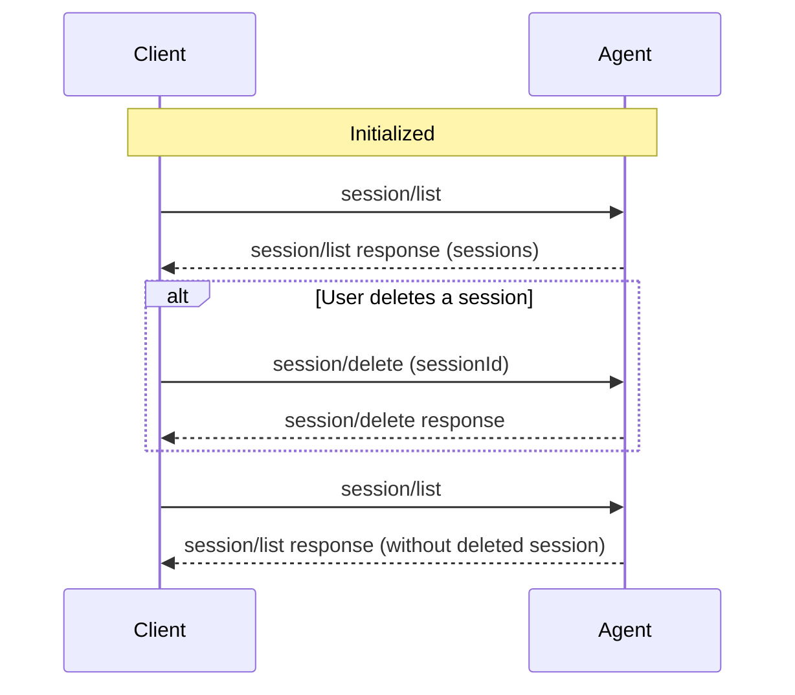

The `session/delete` method lets Clients remove sessions from an Agent's `session/list` results, so users can clean up session history from any ACP Client.

Before deleting sessions, Clients **MUST** first complete the [initialization](/protocol/v2/initialization) phase and verify the Agent supports this capability.

<br />



<br />

## Checking support

Before attempting to delete a session, Clients **MUST** verify that the Agent supports this capability by checking the `session.delete` field in the `initialize` response:

```json highlight={7-9}
{
  "jsonrpc": "2.0",
  "id": 0,
  "result": {
    "protocolVersion": 2,
    "capabilities": {
      "session": {
        "delete": {}
      }
    },
    "info": {
      "name": "my-agent",
      "title": "My Agent",
      "version": "1.0.0"
    }
  }
}
```

If `session.delete` is omitted or `null`, the Agent does not support deleting sessions and Clients **MUST NOT** attempt to call `session/delete`. Supplying `{}` means the Agent supports the method.

## Deleting a session

Clients delete a session by calling `session/delete` with the session ID to remove from session history:

```json
{
  "jsonrpc": "2.0",
  "id": 3,
  "method": "session/delete",
  "params": {
    "sessionId": "sess_abc123def456"
  }
}
```

<ParamField path="sessionId" type="SessionId" required>
  Unique identifier for the session to delete.
</ParamField>

On success, the Agent returns an empty result:

```json
{
  "jsonrpc": "2.0",
  "id": 3,
  "result": {}
}
```

## Semantics

- Deleted sessions no longer appear in future `session/list` results.
- Deleting an already-deleted session, or a session that never existed, **SHOULD** succeed silently.
- Clients **SHOULD** treat a `-32002` response to `session/delete` as a successful delete.
- Agents may implement soft delete or hard delete. ACP only specifies the user-facing session-list behavior.
- Later requests for a deleted session, including `session/resume`, fail with `-32002`. See [Unknown Sessions](/protocol/v2/error#unknown-sessions).
- If the session is active on any connection, the Agent **MUST** cancel its ongoing work and free its resources as if [`session/close`](/protocol/v2/session-setup#closing-active-sessions) had been called, then delete it.
