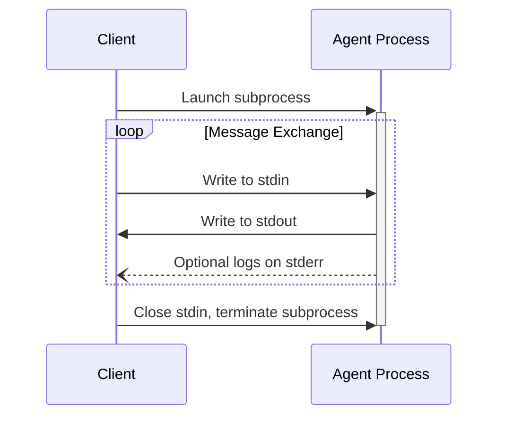

ACP uses JSON-RPC to encode messages. JSON-RPC messages **MUST** be UTF-8 encoded.

The protocol currently defines one transport mechanism for agent-client communication: [stdio](#stdio), communication over standard in and standard out. A remote transport based on Streamable HTTP is being specified in the [transport RFD](/rfds/streamable-http-websocket-transport).

Agents and clients **SHOULD** support stdio whenever possible.

It is also possible for agents and clients to implement [custom transports](#custom-transports).

## stdio

In the **stdio** transport:

- The client launches the agent as a subprocess.
- The agent reads JSON-RPC messages from its standard input (`stdin`) and sends messages to its standard output (`stdout`).
- Each message is a single JSON-RPC request, notification, or response object.
- Messages are delimited by newlines (`\n`), and **MUST NOT** contain embedded newlines.
- The agent **MAY** write UTF-8 strings to its standard error (`stderr`) for logging purposes. Clients **MAY** capture, forward, or ignore this logging.
- The agent **MUST NOT** write anything to its `stdout` that is not a valid ACP message.
- The client **MUST NOT** write anything to the agent's `stdin` that is not a valid ACP message.

### Shutdown

To end the connection, the Client closes the Agent's `stdin`. The Agent treats end of input as the end of the connection: its sessions stop being [active](/protocol/v2/session-setup#session-lifecycle), and it **SHOULD** exit once it has finished or stopped its work. If the Agent does not exit within a reasonable time, the Client **MAY** terminate the process, for example with `SIGTERM` and then `SIGKILL`.

When the connection ends, either side treats requests it sent that have no response as failed.

## Message Timing

After the `initialize` exchange completes successfully, Agents **MAY** send
requests and notifications at any time: between Client requests, before a
pending response, or after a response. Clients **MUST** be
prepared to handle these messages independently of the responses they are
awaiting, including when no Client request is pending.

This permission does not override capability requirements or method-specific
lifecycle and ordering rules. For example, session-scoped messages still
require a valid session.

## Message Order

Transports **MUST** deliver messages in the order they were sent. Receivers
**MUST** apply a session's `session/update` notifications in the order they are
received.

## No Batches

ACP does not use JSON-RPC 2.0 batches. Senders **MUST NOT** send a JSON array of messages, and receivers reject one with a single `-32600` (Invalid Request) response with `id: null`.

## Custom Transports

Agents and clients **MAY** implement additional custom transport mechanisms to suit their specific needs. The protocol is transport-agnostic and can be implemented over any communication channel that supports bidirectional message exchange.

Implementers who choose to support custom transports **MUST** ensure they preserve the JSON-RPC message format, message order, and lifecycle requirements defined by ACP. Custom transports **SHOULD** document their specific connection establishment and message exchange patterns to aid interoperability. A transport **MAY** add its own requirements, such as reconnection, keepalive, or stream resumption, provided it doesn't change the messages ACP defines.
