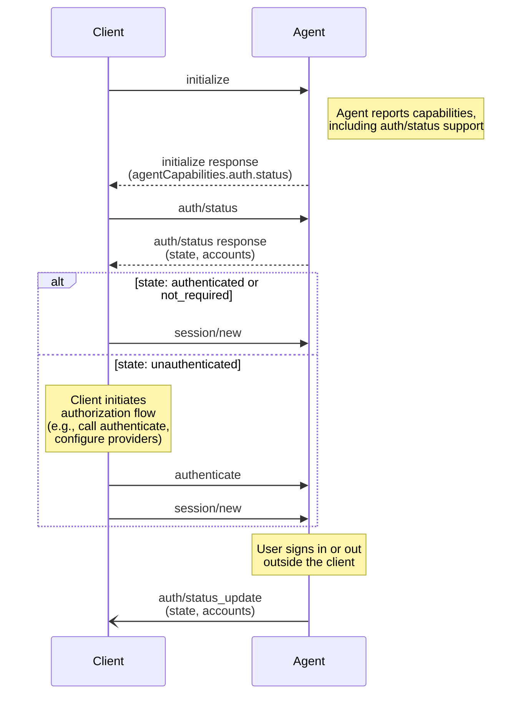

- Author(s): [@xtmq](https://github.com/xtmq)
- Champion: [@benbrandt](https://github.com/benbrandt)

## Elevator pitch

> What are you proposing to change?

Add an `auth/status` method, an `auth/status_update` notification, and a corresponding capability that let clients query and follow the agent's current authentication state. This lets clients determine whether the agent is already configured with credentials or requires authorization before creating a session, without relying on the ambiguous error behavior of `session/new`, and show which account or credentials the agent is using.

## Status quo

> How do things work today and what problems does this cause? Why would we change things?

Currently, there is no dedicated way for a client to determine whether an agent has valid authentication configured. The typical workaround is:

1. Call `initialize`
2. Call `session/new`
3. If the agent has no credentials, it _may_ return an authorization error
4. The client handles the error and initiates an authorization flow

This approach has significant problems:

- **Unreliable detection**: The `session/new` method is not required by the specification to check authorization. Some agents validate credentials eagerly, others do so lazily (e.g., on the first LLM call). The client cannot rely on `session/new` to consistently surface auth issues.
- **Wasted resources**: Creating a session only to discard it on auth failure is wasteful, especially if session creation has side effects (resource allocation, logging, history file creation, etc.).
- **Poor user experience**: The client cannot proactively guide the user through authorization before session creation. Instead, users encounter errors mid-flow.

## Shiny future

> How will things play out once this feature exists?

Clients will be able to:

1. Discover whether an agent supports auth state queries via capabilities during initialization
2. Query the agent's current authentication state immediately after initialization
3. Make an informed decision about whether to proceed with session creation, initiate an authorization flow, or configure providers (e.g., through the providers API)
4. Provide clear, proactive UX — e.g., showing a "Sign in" prompt before any session is created
5. Completely skip authentication process if the agent is already authenticated
6. Show which credentials and accounts the agent is using, including agents that hold credentials for several providers, and keep that display current when the user signs in or out outside the client

## Implementation details and plan

> Tell me more about your implementation. What is your detailed implementation plan?

### Intended flow

The client calls `initialize`, inspects capabilities to confirm `auth/status` support, then queries auth state before deciding how to proceed.



1. **Initialization**: The client calls `initialize`. The agent responds with capabilities, including `auth/status` support via `agentCapabilities.auth`.
2. **Auth state query**: The client calls `auth/status`. The agent inspects its local configuration, stored credentials, or environment to determine the current auth state.
3. **Client-side decision**: Based on the response, the client either proceeds to session creation or initiates an authorization flow first.
4. **Change notifications**: When the agent notices its authentication state changed, for example after `authenticate`, `logout`, or a sign-in in another terminal, it sends `auth/status_update` with the new state.

### Capability advertisement

The agent advertises support for the `auth/status` method via the existing `auth` capability in `agentCapabilities`:

```typescript
interface AgentAuthCapabilities {
  // ... existing fields (e.g., logout) ...

  /**
   * Auth status query support.
   * Omitted or `null` means the agent does not advertise support.
   * Supplying `{}` means the agent supports the auth/status method
   * and may send auth/status_update notifications.
   */
  status?: AuthStatusCapabilities | null;
}

interface AuthStatusCapabilities {
  /** Extension metadata */
  _meta?: Record<string, unknown>;
}
```

**Initialize Response example:**

```json
{
  "jsonrpc": "2.0",
  "id": 0,
  "result": {
    "protocolVersion": 1,
    "agentInfo": {
      "name": "MyAgent",
      "version": "2.0.0"
    },
    "agentCapabilities": {
      "auth": {
        "status": {}
      },
      "sessionCapabilities": {}
    }
  }
}
```

### `auth/status` method

A method that can be called after initialization to query the agent's current authentication status.

```typescript
interface AuthStatusRequest {
  /** Extension metadata */
  _meta?: Record<string, unknown>;
}

interface AuthStatusResponse {
  /**
   * Whether the agent can start sessions without the user signing in first.
   * The only field clients act on. Clients MUST treat values they do not
   * recognize as "unknown".
   */
  state: AuthState;

  /**
   * The accounts the agent has configured, for display.
   * Omitted and empty are equivalent.
   */
  accounts?: AuthAccount[];

  /** Extension metadata */
  _meta?: Record<string, unknown>;
}

/**
 * - "authenticated": credentials are configured (validity is not guaranteed)
 * - "unauthenticated": the user needs to sign in; includes missing, expired,
 *   or known-invalid credentials
 * - "not_required": no authentication is needed, e.g. a local model
 * - "unknown": the agent cannot currently determine the state
 * Values beginning with `_` are reserved for implementation-specific
 * extensions. Other unknown values are reserved for future ACP variants.
 */
type AuthState =
  "authenticated" | "unauthenticated" | "not_required" | "unknown" | string;

/**
 * An account or credential the agent has configured, such as a signed-in
 * user account or an API key. Display information only.
 */
interface AuthAccount {
  /** e.g. "Claude Max", "OpenAI API key", "Vertex AI" */
  label: string;
  /**
   * Whether the agent currently uses this account by default.
   * Several accounts may be active, for example one per provider.
   */
  active?: boolean | null;
  /** Display name of the user, such as a username or full name */
  name?: string | null;
  email?: string | null;
  /** Organization, team, or workspace the account is using */
  organization?: string | null;
  _meta?: Record<string, unknown>;
}
```

Optional fields treat omitted and `null` the same way: the value is not reported. `state` is required and strict, because clients act on it. Everything in `accounts` is display information, so a receiver ignores a malformed value, or skips a malformed entry, instead of rejecting the message.

### `auth/status_update` notification

A notification the agent sends when its authentication status changes. It carries the same fields as `AuthStatusResponse`, as a full snapshot rather than a diff.

```typescript
interface AuthStatusUpdateNotification {
  state: AuthState;
  accounts?: AuthAccount[];
  _meta?: Record<string, unknown>;
}
```

#### Example Exchange

**auth/status Request:**

```json
{
  "jsonrpc": "2.0",
  "id": 1,
  "method": "auth/status",
  "params": {}
}
```

**auth/status Response (single signed-in account):**

```json
{
  "jsonrpc": "2.0",
  "id": 1,
  "result": {
    "state": "authenticated",
    "accounts": [
      {
        "label": "Claude Max",
        "active": true,
        "email": "user@example.com",
        "organization": "Example Inc."
      }
    ]
  }
}
```

**auth/status Response (several providers):**

```json
{
  "jsonrpc": "2.0",
  "id": 1,
  "result": {
    "state": "authenticated",
    "accounts": [
      {
        "label": "OpenAI API key",
        "active": true
      },
      {
        "label": "Vertex AI"
      },
      {
        "label": "GitHub Copilot",
        "name": "octocat"
      }
    ]
  }
}
```

**auth/status Response (unauthenticated):**

```json
{
  "jsonrpc": "2.0",
  "id": 1,
  "result": {
    "state": "unauthenticated"
  }
}
```

**auth/status_update Notification (switched to a gateway):**

```json
{
  "jsonrpc": "2.0",
  "method": "auth/status_update",
  "params": {
    "state": "authenticated",
    "accounts": [
      {
        "label": "Custom model gateway",
        "active": true
      }
    ]
  }
}
```

#### Behavior

1. **Capability advertisement**: The agent SHOULD include `auth.status` in `agentCapabilities` if it supports the `auth/status` method. Clients MUST check for this capability before calling the method.

2. **Timing**: The `auth/status` method MUST be callable after `initialize`. It MAY be called multiple times (e.g., after `authenticate`, to re-check state).

3. **Local checks preferred**: The agent MAY determine auth state from locally available information (config files, environment variables, stored tokens) or by making external API calls. Agents SHOULD keep `auth/status` fast; if a check would block, they SHOULD answer `unknown` and send `auth/status_update` once the check completes. `authenticated` means credentials are present, NOT that they are guaranteed to be valid.

4. **No side effects**: Calling `auth/status` MUST NOT modify any agent state. It is a pure query.

5. **Overall state**: The top-level `state` describes whether the agent can start a session with its default configuration without the user signing in. Agents with several accounts report `authenticated` if the accounts in effect are usable, even if others are not.

6. **Unknown state**: Agents SHOULD return `unknown` rather than guessing when they cannot determine their state. Clients MUST treat unrecognized `state` values as `unknown`, and MAY proceed to `session/new` and handle an `auth_required` error as they do today.

7. **Accounts list**: `accounts` is for display only. Clients MUST NOT use it to decide whether to authenticate. Agents SHOULD list the accounts and credentials they have configured, including API keys, and SHOULD mark the ones in effect with `active: true`. Several accounts MAY be active, for example one per provider. Accounts that are missing or need sign-in are not listed; the top-level `state` reports whether the user needs to sign in. Agents MUST NOT include secrets. Clients MUST NOT use `accounts` entries or their fields, such as `email`, as stable account identifiers, because they can change or be missing. Clients SHOULD NOT log these fields or send them anywhere else, such as telemetry; they are sent only for display.

8. **Agent-owned credentials only**: `accounts` lists credentials the agent itself holds, not provider configuration the client supplied. How client-supplied providers affect the top-level `state` is left open; see the FAQ.

9. **Change notifications**: Agents that advertise `auth.status` MAY send `auth/status_update` at any time after `initialize`, and SHOULD send it when their status changes, including after `authenticate` or `logout`. Agents SHOULD only send it when the reported status differs from the last one sent on the connection. The notification is connection-scoped, never per session.

## Frequently asked questions

> What questions have arisen over the course of authoring this document?

### Why not rely on `session/new` errors?

The `session/new` method is designed for session creation, not for auth validation. Per the specification, agents are not required to validate credentials during session creation — some agents defer validation to the first actual LLM call. This means a successful `session/new` does not guarantee the agent is authenticated, and a failed `session/new` may fail for reasons unrelated to authentication. A dedicated method provides a clear, unambiguous signal.

### Why not include auth state in the `initialize` response directly?

The `initialize` response contains capabilities — what the agent _supports_. Auth state is runtime information — what the agent _currently has configured_. Mixing these concerns would make `initialize` less predictable. Additionally, auth state may change after initialization (e.g., after signing in or configuring providers), and a separate method allows re-querying.

### Why not just check for the presence of environment variables on the client side?

Agents may obtain credentials from many sources: config files, keychains, OAuth tokens, environment variables, or even embedded keys. The client has no visibility into these mechanisms. Only the agent knows whether it has usable credentials configured.

### Why report accounts, after removing auth details earlier?

An earlier version tried to report state per auth method, or which auth method was used. That mapping is ambiguous: one auth flow can produce several credential types (for example, a browser login that results in an API key).

`accounts` describes what the agent has configured, without referring to `authMethods`, and is display information only. Clients still decide what to do from `state` alone. Accounts have no state of their own: nothing links an account to an auth method, so a client could not act on a per-account state, and an empty list could not distinguish `not_required`, `unauthenticated`, and `unknown`.

The shape is based on a survey of how agents and adjacent tools report auth status:

- About half of the agents in the ACP registry hold credentials for several providers at once (for example opencode, goose, cline, Kimi, and pi), and some allow several accounts per provider with one active. A list with an `active` marker covers these as well as single-account agents. CLIs that started with a single account, such as `gh auth status`, later had to add a list.
- Credential kinds, account plans, and credential sources also appear in most agents, but each defines them differently, so they are left to `label` and `_meta` rather than standardized.
- Each entry is called an account even when it is an API key, following VS Code's authentication API, `gcloud auth list`, `az account list`, and `gh auth status`, which all list non-person credentials such as service accounts and tokens as accounts.
- Existing extensions already report similar data: Junie and the Claude and Codex adapters push an `_auth/status_update` notification, and mistral-vibe answers an `auth/status` extension request.
- Fields that are vendor-specific, require network calls, or that no agent reliably exposes to clients are left out: quota and credits, expiry timestamps, and scopes. They can be carried in `_meta`.

### Why add a notification instead of only a query?

Authentication can change without the client doing anything: the user can sign in or out in another terminal, or a token can expire. Without a notification, clients have to poll `auth/status` or show an out-of-date state. The notification reuses the response shape as a full snapshot, so clients can query once after `initialize` and then replace their state with each update.

### Why not use a boolean for the state?

A boolean can't express two cases agents report today. Agents that run local models need no authentication at all, so clients should hide sign-in rather than show "signed in". And an agent cannot always tell its state: a probe can time out or fail. `not_required` and `unknown` cover these. Expired or invalid credentials are reported as `unauthenticated`, since the client's response is the same: ask the user to sign in.

### How does this relate to the providers API?

The two are complementary. `auth/status` reports credentials the agent owns, while the providers API lets the client supply its own routing and credentials. A client could show the agent's signed-in account and also offer to route through the user's own key or gateway.

How they interact is left open while the providers API is being reworked. In particular, this proposal does not yet say whether client-supplied providers count toward the top-level `state`, or whether accounts should reference provider identifiers. Both can be specified once the providers API settles, without breaking this shape.

### Can auth state differ per session or working directory?

Not in this proposal. Authentication in ACP is connection-wide: `authenticate` and `logout` take no session or working directory. Credentials that depend on the project, such as a project-level configuration, are resolved when the session is created and surface through `session/new`.

For agents where the credential in use depends on the session's model or provider, `accounts` lists all of them and `active` marks the ones the agent uses by default, which may be one per provider. A per-session view, for example a `session/update` variant, could be added later if clients need it. An optional `cwd` parameter could be added to `auth/status` later without breaking existing implementations.

## Revision history

- 2026-10-29: Replace `authenticated` and `message` with `state` and a minimal `accounts` list (`label`, `active`, `name`, `email`, `organization`), based on a survey of agent auth models; add the `auth/status_update` notification
- 2026-10-29: Advertise `auth.status` as a capability object (`{}`) instead of a boolean, matching other method capabilities
- 2026-07-21: Accepted as a Draft RFD
- 2026-03-15: Remove `authMethods` from the proposal and keep aggregate auth state only (`authenticated` + optional `message`)
- 2026-03-10: Rename `getAuthState` to `auth/status`, nest capability under `agentCapabilities.auth`
- 2026-03-07: Address review feedback on auth state structure
- 2026-03-05: Initial draft — preliminary proposal to start discussion
