Author(s): [nikomatsakis](https://github.com/nikomatsakis)

## Elevator pitch

> What are you proposing to change?

Enable a universal agent extension mechanism via ACP proxies, components that sit between a client and an agent. Proxies can intercept and transform messages, enabling composable architectures where techniques like context injection, tool coordination, and response filtering can be extracted into reusable components.

## Status quo

> How do things work today and what problems does this cause? Why would we change things?

The AI agent ecosystem has developed many extension mechanisms: AGENTS.md files, Claude Code plugins, rules files, hooks, MCP servers, etc. Of these, only MCP servers have achieved real standardization across the ecosystem.

However, MCP servers are fundamentally limited because they sit "behind" the agent. They can provide tools and respond to function calls, but they cannot:

- **Inject or modify prompts** before they reach the agent
- **Add global context** that persists across conversations
- **Transform responses** before they reach the user
- **Coordinate between multiple agents** or manage conversation flow

As a result, valuable techniques like context management and response processing remain locked within individual agent implementations, with no way to extract and reuse them across different agents.

## What we propose to do about it

> What are you proposing to improve the situation?

We propose implementing _agent extensions_ via ACP _proxies_, a new kind of component that sits between the client and the agent, forwarding (and potentially altering or introducing) messages. Because proxies can do anything a client could do, they serve as a universal extension mechanism that can subsume AGENTS.md, hooks, MCP servers, etc.

Proxies are limited to the customizations exposed by ACP itself, so they would benefit from future ACP extensions like mechanisms to customize system prompts. However, they can already handle the majority of common extension use cases through message interception and transformation.

### Proxying in theory

Conceptually, proxies work like a chain where messages flow through each component:

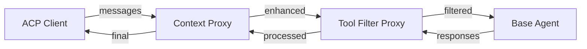

### Proxying in practice: the role of the conductor

To allow for proxy isolation, our design does not have proxies communicate directly with their successor in the chain. Instead, there is a central _conductor_ component that orchestrates messages moving between components.

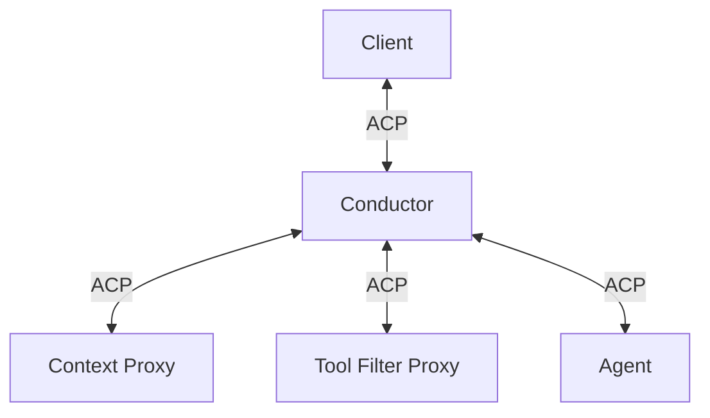

We add one ACP method for proxy communication:

- **`proxy/successor`**: Used bidirectionally - proxies send it to forward messages to their successor, and the conductor sends it to deliver messages from the successor back to the proxy

Here's how a single message flows through the system:

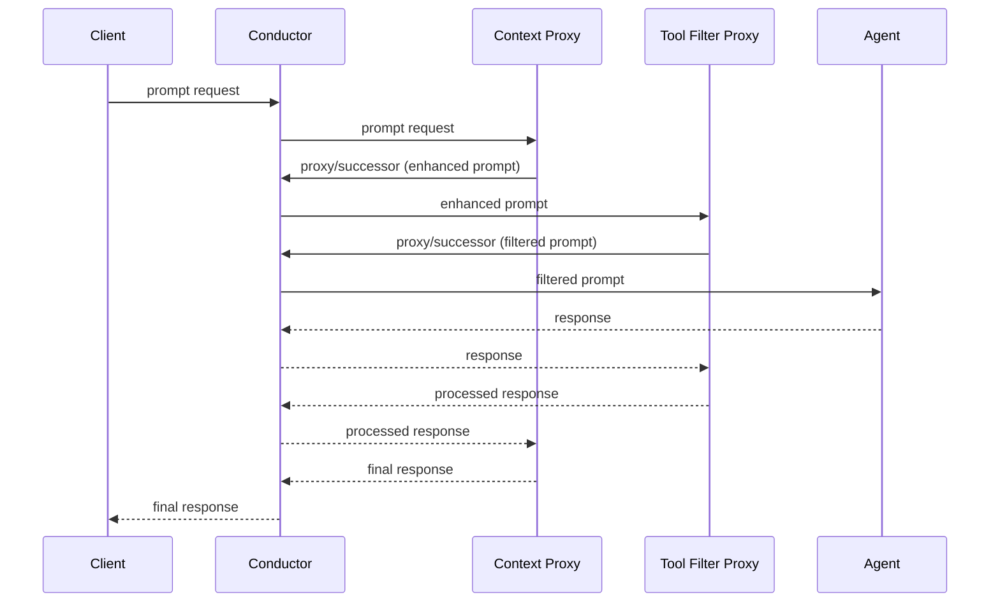

## Shiny future

> How will things play out once this feature exists?

### User experience and editor integration

We expect editors to expose the ability to install proxies in the same way they currently support adding MCP servers - in fact, the distinction probably doesn't matter to users. Both are "extensions" that add capabilities to their AI workflow.

When proxies are installed, editors would not start the agent directly, but instead invoke the conductor with the configured proxy chain. From the user's perspective, they're just getting enhanced agent capabilities - the proxy chain architecture remains transparent.

### Language-specific proxy ecosystems

The monolithic nature of agent development has meant that most of the "action" happens within agents. We wish to invert this, with agents trending towards simple agentic loops, and the creativity being pushed outwards into the broader ecosystem.

The Symposium project is one example exploring this concept, with a focus on Rust. The idea is to give Rust users an automatic set of extensions based on the dependencies they are using. These extensions would be packaged up as ACP proxies using WebAssembly for portability and sandboxing.

Symposium aims to become the standard "Rust ACP experience" by providing both core Rust tooling and a framework for Rust libraries to contribute their own proxy components.

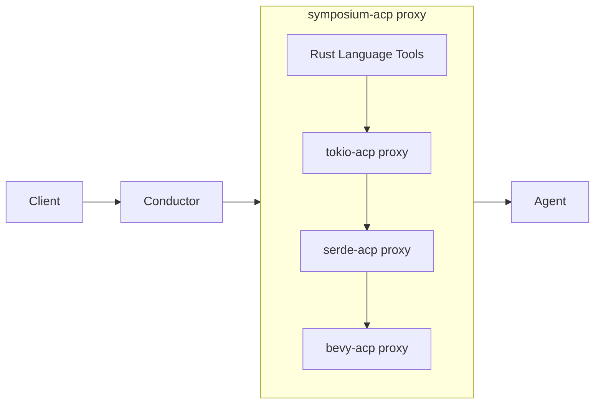

### Standardized IDE capabilities

Proxy infrastructure could also enable editors to expose standardized IDE capabilities (diagnostics, file system access, terminal APIs) to agents via MCP servers provided by proxies. This keeps the core ACP protocol focused on agent communication while allowing rich IDE integration through the proxy layer.

## Implementation details and plan

> Tell me more about your implementation. What is your detailed implementation plan?

### Component roles

Each ACP proxy chain forms a sequence of components:

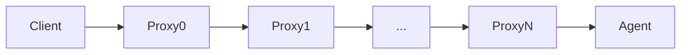

The **client** and **agent** are _terminal_ roles - the client has only a successor (no predecessor), and the agent has only a predecessor (no successor). Proxies are _non-terminal_ - they have both a predecessor and a successor, forwarding messages between them.

The **conductor** is a special component that orchestrates proxy chains. It spawns and manages proxy components, routes messages between them, and handles initialization. From the client's perspective, the conductor appears to be an ordinary agent:

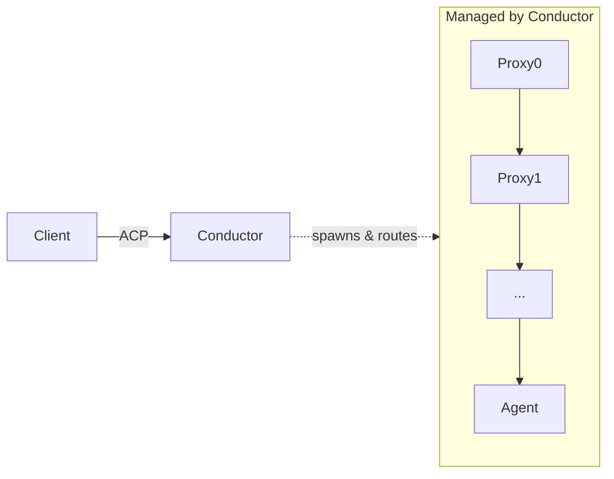

We provide a canonical conductor implementation in Rust (`agent-client-protocol-conductor`). Most editors would use this conductor directly to host proxies and agents, though they could also reimplement conductor functionality if needed.

ACP defines client and agent as superroles, each with two specializations:

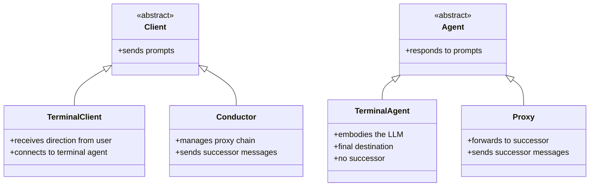

**Example Architecture:**

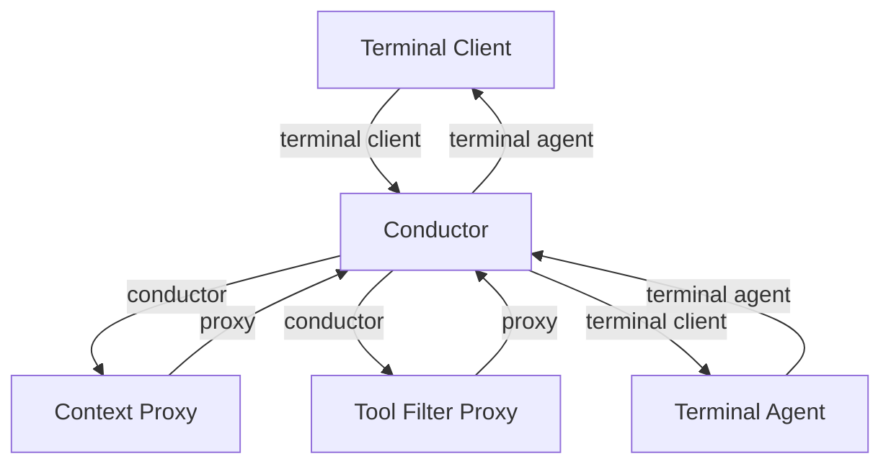

### Proxy initialization protocol

Components discover their role from the initialization method they receive:

- **Proxies** receive `proxy/initialize`. They have a successor and forward messages to it.
- **Agents** receive `initialize`. They are terminal (no successor) and process messages directly.

`proxy/initialize` takes the same params and returns the same result as `initialize` for the chain's protocol version. In the schema these are `InitializeProxyRequest` and `InitializeProxyResponse`, which have the version's `InitializeRequest` and `InitializeResponse` shapes. Only the method name differs, and it tells the component to run as a proxy.

**Conductor behavior:**

- The conductor MUST send `proxy/initialize` to all proxy components
- The conductor MUST send `initialize` to the final agent component (if any)
- The conductor sends the client's `initialize` request to the first proxy as `proxy/initialize`. When a proxy forwards an `initialize` via `proxy/successor`, the conductor determines whether the successor is another proxy or the agent, and sends `proxy/initialize` or `initialize` respectively.

**Proxy behavior:**

- A proxy that receives `proxy/initialize` knows it has a successor
- Before it answers `proxy/initialize` successfully, the proxy MUST forward an `initialize` request to its successor through `proxy/successor`, so that the rest of the chain is initialized. It MAY answer with an error without forwarding.
- The proxy builds its `proxy/initialize` result from its successor's `initialize` result. It MAY change the capabilities and other fields so that the result describes the chain from the proxy onward, for example to add a capability it implements or remove one it blocks. It MUST NOT change `protocolVersion`.
- The proxy SHOULD forward requests and notifications it does not understand. See [Forwarding](#forwarding).
- The proxy SHOULD preserve metadata fields when forwarding messages

**Repeated initialization:**

A client may repeat `initialize` when the chain's protocol version allows it (see [Repeating initialization](/protocol/v2/initialization#repeating-initialization) in v2). The conductor forwards a repeated `initialize` through the chain like the first one, without starting the chain again: the first proxy receives it as `proxy/initialize`. A proxy handles a repeated `proxy/initialize` the way an Agent handles a repeated `initialize`, and forwards `initialize` to its successor again under the same rules as the first time. A conductor in proxy mode does the same with a repeated `proxy/initialize` from its own conductor.

Note: A conductor can be configured to run in either terminal mode (expecting `initialize`) or proxy mode (expecting `proxy/initialize`), enabling nested proxy chains.

### Protocol versions

A chain speaks one ACP protocol version. Each component selects it the way an Agent does during version negotiation ([v1](/protocol/v1/initialization#version-negotiation), [v2](/protocol/v2/initialization#version-negotiation)), so the version can only go down along the chain:

- `proxy/initialize` carries the `initialize` params at the version the conductor selected, which is the client's requested version unless the conductor supports only a lower one. The conductor sets `protocolVersion` to that version, and if it selected the requested version it forwards the client's params unchanged. A chain without proxies receives `initialize` the same way.
- A proxy negotiates `proxy/initialize` the same way. If it does not support the version it received, it forwards `initialize` to its successor with a lower version it supports.
- The version in the agent's `initialize` response applies to every component in the chain. Each proxy returns it unchanged in its `proxy/initialize` response, so the response the client receives carries the version the whole chain accepted.

On an ACP v2 chain, the rules of that version apply to every hop, including the wrapped messages: request IDs are never `null`, and JSON-RPC batches are not used.

### Forwarding

- Proxies and the conductor forward messages without parsing and re-serializing them where they don't need to, so unknown fields and `_meta` survive every hop.
- A proxy SHOULD forward requests and notifications it does not handle, in both directions, without changing them. This includes methods it does not recognize, such as extension methods.
- A request that no component handles reaches the end of the chain. There the agent (or the client, for a request from the agent) answers it with `-32601` (Method not found), and that error passes back to the sender unchanged like any other result. A proxy answers `-32601` itself only for a request it decides not to forward.
- A notification that no component handles is dropped at the end of the chain. Notifications get no response.
- `$/cancel_request` is never forwarded. See [Cancellation](#cancellation).

### Cancellation

Cancellation is hop-local, as described in [Request cancellation](./request-cancellation):

- The `requestId` in `$/cancel_request` is the ID of a request on the connection the notification arrives on. It means nothing on any other connection, so proxies and the conductor MUST NOT forward a `$/cancel_request` to another hop, whether it arrived plain or wrapped in `proxy/successor`.
- To cancel a `proxy/successor` request, the sender sends `$/cancel_request` on the same connection with the ID of that `proxy/successor` request. It SHOULD send it plain. A receiver MUST treat a `$/cancel_request` wrapped in `proxy/successor` the same as a plain one: its `requestId` still names the `proxy/successor` request on that connection.
- A component that forwarded a request and then sees that request cancelled sends its own `$/cancel_request` for the request it forwarded, with that hop's ID. Cancellation reaches the end of the chain one hop at a time.

```text
Client    -> Conductor: session/prompt (id 1)
Conductor -> Proxy:     session/prompt (id 10)
Proxy     -> Conductor: proxy/successor {method: "session/prompt"} (id 20)
Conductor -> Agent:     session/prompt (id 30)

Client    -> Conductor: $/cancel_request {requestId: 1}
Conductor -> Proxy:     $/cancel_request {requestId: 10}
Proxy     -> Conductor: $/cancel_request {requestId: 20}
Conductor -> Agent:     $/cancel_request {requestId: 30}
```

### Errors the conductor returns

The pass-through rule in the [message reference](#message-reference) covers the result or error of a wrapped request. The conductor also answers some requests itself. These errors come from the conductor, not from a successor:

- Before the chain is initialized, the conductor answers any request other than `initialize` (`proxy/initialize` for a conductor in proxy mode) with `-32600` (Invalid request), and drops notifications. It answers an initialization request without a valid `protocolVersion` with `-32602` (Invalid params). After either error the conductor is still uninitialized, and the client may retry.
- If the conductor cannot start the chain, it answers the initialization request with an error and answers every later request with the same error.
- Only the conductor sends `proxy/initialize`. It answers a `proxy/initialize` request from any other component, including one a proxy wraps in `proxy/successor`, with `-32600`. A conductor in proxy mode answers a plain `initialize` request with `-32600`.
- `proxy/successor` is exchanged only between the conductor and the proxies it initialized, and between a conductor in proxy mode and its own conductor. The conductor answers a `proxy/successor` request from the agent, or from the client of a conductor in terminal mode, with `-32600`, and drops such a notification. It does not forward either.
- A `proxy/successor` request without a string `method`, or whose `params` is not an object, an array, or `null`, gets `-32602`.
- If a component has exited, or exits before it answers, the conductor answers each request that it could not deliver or that is still waiting for that component with `-32603` (Internal error). The same applies when the conductor cannot route a message for another reason. A conductor MAY instead close its connection to the client when a component fails.

### MCP-over-ACP support

The [MCP-over-ACP transport](./mcp-over-acp) targets stateless MCP 2026-07-28 only. Requests target a declared `serverId`; a separate logical MCP `requestId` correlates request-scoped notifications and remains unchanged when proxies renumber the outer ACP JSON-RPC ID. There is no MCP connect/disconnect lifecycle.

Proxies that provide MCP servers use the [MCP-over-ACP transport](./mcp-over-acp) mechanism. Capability advertising reflects what the downstream chain can consume; the conductor does not unconditionally add MCP-over-ACP support. In the Rust SDK, an explicit `McpOverAcpPolyfill` proxy can be placed immediately before an HTTP-capable agent that lacks native ACP MCP support.

A forwarding proxy preserves downstream MCP capabilities. A bridging proxy may advertise ACP MCP support only when its successor can consume the target MCP revision over the adapted transport. Proxies that publish MCP servers handle `mcp/message` requests as soon as their declarations are forwarded, including while session setup is still in progress. Ordinary ACP response forwarding and hop-local cancellation apply; logical MCP IDs and payloads are preserved. See the transport RFD for the v1 and draft-v2 capability shapes.

### Message reference

**Initialization:**

```json
// Conductor initializes a proxy (proxy knows it has a successor)
{"method": "proxy/initialize", "params": <INITIALIZE_REQUEST_PARAMS>}

// Conductor initializes the agent (standard ACP)
{"method": "initialize", "params": <INITIALIZE_REQUEST_PARAMS>}
```

Both methods take the params of the version's `InitializeRequest` and return its `InitializeResponse`. A proxy's response describes the chain from that proxy onward.

**Proxy messages:**

```json
// Proxy sends message to successor, or conductor delivers message from successor
// (same method, direction determined by sender)
{
  "method": "proxy/successor",
  "params": {
    "method": "<INNER_METHOD>",
    "params": <INNER_PARAMS>,
    "_meta": { ... }           // optional metadata
  }
}
```

The inner message fields (`method`, `params`) are flattened into the params object. The optional `_meta` belongs to the `proxy/successor` envelope and is hop-local: it describes the envelope on this connection. The conductor does not copy it into the message it unwraps, and it MAY set its own envelope `_meta` when it wraps a message. The wrapped message's own metadata stays in its `params` and is forwarded with them. Whether the wrapped message is a request or notification is determined by the presence of an `id` field in the outer JSON-RPC envelope, following JSON-RPC conventions.

`params` is optional, and omitting it is equivalent to `null`: the wrapped message has no params, and the receiver unwraps it to a message without `params`. When present, it MUST be an object or an array, as JSON-RPC requires for params. ACP methods use objects. The result or error of a wrapped request **MUST** be returned unchanged, as the same JSON value, as the result or error of the `proxy/successor` request. The same JSON value need not be the same bytes, because implementations that parse JSON may write numbers differently, for example `1E2` as `100.0`, or may not keep integers beyond 64 bits exactly. An error keeps its `code`, `message`, and `data`. JSON-RPC defines no other members of the error object, and implementations may drop them.

### Schema

Both methods are in the v1 and draft v2 schemas behind the `unstable_proxy_chains` feature. Because only conductors and proxies exchange them, they form their own `proxy` side, separate from the agent and client methods, with their own `ProxyRequest`, `ProxyResponse`, and `ProxyNotification` unions and a `proxyMethods` entry in `meta.json`.

| Type                         | Shape                                                                                        |
| ---------------------------- | -------------------------------------------------------------------------------------------- |
| `InitializeProxyRequest`     | The version's `InitializeRequest`, unchanged.                                                |
| `InitializeProxyResponse`    | The version's `InitializeResponse`, unchanged.                                               |
| `ProxySuccessorRequest`      | `method` (required string), `params` (optional: a JSON object or array, or `null`), `_meta`. |
| `ProxySuccessorNotification` | Same as `ProxySuccessorRequest`.                                                             |
| `ProxySuccessorResponse`     | The wrapped request's result, unchanged.                                                     |

### Examples (non-normative)

The following sequence diagrams illustrate common proxy chain scenarios for implementers.

#### Initialization of a 4-component proxy chain

This shows the initialization flow for: Terminal Client → Conductor → Context Proxy → Tool Filter Proxy → Terminal Agent

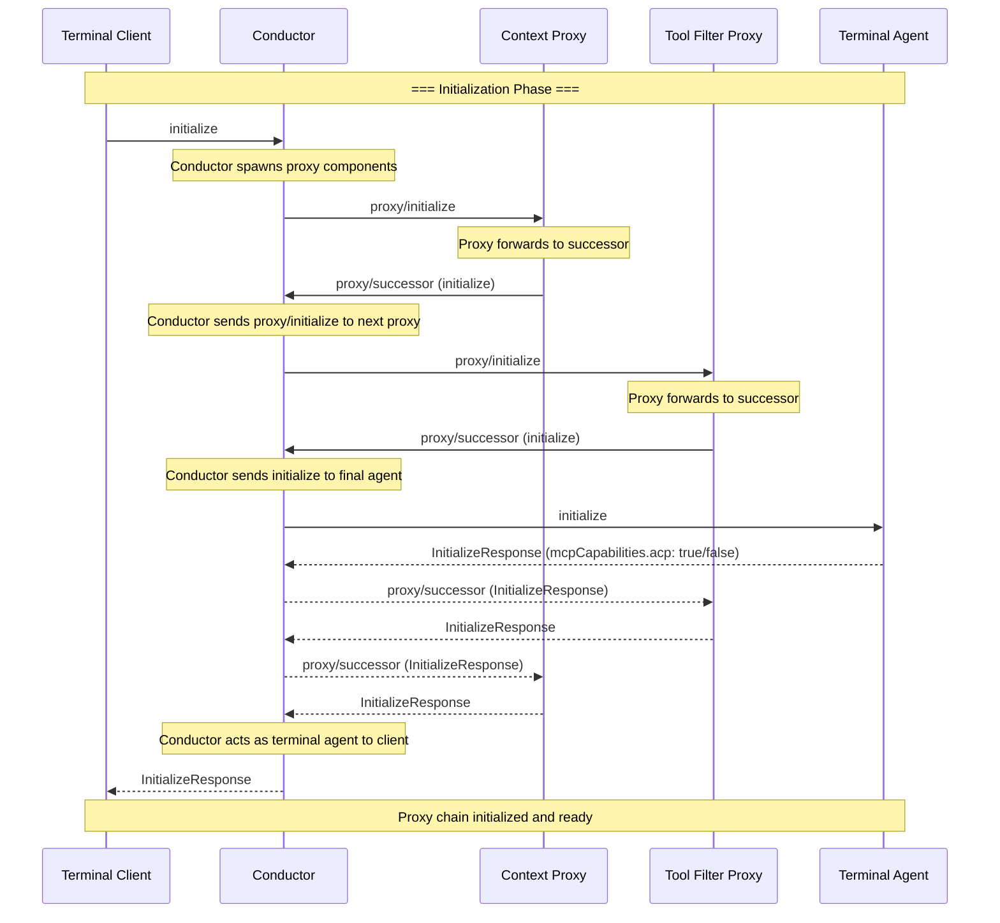

#### Context-providing proxy with session notifications

This example shows how a proxy can handle initialization and forward session notifications. Sparkle (a collaborative AI framework) runs an embodiment sequence during session creation.

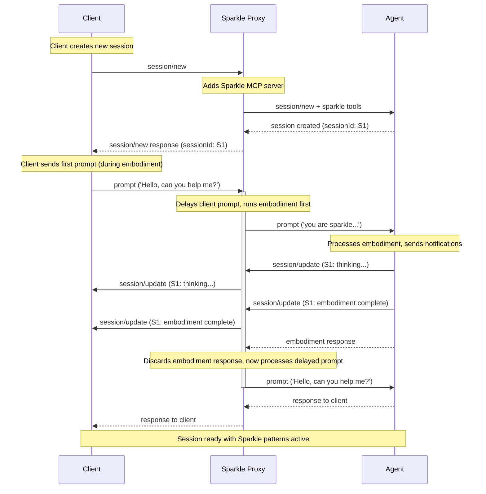

This demonstrates how proxies can run initialization sequences during session creation while transparently forwarding all session notifications back to the client.

## Frequently asked questions

> What questions have arisen over the course of authoring this document or during subsequent discussions?

### Why use a separate `proxy/initialize` method instead of a capability?

Earlier designs used a `"proxy": true` capability in the `InitializeRequest` and required proxies to echo it back in the response. This felt awkward because it wasn't really a capability negotiation - it was more of a "you must operate as a proxy" directive.

Using a distinct method makes the contract clearer: if you receive `proxy/initialize`, you're a proxy with a successor; if you receive `initialize`, you're the terminal agent. There's no capability dance, no risk of misconfiguration, and components know their role immediately from the method name.

### How do proxies subsume existing agent extension mechanisms?

Because proxies sit between the client and agent, they can replicate the functionality of existing extension mechanisms:

- **AGENTS.md files**: Proxies can inject context and instructions into prompts before they reach the agent
- **Claude Code plugins/skills**: Proxies can add contextual data for available skills and provide MCP resources with detailed skill instructions that are provided on-demand when requested by the agent
- **MCP servers**: Proxies can provide tools via [MCP-over-ACP](./mcp-over-acp) and handle tool callbacks
- **Subagents**: Proxies can create "subagents" by initiating new sessions and coordinating between multiple agent instances
- **Hooks and steering files**: Proxies can modify conversation flow by intercepting requests and responses
- **System prompt customization**: Proxies can switch between predefined session modes or prepend system messages to prompts

The key advantage is that proxy-based extensions work with any ACP-compatible agent without requiring agent-specific integration or modification.

### How do proxies work with MCP servers?

Proxies can provide MCP servers via [MCP-over-ACP transport](./mcp-over-acp), enabling a single proxy to add context, provide tools, and handle callbacks with full awareness of the conversation state.

When the agent supports native ACP MCP transport, no adapter is needed. Otherwise, the chain can include an explicit adapter for a modern MCP HTTP client. The Rust SDK's HTTP polyfill rewrites MCP declarations to local HTTP endpoints and relays requests and request-scoped notifications to and from the providing proxy's ACP channel. Requests may share a listening endpoint without sharing MCP session state.

Tool-providing proxies implement MCP-over-ACP without managing those alternative transports themselves. The chain's owner chooses an appropriate adapter, and the resulting advertised capability tells providers whether ACP MCP servers can be consumed.

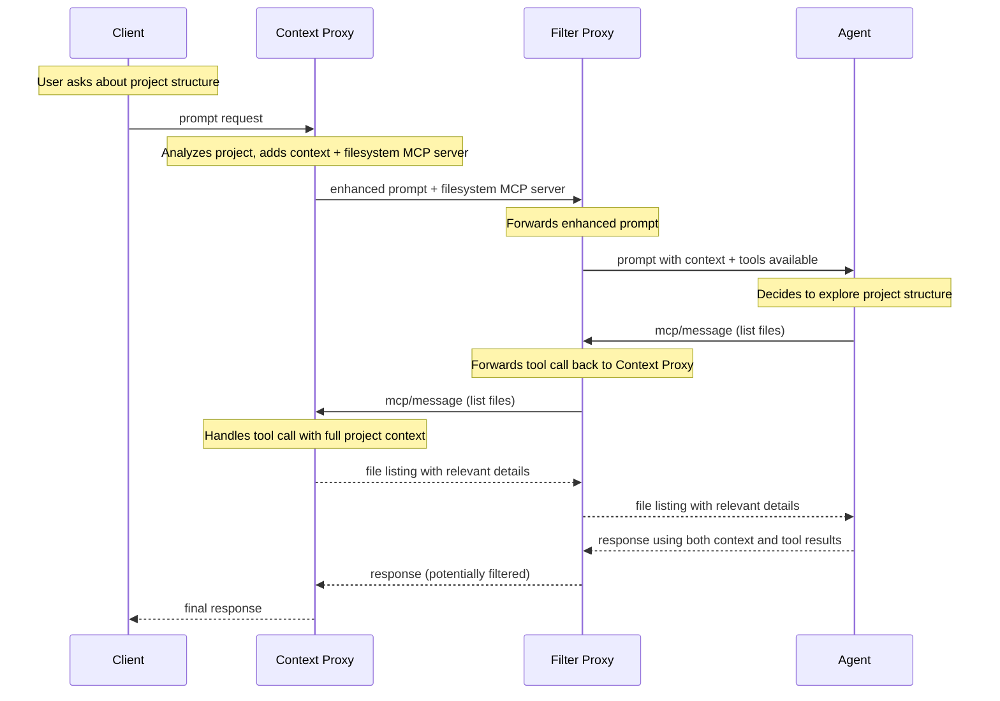

### Are there any limitations to what proxies can do?

Yes, proxies are limited to what is available through the ACP protocol itself. They can intercept and transform any ACP message, but they cannot access capabilities that ACP doesn't expose.

For example, proxies cannot directly modify an agent's system prompt or context window - they can only switch between predefined session modes (which may affect system prompts) or prepend additional messages to prompts. Similarly, proxies cannot access internal agent state, model parameters, or other implementation details that aren't exposed through ACP messages.

This is actually a feature - it ensures that proxy-based extensions remain portable across different agent implementations and don't rely on agent-specific internals.

### Why not just cascade ACP commands without protocol changes?

One alternative is to make proxies be ordinary agents that internally create and manage their successors. This works (HTTP proxies operate this way) but requires each proxy to understand the full chain and know how to start its successors.

This couples proxies to transport mechanisms, process management, and chain configuration. Changing transports, reordering the chain, or inserting a new proxy requires modifying predecessor configurations.

The conductor design decouples proxies from their successors. Proxies send messages "to successor" and receive messages "from successor" without knowing who that successor is, how it's started, or what transport it uses. This enables:

- Changing transport protocols or process management without recompiling proxies
- Shipping proxies as low-capability WASM containers that need only a single communication channel
- Reordering, adding, or removing proxies through configuration rather than code changes

The tradeoff is protocol complexity, but this complexity lives in the conductor (implemented once) rather than being duplicated across proxy implementations.

### Why do all messages go through the conductor instead of direct proxy-to-proxy communication?

Even with a conductor, proxies could communicate directly with their successors after the conductor sets up connections. Routing all messages through the conductor further minimizes proxy responsibilities to a single communication channel.

This supports running proxies as isolated WebAssembly components with minimal capabilities. It also removes redundant logic: without the conductor routing messages, each proxy would need to manage connections to its successor.

The conductor handles process management, capability negotiation, and message routing, allowing proxies to focus on transformation logic.

### How does the standard conductor implementation work?

The `agent-client-protocol-conductor` reference implementation can form trees of proxy chains. It can be configured to run in proxy mode (expecting `proxy/initialize`) or terminal mode (expecting `initialize`). When the last proxy in its managed chain sends a message to its successor, the conductor forwards that message to its own parent conductor (if in proxy mode) or to the final agent (if in terminal mode).

This enables hierarchical structures like:

```
client → conductor1 → final-agent
             ↓ manages
         proxy-a → conductor2 → proxy-d
                      ↓ manages
                  proxy-b → proxy-c
```

The conductor handles process management, capability negotiation, and message routing, but these are implementation details - the protocol only specifies the message formats and capability requirements.

### What about security concerns with proxy chains?

Proxy components can intercept and modify all communication, so trust is essential - similar to installing any software. Users are responsible for the components they choose to run.

We plan to explore WebAssembly-based proxies which will offer some measure of sandboxing but such components could still modify prompts in unknown or malicious ways.

### What about performance implications of the proxy chain?

Our architecture does introduce additional message passing - each proxy in the chain adds extra hops as messages flow through the conductor. However, these messages are typically small and inexpensive, particularly when compared to the latency of actual LLM inference.

For messages that contain significant quantities of data (large file contents, extensive context), we may wish to have the conductor store that data centrally and introduce a "reference" mechanism so that most proxies don't have to inspect or copy large payloads unless they specifically need to transform them.

The benefits of composability typically outweigh the minimal latency costs for human-paced development interactions.

### What happens when proxy components crash or misbehave?

The conductor answers requests that a failed component can no longer answer with `-32603`, or closes its connection to the client. See [Errors the conductor returns](#errors-the-conductor-returns). Whether a conductor restarts or bypasses a failed component is conductor behavior, not part of the protocol.

### Can proxy chains be nested or form trees?

Yes! The conductor can itself run in proxy mode, enabling hierarchical structures:

```
client → proxy1 → conductor (proxy mode) → final-agent
                      ↓ manages
                  p1 → p2 → p3
```

This enables complex compositions while maintaining clean interfaces.

### How could proxy chains support multi-agent scenarios in the future?

The current design assumes a linear chain where each proxy has a single successor. To support M:N topologies where a proxy communicates with multiple peers (e.g., a research coordinator dispatching to multiple specialized agents), we could extend `proxy/successor` with an optional `peer` field:

```json
{
  "method": "proxy/successor",
  "params": {
    "method": "prompt",
    "params": { ... },
    "peer": "research-agent"
  }
}
```

When `peer` is omitted, the message goes to the default successor (backwards compatible with the current linear chain model). When present, it specifies which peer the message is intended for. The `proxy/initialize` response could be extended to enumerate available peers, enabling proxies to discover and coordinate between multiple downstream components.

### What's the current implementation status?

This proposal is implemented in the [Rust SDK](https://github.com/agentclientprotocol/rust-sdk), for both ACP v1 and the draft v2 protocol:

- `agent-client-protocol` -- proxy roles and the `proxy/initialize` and `proxy/successor` messages
- `agent-client-protocol-conductor` -- reference conductor implementation
- `agent-client-protocol-rmcp` -- bridging proxies to the `rmcp` crate
- `agent-client-protocol-polyfill` -- compatibility proxies, such as MCP-over-ACP for agents without native support

Earlier releases of the Rust SDK used the `_proxy/initialize` and `_proxy/successor` method names.

## Revision history

- Initial draft based on working implementation in symposium-acp repository.
- Split MCP-over-ACP transport into [separate RFD](./mcp-over-acp) to enable independent use by any ACP component.
- **2026-10-30**: Added schema support behind `unstable_proxy_chains` as a separate `proxy` side, required wrapped request results and errors to pass through unchanged, and marked the crash-handling FAQ as conductor behavior.
- **2026-10-30**: Named the `proxy/successor` metadata field `_meta`, defined how a chain carries one protocol version (including draft v2), and updated the implementation status to the Rust SDK crates.
- **2026-11-01**: Matched the rules to the reference conductor. Defined how each proxy negotiates the protocol version and builds its `proxy/initialize` response, how unknown requests and notifications are forwarded, hop-local cancellation and envelope `_meta`, and the errors the conductor returns. Required wrapped `params` to be an object, an array, or `null`, and defined "unchanged" for wrapped results and errors as the same JSON value. Defined repeated `proxy/initialize`. Linked version negotiation for both v1 and v2, replaced the old `sacp-conductor` name, and removed crash-handling claims the reference conductor does not implement.
