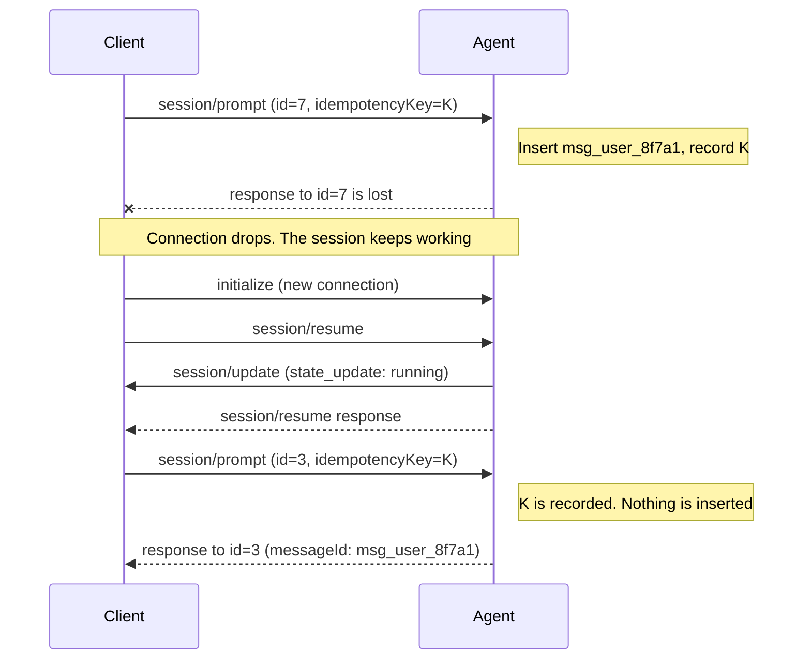

Author(s): [@benbrandt](https://github.com/benbrandt)

## Elevator pitch

> What are you proposing to change?

When a Client sends a request and never sees the response, it can't tell whether the Agent acted on it. For most ACP methods the Client can send the request again and nothing changes. For `session/prompt`, a second request inserts a second user message and may run the work twice.

This RFD proposes two changes for v2:

- Give every method a documented retry class. A Client then knows whether a request is safe to send again as is, safe to send again with a key, or not resent at all.
- Add an optional `idempotencyKey` parameter to `session/prompt`. The Client generates the key and sends the same key on every attempt. The Agent inserts the user message at most once for that key and answers retries with the `messageId` of the original.

Clients may omit the key. A prompt without one behaves as it does today. Agents that advertise `capabilities.session` honor a key whenever one is present. There is no separate capability, so Clients can rely on it on every v2 connection.

## Status quo

> How do things work today and what problems does this cause? Why would we change things?

### A lost response has an unknown outcome

The v2 prompt lifecycle already names the gap: "If the response is lost, the submission's outcome remains uncertain: replay may omit live-only or discarded messages, and a retry can create another submission." The [Prompt Lifecycle RFD](./prompt.mdx#does-returning-messageid-make-retrying-safe) left safe retries and submission idempotency out of scope.

For `session/prompt`, a wrong guess is costly in both directions:

- The Client retries, and the first message was inserted. The Agent now has two user messages and does the work twice. Model usage is spent twice, and tool calls with side effects, such as commits, deployments, or sent messages, run again.
- The Client doesn't retry, and the message was never inserted. The user's input is dropped without an error.

The JSON-RPC `id` can't resolve this. It identifies a request on one connection, a retry after reconnecting uses a different connection, and proxies may rewrite it.

### When responses get lost

How a response gets lost depends on the transport and on what outlives the connection.

| Situation                                              | What the Client knows                                                                                                                                                                                                                                                      |
| ------------------------------------------------------ | -------------------------------------------------------------------------------------------------------------------------------------------------------------------------------------------------------------------------------------------------------------------------- |
| stdio, connection open                                 | Pipes deliver messages in order and don't drop them. A request stays pending until it is answered. A Client that stops waiting sends `$/cancel_request` and still gets a definite response.                                                                                |
| stdio, Agent process exits with a request pending      | The Client [treats the request as failed](/protocol/v2/transports#shutdown). The Agent may have stored the effect first, for example by writing the user message to the session on disk. After starting a new process and calling `session/resume`, the Client can't tell. |
| Client restarts with unanswered input                  | The same problem from the other side. A Client that restores pending input after a crash doesn't know which entries the Agent inserted.                                                                                                                                    |
| Streamable HTTP, POST fails before `202 Accepted`      | The request may or may not have reached the Agent.                                                                                                                                                                                                                         |
| Streamable HTTP, stream closes after `202 Accepted`    | The response travels on the GET stream. The [remote transport RFD](../streamable-http-websocket-transport.mdx#durability-and-reliability-expectations) says in-flight messages are not replayed, so the response is gone while the session and its work continue.          |
| WebSocket closes                                       | Every pending request on that connection has an unknown outcome. The sessions survive and can be resumed on a new connection.                                                                                                                                              |
| A proxy or conductor between Client and Agent restarts | The request may have been forwarded before the restart, and the response lost after it.                                                                                                                                                                                    |

On stdio, the ambiguity needs a crash. On a remote transport, it only needs a dropped connection, and sessions are designed to outlive connections: "When the connection ends, its sessions stop being active. The Agent **MAY** continue or cancel their foreground work." A retry can therefore arrive on a different connection than the original request, and in a different Agent process.

### Retry safety isn't written down per method

Some methods already define what a repeat does. `session/close` is idempotent, `session/delete` of a missing session succeeds, and `session/resume` of an active session synchronizes it again. Other methods say nothing, and a Client or SDK author has to work out the answer from each page. Nothing states which requests an SDK may retry on its own.

## What we propose to do about it

> What are you proposing to improve the situation?

### Give every method a retry class

Each method's documentation states one of four classes:

| Class       | Meaning                                                                                                                          | Retry rule                                                                                              |
| ----------- | -------------------------------------------------------------------------------------------------------------------------------- | ------------------------------------------------------------------------------------------------------- |
| Idempotent  | Sending the request again with the same parameters has no effect beyond the first. This includes read-only requests.             | The Client may send it again as is. The response reports current state.                                 |
| Keyed       | Each request performs the operation again, and a duplicate does real damage. The request accepts an `idempotencyKey`.            | The Client may send it again with the same `idempotencyKey`. Without a key, a retry is a new operation. |
| Duplicating | Each request creates something new, and an extra one does little harm.                                                           | The Client may send it again. If the first request also took effect, what it created is left unused.    |
| Not retried | Notifications, which have no response to lose, and messages that only have meaning on one connection or for one pending request. | The sender doesn't send it again. It recovers through `session/resume` or a new connection.             |

The [method audit](#method-audit) finds one keyed method, `session/prompt`, and two duplicating methods, `session/new` and `session/fork`. Every method added to ACP later states its class.

### The `idempotencyKey` parameter

`session/prompt` accepts an `idempotencyKey`:

```json
{
  "jsonrpc": "2.0",
  "id": 7,
  "method": "session/prompt",
  "params": {
    "sessionId": "sess_abc123def456",
    "idempotencyKey": "0b6f3c1e-8d2a-4c57-9a41-5e2f7d90c3ab",
    "prompt": [
      {
        "type": "text",
        "text": "Run the database migration"
      }
    ]
  }
}
```

- Agents that advertise `capabilities.session` **MUST** support the key.
- The field is optional. Omitted and `null` are equivalent and mean no key. The Agent handles the prompt without duplicate detection, as it does today.
- When present, it is an opaque, case-sensitive string of 1 to 255 characters. The Agent **MUST** reject any other value with `-32602` (Invalid params) and **MUST NOT** treat it as omitted.
- The Client generates the key. Clients **SHOULD** use a UUID ([RFC 9562](https://www.rfc-editor.org/rfc/rfc9562)) or another random value with at least as much entropy. Clients **SHOULD NOT** derive the key from user content or put sensitive data in it.
- One key identifies one submission. The Client creates the key when the user submits the input, not when it writes the request, and stores it with the pending input. It sends the same key on every attempt, including after reconnecting or restarting. It uses a new key for a new submission, including when the user sends the same text again on purpose.
- Clients **MUST NOT** send the same key with a different prompt.
- Each attempt is its own JSON-RPC request with its own `id`. The key is what links the attempts.

### How the Agent handles a keyed prompt

The Agent looks the key up in the session:

| What the Agent has recorded for the key                                                                                            | What the Agent does                                                                                      |
| ---------------------------------------------------------------------------------------------------------------------------------- | -------------------------------------------------------------------------------------------------------- |
| Nothing                                                                                                                            | Handles the prompt as usual. When the user message is inserted, it records the key with it.              |
| A message that was inserted with this key                                                                                          | Doesn't insert a message. Responds with that message's `messageId`.                                      |
| A prompt with this key that is not inserted yet, such as a [held prompt](/protocol/v2/prompt-lifecycle#prompts-during-active-work) | Doesn't hold a second prompt. Answers this request when it answers the first one, with the same outcome. |

- **The response.** A retry gets the original `messageId` and nothing else. The Agent doesn't start a second round of work for the message. Whether it continues work that stopped before it finished is up to the Agent, as it is after any restart. The Client learns the session's current activity from live updates or from the `session/resume` snapshot.
- **Errors leave the key unused.** An error response to `session/prompt` already means the message was not inserted. The Agent records nothing, and the Client can send the same prompt with the same key again.
- **A reused key.** The Agent **MUST NOT** insert a second message for a key it has recorded. If a request carries a recorded key with a different prompt, the Agent either answers as for a retry or, if it notices the difference, rejects the request with `-32602`. Agents are not required to compare prompts. After such a `-32602`, the key stays recorded for the first prompt.
- **Cancelling.** `$/cancel_request` for any pending request with the key withdraws a prompt that is not inserted yet. The Agent then answers every pending request for that key with `-32800`. `session/cancel` and `session/close` answer held prompts the same way they do today.
- **Keys stay private.** The Agent doesn't echo keys in session updates, `session/list` results, or replayed history, so one Client doesn't see another Client's keys. A key is not a credential. It only has meaning in a session the caller can already prompt.

### How long a key lasts

A key is scoped to the session named by `sessionId`. The same key string in another session, including a fork of this one, names an unrelated submission.

A key lasts as long as the message it belongs to. There is no time window:

- **Retained messages.** For a prompt whose inserted message the Agent retains, the Agent **MUST** recognize the key for as long as it retains the message. This holds across connections and Agent restarts. It follows the existing rule that a retained message keeps its `messageId`: if the Agent would still replay the message, it still recognizes the key.
- **Live-only messages.** For a prompt whose message the Agent doesn't retain, such as a locally handled command, the Agent **MUST** recognize the key while the session stays active on a connection. After that it **MAY** forget it.
- Once the Agent no longer has the message or the session, it **MAY** forget the key. A prompt with a forgotten key is a new submission.
- Clients **SHOULD** resend a pending prompt as soon as they have resumed the session. A Client that has held a prompt for a long time, such as since a previous day, **SHOULD** show it to the user instead of resending it. By then the Agent may have discarded the message under its own history retention.

Agents **SHOULD** store the key in the same step as the message, for example as part of the message's ID. The two then can't be stored or lost separately. If a restart loses a message that was never written to the stored session, the key is lost with it, and the retry inserts the message.

A key is not tied to the connection that first carried it. The Agent recognizes it on any connection where the session is active. After reconnecting, the Client calls `initialize` and `session/resume`, then sends the prompt again. Proxies and conductors forward `idempotencyKey` unchanged.



Where the record has to live follows from the transport:

- **stdio.** While the process runs, a record in memory is enough. The cases that need the key are a crashed or restarted Agent process and a restarted Client, so the record only helps if it is in the stored session.
- **Remote transports.** A retry may reach a different process or node than the original request. The record belongs in the storage the session is loaded from, not in per-connection or per-node memory. A Client may also resend an HTTP POST that failed before `202 Accepted` without reconnecting.

## Shiny future

> How will things play out once this feature exists?

- A Client stores a key with each pending prompt. After a dropped connection or a crash, it resumes the session and sends the pending prompts again. Each one is inserted once, and the Client gets the `messageId` it needs to reconcile its optimistic message.
- Client SDKs generate a key for every prompt by default and resend on transport failures without asking the application. Applications that persist pending input pass their own key.
- SDK and Client authors read one table to learn which requests they may retry.

## Implementation details and plan

> Tell me more about your implementation. What is your detailed implementation plan?

### Method audit

This audit covers the stable and unstable v2 methods. "Sending it again" means the same parameters, without a key.

#### Client to Agent requests

| Method                                                                          | Sending it again                                                                                                                                                                                                                       | Class                        |
| ------------------------------------------------------------------------------- | -------------------------------------------------------------------------------------------------------------------------------------------------------------------------------------------------------------------------------------- | ---------------------------- |
| `session/prompt`                                                                | Inserts a second user message and may start the work twice.                                                                                                                                                                            | Keyed                        |
| `session/new`                                                                   | Creates a second session. If the first response was lost, the Client never learned that session's ID, so it is never prompted. It stays active until the connection ends, and Agents need not store a session that was never prompted. | Duplicating                  |
| `session/fork` (unstable)                                                       | Creates a second copy of the source session. The Client can find the unused copy with `session/list` and remove it with `session/delete`.                                                                                              | Duplicating                  |
| `session/resume`                                                                | Synchronizes the session again. The request's MCP servers and workspace roots replace the previous ones, which are the same on a retry.                                                                                                | Idempotent                   |
| `session/close`                                                                 | Succeeds. The spec already defines closing as idempotent.                                                                                                                                                                              | Idempotent                   |
| `session/delete`                                                                | Succeeds. Deleting a missing session already succeeds.                                                                                                                                                                                 | Idempotent                   |
| `session/list`                                                                  | Read-only.                                                                                                                                                                                                                             | Idempotent                   |
| `session/set_config_option`                                                     | Sets the same value and returns the complete current options. A retry sent after a later change to the same option overwrites that change, so Clients retry before sending further changes.                                            | Idempotent                   |
| `tool_call/cancel`, `terminal/cancel`                                           | Has no second effect. Once the tool call is final or the terminal has exited, the retry gets `-32602`, and the `tool_call_update` or `terminal_update` reports what happened.                                                          | Idempotent                   |
| `auth/login`                                                                    | Leads to the same authenticated state. The Agent may show the user a second login flow.                                                                                                                                                | Idempotent                   |
| `auth/logout`                                                                   | Ends an authenticated state that has already ended.                                                                                                                                                                                    | Idempotent                   |
| `initialize`                                                                    | Allowed before the first other request, where the latest successful one applies, and rejected with `-32600` afterwards. On Streamable HTTP each attempt opens a new connection.                                                        | Not retried                  |
| `session/archive`, `session/unarchive` (unstable)                               | Succeeds. The RFD already defines both as idempotent.                                                                                                                                                                                  | Idempotent                   |
| `session/set_title`, `providers/set`, `providers/disable` (unstable)            | Sets the same value again.                                                                                                                                                                                                             | Idempotent                   |
| `session/status`, `session/options`, `providers/list`, `auth/status` (unstable) | Read-only.                                                                                                                                                                                                                             | Idempotent                   |
| `mcp/message` (unstable)                                                        | Depends on the MCP message it carries. MCP defines no retry semantics for `tools/call` today.                                                                                                                                          | Out of scope, defined by MCP |
| `proxy/initialize`, `proxy/successor` (unstable)                                | `proxy/successor` carries another message. The class of the carried message applies, and its `idempotencyKey` is forwarded unchanged.                                                                                                  | As the carried message       |

#### Agent to Client requests

| Method                       | Sending it again                                                                                                                                                                                                                                                        | Class        |
| ---------------------------- | ----------------------------------------------------------------------------------------------------------------------------------------------------------------------------------------------------------------------------------------------------------------------- | ------------ |
| `session/request_permission` | The Client shows the request again. The response is the user's decision, and the action it allows stays with the Agent. After connection loss the Agent already [reestablishes or resolves](/protocol/v2/session-setup#current-state-synchronization) pending requests. | Idempotent   |
| `elicitation/create`         | The same. URL-mode requests carry an `elicitationId` that links the completion notification.                                                                                                                                                                            | Idempotent   |
| `mcp/message` (unstable)     | Depends on the MCP message it carries.                                                                                                                                                                                                                                  | Out of scope |

#### Notifications

| Method                                       | Sending it again                                                                                                                                  | Class       |
| -------------------------------------------- | ------------------------------------------------------------------------------------------------------------------------------------------------- | ----------- |
| `session/cancel`                             | Does nothing on an idle session. A copy that arrives after new work has started cancels that work, so a sender must not resend it later.          | Not retried |
| `$/cancel_request`                           | Receivers ignore a request ID that is unknown or already answered.                                                                                | Not retried |
| `session/update`                             | Upserts replace state by entity ID, but chunks append, so a resent chunk duplicates content. A Client that missed updates calls `session/resume`. | Not retried |
| `elicitation/complete`, `auth/status_update` | Reports the same state again.                                                                                                                     | Not retried |

The spec doesn't say what an Agent does with held prompts when the connection that sent them ends, and this RFD doesn't settle it. With a key, either choice is safe: if the Agent kept the prompt, the retry gets its outcome, and if the Agent dropped it, the retry is a new submission.

### Prior art

| API                                                                                                            | Where the key goes                                                          | A request with a known key                                                                                                                                                                     | Same key, different request   | Retention                                  |
| -------------------------------------------------------------------------------------------------------------- | --------------------------------------------------------------------------- | ---------------------------------------------------------------------------------------------------------------------------------------------------------------------------------------------- | ----------------------------- | ------------------------------------------ |
| [Stripe API v1](https://docs.stripe.com/api/idempotent_requests)                                               | `Idempotency-Key` header on `POST`. Up to 255 characters, UUID v4 suggested | Returns the saved status code and body, including `500` errors. Nothing is saved for requests that fail validation or conflict with a concurrent request                                       | Error                         | At least 24 hours                          |
| [Stripe API v2](https://docs.stripe.com/api-v2-overview#idempotency)                                           | `Idempotency-Key` header on `POST` and `DELETE`                             | Doesn't repeat work that succeeded, runs failed work again, and returns an updated response. A request is a retry only for the same API and account                                            | Not stated                    | 30 days                                    |
| [IETF `Idempotency-Key` draft 08](https://datatracker.ietf.org/doc/draft-ietf-httpapi-idempotency-key-header/) | `Idempotency-Key` header, a string. UUID recommended                        | "SHOULD respond with a response consistent with the request being completed according to the user's intent". `409` while the original is still being processed                                 | `422`                         | The resource publishes its expiry policy   |
| [AWS EC2 client tokens](https://docs.aws.amazon.com/ec2/latest/devguide/ec2-api-idempotency.html)              | `ClientToken` request parameter, up to 64 ASCII characters, on some actions | Succeeds without performing the action again                                                                                                                                                   | `IdempotentParameterMismatch` | Not stated                                 |
| [Google AIP-155](https://google.aip.dev/155)                                                                   | `request_id` field in the request message, a UUID                           | Returns the response of the earlier successful request, or the resource's current state when an identical response is no longer possible                                                       | Not addressed                 | Any timeframe the API considers reasonable |
| [MCP](https://github.com/modelcontextprotocol/modelcontextprotocol/issues/3394)                                | None in the spec                                                            | A retried `tools/call` runs the tool again. [SEP-3182](https://github.com/modelcontextprotocol/modelcontextprotocol/pull/3182) proposed `params.idempotencyKey` and was closed without merging | Not defined                   | Not defined                                |

This proposal takes the following from them:

- The Client generates the key, and the server uses it "to recognize subsequent retries of the same request" (Stripe and the IETF draft).
- The key is optional, and a request is only protected when it carries one (AIP-155).
- The key travels in the request body, not in a header, so it works on every transport (AWS, Google). ACP has no headers on stdio or WebSocket.
- The server records a key when the operation takes effect, not when the request arrives, so a request that fails early can be sent again with the same key (Stripe v1).

It differs in four places:

- Only one method takes a key. Stripe accepts one on every `POST`.
- There is no time window. Stripe keeps a key for 24 hours or 30 days. Here a key lasts as long as the message it belongs to.
- The Agent doesn't have to detect a key reused with a different request. Stripe, AWS, and the IETF draft make that an error. AIP-155 doesn't address it.
- HTTP APIs answer a retry of an in-progress request with `409` and expect the client to poll. ACP requests can stay pending, so the Agent answers the retry when it answers the original.

### Adapter validation

Adapters are the hardest case, because the runtime owns the stored session and the adapter can't write the key and the message in one step. The table shows what the v2 agents of claude-agent-acp and codex-acp do today, and what Claude Code 2.1.319 and Codex 0.166.0 did when tested directly.

|                                       | claude-agent-acp on Claude Code                                                                                                                                   | codex-acp on Codex                                                                                                                  |
| ------------------------------------- | ----------------------------------------------------------------------------------------------------------------------------------------------------------------- | ----------------------------------------------------------------------------------------------------------------------------------- |
| ID of a prompt                        | The adapter generates a UUID, sends it as the `uuid` of the Claude Agent SDK user message, and returns it as the `messageId`.                                     | The adapter generates a UUID, sends it as `clientUserMessageId` on `turn/start` or `turn/steer`, and returns it as the `messageId`. |
| Stored for a prompt that starts work  | A `user` transcript entry with that `uuid`.                                                                                                                       | `clientId` on the `userMessage` item.                                                                                               |
| Stored for a prompt taken in mid-turn | A `queued_command` attachment with that ID as `source_uuid`. `getSessionMessages` returns it as a user message with that `uuid`.                                  | `clientId` on the `userMessage` item, as for `turn/start`.                                                                          |
| After a restart                       | Both are still in the transcript.                                                                                                                                 | Both are returned by `thread/turns/list` with full items. The summary view leaves out a prompt added with `turn/steer`.             |
| The same ID submitted again           | Skipped with no second turn, in the same process and after a restart, even when the text differs. A prompt that was taken in mid-turn runs again after a restart. | A new turn every time. Codex does not compare IDs.                                                                                  |
| Locally handled commands              | The adapter's own `/remote-control` never reaches Claude Code.                                                                                                    | `/status`, `/rename`, `/logout`, `/skills`, `/mcp`, and others run without a Codex turn and are not stored.                         |

Both runtimes store an ID that the adapter chooses with each user message, and both adapters already use that ID as the v2 `messageId`. What follows from that:

- **Prompt keys need no extra storage.** The adapter derives the ID from the key, for example a UUIDv5 of the `sessionId` and the key, in place of a random UUID. The runtime then writes the key and the message in one step.
- **The adapter does the lookup itself.** Neither runtime can be relied on to refuse a repeated ID. Before it submits a keyed prompt, the adapter looks for the derived ID among its pending prompts and in the stored session.
- **Finding the ID after a restart means reading history.** The adapter keeps an in-memory set of the session's user message IDs. It fills the set from the session's history once, on the first keyed prompt after a restart, and adds each ID when it inserts a message. The set is a cache. The stored session stays the record. Filling it is about the work of a replay, and a replay the Client asked for can fill it. claude-agent-acp's replay already reads the messages before each compaction, which `getSessionMessages` alone leaves out, and the lookup can use the same read. codex-acp pages `thread/turns/list` with full items.
- **There is no stored prompt to compare a retry with.** The runtimes store the prompt in their own form, and Claude Code itself ignores the text when it skips a repeated ID. This is why comparing prompts is not required.
- **Keys for locally handled commands stay in memory.** These commands report status or set a value, so running one again after a restart does no harm.

### Plan

1. Add an optional, nullable `idempotencyKey` to `PromptRequest` in the v2 schema, as an `IdempotencyKey` string type with a length of 1 to 255. Keep it strict: a malformed value fails with `-32602`.
2. Document the retry classes in the v2 overview and on each method's page, and add the keyed-prompt rules to the prompt lifecycle, session setup, and transport pages. Replace the "outcome remains uncertain" paragraph in the prompt lifecycle with the keyed behavior.
3. Add serialization and schema coverage for a valid key, `null`, an empty string, a string over 255 characters, and a non-string value.
4. Exercise these traces in SDK tests and conformance suites: a retry on the same connection, a retry after `session/resume` on a new connection, a retry after an Agent restart with a stored session, a retry while the prompt is held, a retry after an error, the same key in another session, and a retry of a prompt that was inserted during active work.
5. Have Client SDKs generate keys by default, and give Agent SDKs a helper that records keys for a session.
6. Implement the derived ID and the lookup in claude-agent-acp and codex-acp.

## Frequently asked questions

> What questions have arisen over the course of authoring this document or during subsequent discussions?

### Why is there no capability?

A Client that has to check a capability also has to keep the unsafe path for Agents that lack it, and an SDK can't resend on its own. v2 is still a draft, so the requirement can be part of the baseline now. Adding it after v2 is stable would need a capability.

The Agent's obligation scales with what it already stores. An Agent that keeps sessions in memory keeps a map in memory. An Agent that stores sessions stores the key with the message, and both adapters can do that without storage of their own (see [Adapter validation](#adapter-validation)).

### Why not key `session/new` and `session/fork`?

Both create something new on every request, so they are the other candidates for a key. They don't get one, for three reasons:

- **A duplicate is cheap.** It is an unused session, not repeated work. If the `session/new` response was lost, the Client never learned the session ID, so the session is never prompted, and Agents commonly don't store a session before its first prompt.
- **Adapters could not keep the promise.** The Claude Agent SDK and Codex choose the ID of a forked session themselves, so an adapter could only remember the key until it restarts. On stdio, a restart is the only time the key would be needed.
- **It can be added later without a breaking change.** Whatever an Agent could promise here is best effort, and a best-effort key needs no capability. An Agent that ignores it behaves as it does today.

Remote Agents that allocate a sandbox or other resources per session are the case to watch. If unused sessions become a cost there, a later RFD can add the field to both requests with a best-effort rule.

### Why is there no error for a reused key?

A payments API has to refuse a key that comes back with a different amount. Here the cases are narrower. A Client that follows the rules never reuses a key, because it creates one random key per submission. Adapters have no stored copy of the prompt to compare with after a restart. A dedicated error code would also need a rule for intermediaries that rewrite prompts. An Agent that does notice a different prompt rejects it with `-32602`. An Agent that doesn't notice answers as for a retry and inserts nothing.

### Why is there no time window?

Payments APIs keep a key for a fixed time, such as Stripe's 24 hours, because their clients retry on a schedule and the key lives in a table of its own. Neither holds here. An ACP Client resends when it reconnects, and the key belongs to a message that the Agent already keeps or discards under its own retention. Tying the key to the message needs no number, and it matches the rule that a retained message keeps its `messageId`.

A window would do one thing: an adapter could stop reading a session's history early when it looks for a key after a restart. Without one, the adapter reads the history once per session to build an in-memory set of user message IDs, and checks each keyed prompt against that set. The read is about the work of a replay. If that is too slow for long sessions, a window can be added later as a cap on that lookup.

### Why a field in `params` and not `_meta`, an HTTP header, or the JSON-RPC `id`?

- `_meta` carries custom information that receivers may ignore and intermediaries may drop. The Agent acts on this value, so it belongs in the schema, where a malformed value fails with `-32602`.
- An `Idempotency-Key` HTTP header doesn't exist on stdio or WebSocket, and the rules here apply to a JSON-RPC request, not to an HTTP exchange.
- The JSON-RPC `id` is scoped to a connection, and proxies may rewrite it. A retry after reconnecting can't reuse it.

### Why not accept a key on every request?

Stripe accepts a key on every `POST`. ACP could do the same and skip the audit. It would make Agents record an outcome for requests that are already safe to repeat, and for those requests the right answer to a retry is current state, not the first response. A field on one method also shows in the schema which request needs a key.

### Does a key make the work run exactly once?

No. It makes insertion happen at most once. If the Agent stops after inserting the message, the work may be incomplete, and a retry doesn't promise to finish it. If the user then prompts again, that is a new submission with a new key. Tool calls the Agent makes are also outside this proposal. Whether an MCP `tools/call` can be retried is a question for MCP.

### Why does a retry wait for a held prompt and not get an error?

A held prompt can stay pending for a long time. If the retry got an error, the Client would have to poll with the same key until the prompt was inserted, and ACP would need an error code for "still in progress". Answering the retry when the original is answered uses the pending request ACP already has.

### Doesn't stream resumption on the remote transport solve this?

It solves one case. `Last-Event-ID`-style resumption redelivers a response that was sent on a stream the Client can still resume. It doesn't cover a POST that never arrived, a connection whose ID is gone, an Agent or Client restart, or stdio. Keys work across connections and on every transport.

### Should `user_message` updates echo the key?

Not in this proposal. A Client that wants to know what happened to a key sends the prompt again and gets the `messageId`. Echoing the key in updates would show one Client's keys to every other Client on the session and would turn the key into a second message identity, which the Prompt Lifecycle RFD [decided against](./prompt.mdx#client-generated-correlation-token).

### What about v1?

This RFD doesn't change v1. A v1 `session/prompt` response arrives at the end of the turn, so a keyed retry would need different rules for what it returns. v1 could add the field behind a capability later.

### What alternative approaches did you consider, and why did you settle on this one?

- **Document retry classes only.** This is the smallest change and still worth doing, but it leaves `session/prompt` unsafe to retry, which is the case that costs users the most.
- **Stricter rules.** Agents would compare a retry's prompt with the original, return a dedicated error for a reused key, keep keys for a fixed window, and write the key and the message in one transaction. Adapters have no stored prompt to compare with and no storage of their own for keys (see [Adapter validation](#adapter-validation)). See also [Why is there no error for a reused key?](#why-is-there-no-error-for-a-reused-key) and [Why is there no time window?](#why-is-there-no-time-window).
- **Let the Client choose the `messageId`.** A Client-chosen ID would deduplicate prompts. The [Message ID RFD](../message-id.mdx) rejected Client-generated message IDs. An Agent may still derive its `messageId` from the key, which keeps the ID Agent-owned.
- **Resolve by lookup instead of retry.** The Client could call `session/resume` with replay and look for its message. Replay may omit live-only or discarded messages, matching by content is unreliable, and the Client still couldn't tell "not inserted yet" from "never arrived".

## Revision history

- 2026-11-13: Initial draft.
