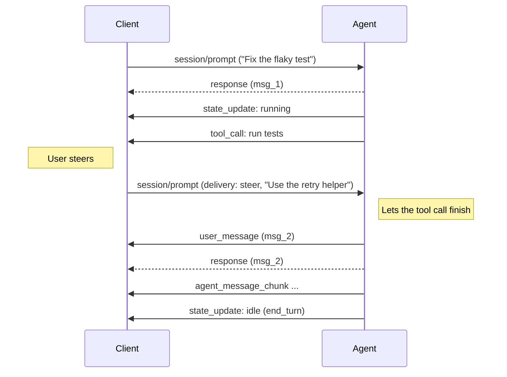

Author(s): [@kennethsinder](https://github.com/kennethsinder)

## Elevator pitch

> What are you proposing to change?

Let a Client send `session/prompt` while the Agent is still working, and say what should happen to the message:

- **`steer`**: add it to the current turn at the next safe point, so the Agent changes course without starting over.
- **`queue`**: hold it until the current turn ends, then start a new turn with it.

The Client picks one with a new optional `delivery` field on `session/prompt`. The Agent advertises which values it supports.

Everything else reuses the [v2 prompt lifecycle](./prompt). The response still means "inserted." `messageId`, `user_message`, and cancelling a prompt before insertion work as they do today. No new methods or error codes.

In this RFD, a "turn" is the Agent's foreground work, from `running` until `idle`.

## Status quo

> How do things work today and what problems does this cause? Why would we change things?

Users of coding agents often type while the agent is working. They usually mean one of two things:

- **"Stop, wrong file."** The user wants the agent to change course now, without losing the work it has done.
- **"When you're done, also run the tests."** The user wants the message held until the current turn ends.

Most agent tools now support one or both. Codex has [`turn/steer`](https://developers.openai.com/codex/app-server) for adding input to a running turn. The OpenAI Responses API has [`response.steer`](https://developers.openai.com/api/docs/guides/steering), which finishes the current output item and running tools, then continues with the new input. Cursor separates queue (Option/Alt+Enter) from send-now (Cmd/Ctrl+Enter) in its [1.4 release](https://cursor.com/changelog/1-4). Claude Code, Gemini CLI, Windsurf, and Replit all queue messages typed during a turn.

ACP has no way to say which one the user means. In v2, a `session/prompt` response means the message was inserted, not that the turn ended, and a prompt may contribute to work already in progress. But the [v2 prompt RFD](./prompt) "does not specify queueing, steering, or whether agents insert new prompts while busy." So a Client today has three options:

- **Send the prompt anyway.** Each Agent does something different, and the Client cannot tell in advance what.
- **Cancel and resend.** This throws away in-flight work and marks running tool calls as cancelled.
- **Use an Agent-specific extension.** This does not work across Agents.

ACP implementers are already building this, each in its own shape. [Goose](https://github.com/aaif-goose/goose/pull/9560) ships steering as an ACP extension. [Kit](https://github.com/speakeasy-api/kit/pull/24) and [Harn](https://github.com/burin-labs/harn), the author's project, implement an earlier draft of this RFD, and [Rust SDK support](https://github.com/agentclientprotocol/rust-sdk/pull/339) for it is proposed. [Raft](https://raft.build) [reported](https://github.com/agentclientprotocol/agent-client-protocol/pull/1261#issuecomment-4933482440) that missing steering blocks its ACP adoption.

## What we propose to do about it

> What are you proposing to improve the situation?

### Capability

An Agent lists the delivery values it supports under its prompt capabilities:

```json
{
  "capabilities": {
    "session": {
      "prompt": {
        "delivery": {
          "steer": {},
          "queue": {}
        }
      }
    }
  }
}
```

Omitting `delivery`, or sending `null`, means the Agent supports neither value. Within `delivery`, omitting `steer` or `queue`, or sending `null`, means that value is unsupported. An Agent that can only hold messages until the end of a turn advertises `queue` alone. A Client **MUST NOT** send a `delivery` value the Agent did not advertise.

### Request

The Client adds `delivery` to an ordinary `session/prompt`:

```json
{
  "jsonrpc": "2.0",
  "id": 7,
  "method": "session/prompt",
  "params": {
    "sessionId": "sess_abc123",
    "delivery": "steer",
    "prompt": [
      { "type": "text", "text": "The bug is in retry.rs, not client.rs." }
    ]
  }
}
```

Omitting `delivery` keeps today's v2 behavior, which this RFD does not define for a busy session. A prompt without `delivery` does not join the queue. If the Agent receives a `delivery` value it did not advertise, or one it does not recognize, it **MUST** reject the request with `-32602` (Invalid params) before inserting the message.

### Delivery rules

**`steer`**: The Agent inserts the message at its next safe point in the current turn, then continues that turn. The Agent decides what a safe point is. A typical one is after the running tool calls finish and before the next model request. The Agent **MAY** stop a model response that is still streaming in order to insert sooner. It **MUST NOT** cancel tool calls that already started or change messages it already streamed. The session does not report `idle` between the earlier work and the steer.

**`queue`**: The Agent holds the message until the current turn ends. It reports `idle`, then inserts the message and starts a new turn with it, exactly as if the Client had sent the prompt right after `idle`.

**Rules for both:**

- **Insertion and response.** The v2 rules apply unchanged. The Agent responds with the `messageId` once the message is inserted, which may be a long time after the request. It reports the message with a `user_message` update that uses the same `messageId`.
- **Idle session.** If the session is already `idle` when the prompt arrives, the Agent inserts it as a normal prompt. This removes the race at the end of a turn, so the Client never has to retry.
- **Turn ends first.** If the turn ends before a steer reaches a safe point, for any reason, the steer starts the next turn. All waiting steers go into that turn together, in the order received. Queued messages follow, each starting its own turn in the order received.
- **Order.** Several steers waiting at the same safe point are inserted there together, in the order received. The `user_message` updates show every Client the final order once each message is inserted.
- **Waiting on the user.** While the session is `requires_action`, for example during a permission request, the Agent accepts the prompt. It inserts a steer at the next safe point after work resumes. A prompt never answers a pending permission request or elicitation.
- **Withdrawing.** A Client withdraws a pending message by cancelling its request with [`$/cancel_request`](/protocol/v2/draft/cancellation). The v2 rule already covers the race: before insertion, the request fails with `-32800` (Request Cancelled) and no `user_message` is sent. After insertion, it succeeds with the `messageId`.
- **`session/cancel`.** Cancelling stops the current turn, not the pending prompts. After the Agent reports `idle` with the `cancelled` stop reason, waiting steers start the next turn right away, followed by queued messages. This is how a user interrupts the Agent and has it act on their message at once. A Client that wants to discard its pending prompts too withdraws them with `$/cancel_request` first.
- **Connection closes.** If the connection that sent a pending prompt closes, the Agent **SHOULD** drop the prompt without inserting it. A Client that reconnects can see which messages were inserted from `session/resume` replay, and resend the rest.

A full steer looks like this:



The `user_message` and the response can arrive in either order, as for any v2 prompt.

## Shiny future

> How will things will play out once this feature exists?

A user asks the Agent to fix a failing test. While it reads files, they see it heading for the wrong module. They type "the bug is in `retry.rs`" and press Cmd+Enter. The message appears in the transcript right after the Agent's last tool call, and its next step uses it. Nothing is cancelled or re-run. If they press Option+Enter instead, the message waits and starts the next turn.

The same keys work in every Client and with every Agent that advertises `delivery`. A Client connected to an Agent without it can still queue on its own side and hide the steer option.

When several Clients share a session, each user's messages land in one agreed order, and every Client shows that order from the same `user_message` updates.

## Implementation details and plan

> Tell me more about your implementation. What is your detailed implementation plan?

### Schema

1. Add a `PromptDelivery` enum with values `steer` and `queue`. The Agent acts on this value, so the enum stays closed: an unknown value is `-32602`, not a fallback.
2. Add an optional `delivery: PromptDelivery` field to the v2 `PromptRequest`. Omitted and `null` both mean no delivery mode.
3. Add an optional `delivery` object to the v2 `PromptCapabilities`, with optional `steer` and `queue` objects. For `delivery`, `steer`, and `queue`, omitted and `null` both mean unsupported.
4. Put all three behind an `unstable_prompt_delivery` feature in the Rust crate and regenerate the schema.

No new methods, notifications, error codes, or stop reasons.

### Rollout

1. Land the schema and document the delivery rules in the v2 prompt lifecycle guide.
2. Update one Agent adapter and one Client. Goose, Kit, and Harn already have the delivery behavior and need only the new request shape.
3. Mark the feature stable once two Agents and one Client support both values in real use.

## Frequently asked questions

> What questions have arisen over the course of authoring this document or during subsequent discussions?

### Why an explicit `delivery` field instead of treating any prompt sent while busy as a steer?

The Agent cannot tell what the user meant. "Stop, wrong file" should steer. "When you're done, also run the tests" should wait. Only the user knows, so the Client should say. An explicit field also keeps today's meaning of a prompt without `delivery` unchanged. [#2255](https://github.com/agentclientprotocol/agent-client-protocol/pull/2255) proposes the implicit version and raises this as its open question.

### Why put a queue in the protocol when Clients can queue on their own?

For one Client and one Agent, a Client-side queue works, and this RFD lets the Agent skip `queue`. The protocol queue helps when several Clients share a session. If each Client holds its own queue and sends on `idle`, their messages race and no one decides the order. With a protocol queue, the Agent sets one order, and every Client sees it as messages are inserted. Supporting it costs an Agent little, because steering already needs a way to hold a message until a safe point.

### Must the response arrive before the `user_message` update?

No. The v2 prompt lifecycle already lets them arrive in either order, and the Client matches them by `messageId`. ACP's transport rules also let an Agent send notifications before a pending response. Sending the response first is allowed, not required. Requiring it would make every SDK track the order of responses and notifications, which [an implementation of an earlier draft](https://github.com/agentclientprotocol/rust-sdk/pull/338) needed extra machinery to do.

### Why does the request stay open until insertion? A queued message may wait for minutes.

Every v2 prompt works this way: the response means "inserted." The v2 prompt RFD left an earlier receipt to future queueing designs. This RFD does not need one, because withdrawing and cancelling already work on the pending request. A Client shows a pending message from its own state until the `user_message` update arrives.

### Why drop pending messages when the connection closes?

A pending prompt belongs to a request, and a closed connection can no longer receive its response or withdraw it. Inserting it anyway could act on a message the user can no longer see or stop. The OpenAI Responses API makes the same choice: queued steers exist only on the current connection.

### How does a user interrupt the Agent and have it act on a message right away?

The Client sends the message with `delivery: "steer"`, then sends `session/cancel`. The running tool calls stop, the turn ends with `cancelled`, and the steer starts the next turn. The work done so far stays in the transcript. Claude Code's Esc and Codex's interrupt with pending steers both behave this way.

ACP keeps each level of stopping separate, so a Client can pick the smallest one:

| User intent                           | Request                                                          |
| ------------------------------------- | ---------------------------------------------------------------- |
| Take back one message not yet sent    | `$/cancel_request` on its `session/prompt`                       |
| Stop the current turn                 | `session/cancel`; pending messages still go next                 |
| Stop the current turn and drop drafts | `$/cancel_request` on each pending prompt, then `session/cancel` |
| End the session                       | `session/close`                                                  |

### Why don't pending messages fail when the turn is cancelled?

A user who presses Stop with a message waiting usually wants the Agent to act on that message instead of what it was doing. Dropping it would make the Client resend it, which loses its place in the order and, with several Clients, would let one Client's Stop erase another user's message. Withdrawing is a separate, explicit request.

### Can a pending message be edited?

Not directly. Withdraw it with `$/cancel_request` and send a new one. A queued message then moves to the end of the queue. Editing in place would need a new method and new race rules, and no implementation has needed it yet. A Client can also keep a message as an editable draft until the user sends it.

### How does an Agent adapter get a `messageId` from an SDK that assigns IDs late?

Some SDKs, such as the Claude Agent SDK, only assign a message ID when they add the message to the model context. The adapter can mint its own ID and return it once it sees the SDK insert the message. The v2 prompt lifecycle already allows adapter-owned IDs, as long as updates and replay use the same ID.

### Does the model need special support for steering?

No. An Agent's turn is a loop of model requests and tool calls. Between two requests, the Agent adds the new user message to the next request. Any model that handles a multi-turn conversation can respond to it.

### What alternatives did we consider?

- **New `session/inject` method with its own revoke and replace methods.** This was the first draft of this RFD. It needed its own acknowledgment, ID, cancellation, and error rules. The v2 prompt lifecycle now provides all of these for `session/prompt`, so a new method would duplicate them.
- **Implicit steering** ([#2255](https://github.com/agentclientprotocol/agent-client-protocol/pull/2255)). Same transport, but the Agent has to guess the user's intent. See the first question above.
- **Cancel and resend.** Works today but throws away in-flight work.
- **Agent-specific extensions.** Work today but do not carry across Agents.

## Revision history

- 2026-10-24: Rebuilt on the v2 prompt lifecycle. Replaced `session/inject`, `session/revoke_inject`, and `session/replace_inject` with a `delivery` field on `session/prompt`, `$/cancel_request` for withdrawing, and no new error codes. Adopted the `session/prompt` approach from [#2255](https://github.com/agentclientprotocol/agent-client-protocol/pull/2255) by [@uzayer](https://github.com/uzayer). Added the response-ordering rule from implementation feedback. Pending messages survive `session/cancel` and go next, so Stop with a waiting message acts on it at once.
- 2026-05-24: Revised after review from [@SteffenDE](https://github.com/SteffenDE): made revoke mandatory, defined delivery as the `user_message` update, and removed the option to drop steers during permission waits.
- 2026-05-19: Initial draft as `session/inject`, from [discussion #1220](https://github.com/agentclientprotocol/agent-client-protocol/discussions/1220).
